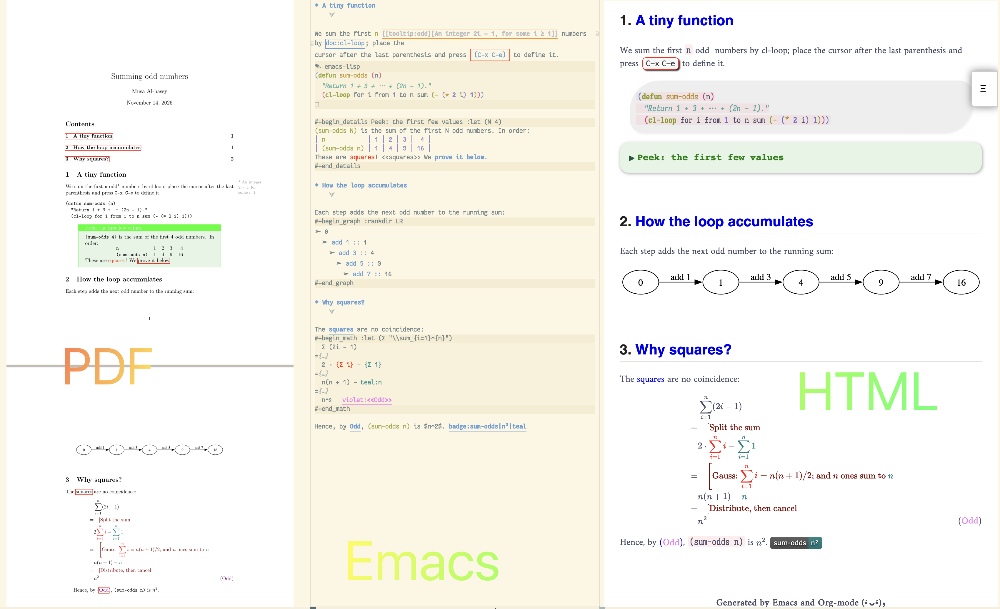
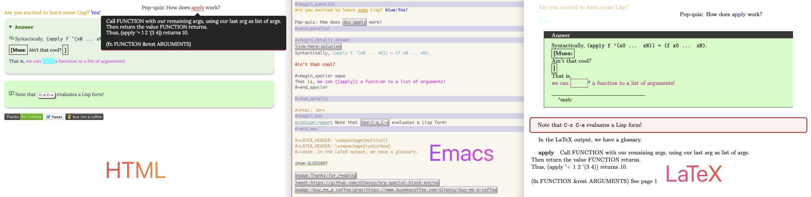

# 🧙‍♂️ *Write Once, Export Everywhere*: Say Hello to `org-special-block-extras`

**Use the Org markup you already know ---in any block.** Our new `math`, `graph`, and `details` blocks read
Org just as prose does: colours `red:hello`, permalinks `<<here>>` cited by `[[here]]`, hoverable docs
`doc:cl-loop`, keystrokes `kbd:C-x_C-e`, footnotes as tooltips, and `:let (N 7)` substitution ---which works
on every block, Org's own `src` blocks included. One Org source exports to HTML, LaTeX, and Markdown; no raw
HTML or LaTeX required.

<a href="https://melpa.org/#/org-special-block-extras"></a>
<a href="https://www.buymeacoffee.com/alhassy"></a>
<a href="https://youtu.be/BQdNhtJSbqk"></a>

📖 **[The guide to every block and link type](https://alhassy.com/org-special-block-extras-blocks-and-links)**
shows, for each, the Org we write, what it exports to, and the Lisp behind it. Start there.

## 🧱 Ready-to-Use Custom Blocks

Each block is demoed in [the guide](https://alhassy.com/org-special-block-extras-blocks-and-links).

| Block                         | Use Case                                                                                      |
|-------------------------------|-----------------------------------------------------------------------------------------------|
| [`math`](https://alhassy.com/org-special-block-extras-blocks-and-links#math) | Display maths wherein `red:𝒳` colours a symbol, Org tables are matrices, and `<<X>>` tags an equation; [calculational proofs](https://alhassy.com/org-special-block-extras-blocks-and-links#equational-proofs), with foldable hints. |
| [`graph`](https://alhassy.com/org-special-block-extras-graphs) | Draw nested Org lists as Graphviz diagrams ---`C-c C-c` renders a PNG in place. |
| [`details`](https://alhassy.com/org-special-block-extras-blocks-and-links#folded-details) | Foldable sections ---perfect for hiding spoilers, proofs, or long explanations. |
| [`parallel`](https://alhassy.com/org-special-block-extras-blocks-and-links#parallel) | Display content in multiple columns ---great for comparisons or saving space. |
| [`box`](https://alhassy.com/org-special-block-extras-blocks-and-links#boxed-text) | Emphasize content with nicely styled borders ---great for callouts or side notes. |
| [`note`, `tip`, `warning`, …](https://alhassy.com/org-special-block-extras-blocks-and-links#callouts) | GitHub-style callouts ---a coloured rule and a titled heading. |
| [`highlight`](https://alhassy.com/org-special-block-extras-blocks-and-links#highlights) | Colour a paragraph's background, rather than its text. |
| [`quote KEY`](https://alhassy.com/org-special-block-extras-blocks-and-links#quote-citations) | Quotations, cited by an `org-cite` key. |
| [`documentation`](https://alhassy.com/tooltips-for-glossaries-dictionaries-and-documentation) | Define a glossary term once; cite it anywhere with `doc:`, and print a glossary with `#+print_glossary:`. |
| [`remark`](https://alhassy.com/editor-comments) | Editorial comments, shown in colour; `org-hide-editor-comments` hides them all from the export. |
| `margin`                      | Subtle explanatory tooltips or side remarks ---delightful for scholarly writing.               |
| `spoiler`                     | Hide content visually until the reader chooses to see it ---useful in teaching.               |
| `tree`                        | Display proof trees and logical derivations ---fantastic for formal logic.                    |
| `solution`                    | Reveal answers in stages ---perfect for educational content.                                  |
| `stutter`                     | Repeat content multiple times ---e.g., for emphasis or stylistic flair.                       |
| [`org-demo`](https://alhassy.com/org-special-block-extras-blocks-and-links#demos) | Show Org markup alongside its rendered result ---ideal for tutorials. |

**🎛 Switch any block**: `:when (eq backend 'html)`, `:noexport t`, `:let (N 7)`, `:boxed "Title"`, `:folded t`,
`:verbatim t`, and `:C-c_C-c ACTION` work on every block ---ours, yours, or Org's own `src` and `quote` blocks;
see [switches](https://alhassy.com/org-special-block-extras-blocks-and-links#switches-for-every-block).

## 🔗 Ready-to-Use Custom Links

| Link                   | Purpose                                                                                      |
|------------------------|----------------------------------------------------------------------------------------------|
| [`doc:label`](https://alhassy.com/tooltips-for-glossaries-dictionaries-and-documentation) | Glossary tooltips ---from our own `documentation` blocks, else Emacs Help; e.g., <abbr title="The Common Lisp ‘loop’ macro. Valid clauses include: for, repeat, while, collect, sum, …">cl-loop</abbr>. |
| `tooltip:`             | An ad-hoc tooltip: `[[tooltip:odd][An integer 2i - 1]]` shows *odd*, and hovers the rest.     |
| [`kbd:`](https://alhassy.com/org-special-block-extras-blocks-and-links#nice-keystroke-renditions) | Stylized keybindings with tooltips ---e.g., `kbd:C-x_C-e`; in Emacs, 〔C-x C-e〕, click to run. |
| [`color:` or `red:`](https://alhassy.com/colours) | Inline text colouring ---supports both names and hex codes.                       |
| `highlight:`           | Colour the background instead ---so highlighted in Emacs too.                                 |
| [`badge:`](https://alhassy.com/badge-links) | Embed project badges ---e.g., GitHub stars, Reddit subs, versioning.                     |
| [`<<X>>`](https://alhassy.com/permalinks) | Permalinks ---Org's own targets, made a visible 🔗 in HTML.                                |
| `palette:`             | A button for readers to pick the page's background colour.                                   |
| `toggle-details:`      | A button to unfold, or fold, every `details` block at once.                                  |
| `fortune:`             | Insert ASCII animals saying jokes or phrases ---joy in our docs!                              |
| `elisp:`               | Make clickable actions ---buttons that run Emacs Lisp.                                        |
| `info:elisp#Node`      | Org's own, yet worth knowing: in Emacs, it opens the Info reader at that node; on HTML export, it becomes the GNU manual's URL, e.g., [`(elisp) Face Attributes`](https://www.gnu.org/software/emacs/manual/html_mono/elisp.html#Face-Attributes). |

## 🛠 Make your own blocks and links

**Tired of repeating yourself when writing in Org-mode for LaTeX and HTML exports?** Org, extended as one
extends Lisp: `org-defblock`, `org-deflink` and `org-deftag` are each declared like a `cl-defun`, with
`&optional` and `&key` arguments.

- Create custom blocks with `org-defblock`: define a block once and export to LaTeX *and* HTML. With
  *header-args* support like `:color red :signoff "Thanks!"` for locally customised exports. Each block is also
  a link and a tag, for free; and `:fontify` says how it looks in the buffer.
- Create custom links with `org-deflink`, as functions of their label and description.
- Create custom tags with `org-deftag`, as functions of the Org sections they tag.

For instance, the following folds every `src` block into a `<details>` on HTML export:
```emacs-lisp
(org-defblock src (&optional lang &key title &context raw-contents)
  "Fold away all ‘src’ blocks as ‘<details>’ on HTML export."
  (format "<details> <summary> %s </summary> <pre> %s </pre></details>"
          (or title (concat "Details; " lang))
          raw-contents))
```
The [developer's guide](https://alhassy.com/org-special-block-extras-developers-guide) shows that every block and
link in this package is made with these very tools; so a new one of our own is a `defun` away.

**Basic examples live in the tests**, which pair a block's definition, its Org input, and its expected output:
each family of blocks has its own file and tests, e.g., [`lisp/org-callout-blocks.el`](lisp/org-callout-blocks.el)
and [`tests/org-callout-blocks-tests.el`](tests/org-callout-blocks-tests.el); and
[`tests/demos.org`](tests/demos.org) ---[live](https://alhassy.com/org-special-block-extras-demos)--- shows each
example beside its snapshotted export.

## 📦 Installation

```emacs-lisp
(use-package org-special-block-extras
  :ensure t
  :hook (org-mode . org-special-block-extras-mode))
```
Or use `M-x org-special-block-extras-mode` to turn it on or off. Graphs need [Graphviz](https://graphviz.org)'s
`dot` on our `PATH`.

<a id="Minimal-working-example"></a>

## 🧪 Minimal working example

A tiny Lisp function, a peek at its values, a picture of its loop, and a proof of what it computes. Its source is
[`minimal-working-example.org`](minimal-working-example.org); its **[live HTML export](https://alhassy.com/org-special-block-extras-mwe)** is where we
hover the tooltips, unfold the `details`, and click the proof's hints.

```org
#+title: Summing odd numbers

* A tiny function

We sum the first =n= [[tooltip:odd][An integer 2i - 1, for some i ≥ 1]] numbers by doc:cl-loop; place the
cursor after the last parenthesis and press kbd:C-x_C-e to define it.
#+begin_src emacs-lisp
(defun sum-odds (n)
  "Return 1 + 3 + ⋯ + (2n - 1)."
  (cl-loop for i from 1 to n sum (- (* 2 i) 1)))
#+end_src

#+begin_details Peek: the first few values :let (N 4)
=(sum-odds N)= is the sum of the first N odd numbers. In order:
| =n=            | 1 | 2 | 3 |  4 |
| =(sum-odds n)= | 1 | 4 | 9 | 16 |
These are red:squares! <<squares>> We [[*Why squares?][prove it below]].
#+end_details

* How the loop accumulates

Each step adds the next odd number to the running sum:
#+begin_graph :rankdir LR
+ 0
  + add 1 :: 1
    + add 3 :: 4
      + add 5 :: 9
        + add 7 :: 16
#+end_graph

* Why squares?

The [[squares][squares]] are no coincidence:
#+begin_math :let (Σ "\\sum_{i=1}^{n}")
  Σ (2i - 1)
={ Split the sum }
  2 · red:{Σ i} - teal:{Σ 1}
={ Gauss: $red:{Σ i} = n(n+1)/2$; and $n$ ones sum to $teal:n$ }
  n(n + 1) - teal:n
={ Distribute, then cancel }
  n^2   violet:<<Odd>>
#+end_math

Hence, by [[Odd]], =(sum-odds n)= is $n^2$. badge:sum-odds|n²|teal
```

Here it is in Emacs (left) and exported to HTML (right); click it to [interact with it live](https://alhassy.com/org-special-block-extras-mwe):

[](https://alhassy.com/org-special-block-extras-mwe)

## 📚 Further reading

All articles on the package live under [#org-special-block-extras](https://alhassy.com/tag-org-special-block-extras.html):
- [Write Once, Export Everywhere](https://alhassy.com/org-special-block-extras) ---the package at a glance.
- [The block and link types](https://alhassy.com/org-special-block-extras-blocks-and-links) ---the guide.
- [A minimal working example](https://alhassy.com/org-special-block-extras-mwe) ---the one above, live.
- [Org lists, drawn as Graphviz graphs](https://alhassy.com/org-special-block-extras-graphs) ---the `graph` block, a feature at a time.
- [Make your own blocks and links](https://alhassy.com/org-special-block-extras-developers-guide) ---the developer's guide.
- [Tooltips for glossaries, dictionaries, and documentation](https://alhassy.com/tooltips-for-glossaries-dictionaries-and-documentation) ---`doc:` and `documentation`.
- [Colours](https://alhassy.com/colours), [Badge links](https://alhassy.com/badge-links), [Permalinks](https://alhassy.com/permalinks), [Editor comments](https://alhassy.com/editor-comments), and [HTML export styles](https://alhassy.com/html-export-styles-as-links).
- [Demos that are tests, rather than docs](https://alhassy.com/org-special-block-extras-demos).
- [Powering-up Special Blocks](https://alhassy.com/emacs-conf-2020) ---our EmacsConf 2020 talk; its
  [slides](emacs-conf-2020.org) are no pictures, just Org: “Look ma, no HTML required!”



<a id="Bye"></a>

# Bye!


<a href="https://twitter.com/intent/tweet?text=This looks super neat (•̀ᴗ•́)و::&url=https://github.com/alhassy/org-special-block-extras"></a>
<a href="https://www.buymeacoffee.com/alhassy"></a>
