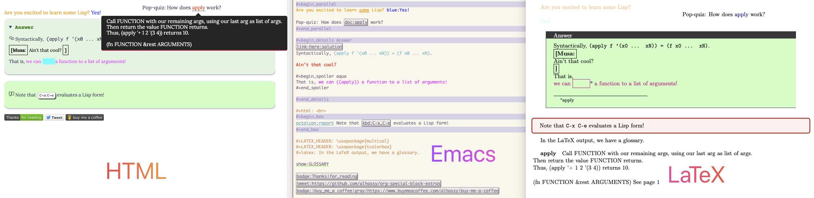
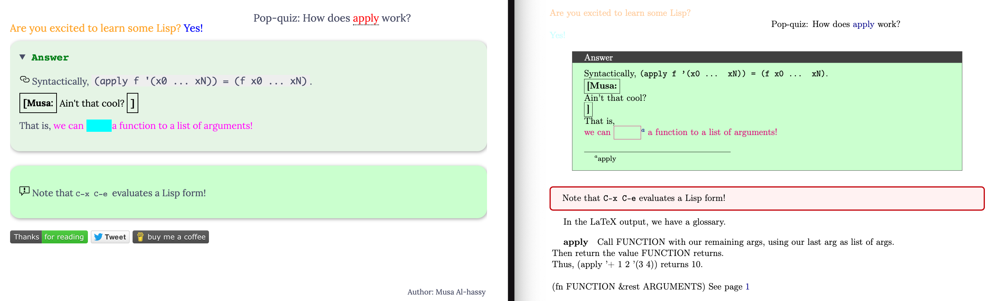

# 🧙‍♂️ *Write Once, Export Everywhere*: Say Hello to `org-special-block-extras`

**Tired of repeating yourself when writing in Org-mode for LaTeX and HTML
exports?** `org-special-block-extras` is your magical toolkit for
creating *custom Org-mode blocks* and *links* that work seamlessly
across backends &#x2014;without diving into the dark arts of raw HTML or
LaTeX!

<a href="https://melpa.org/#/org-special-block-extras"></a>
<a href="https://www.buymeacoffee.com/alhassy"></a>
<a href="https://youtu.be/BQdNhtJSbqk"></a>

## 🎁  What Does It Do?

-   **🎨 Style with ease** &#x2014; add colors, badges, tooltips (from a dictionary, Emacs
    Help, or custom file), keystroke notations, inline editorial comments, or even
    colourful ASCII cows with fortune cookies.
-   **📚 Glossary support** &#x2014; embed hoverable documentation with `doc:` links and auto-generated glossaries.
-   **📦 Add interactive content**: from collapsible detail sections and parallel columns to spoiler tags and equational proofs.
-    Use **badge-style links** to embed GitHub stars, Reddit subs, or custom  project metadata via `shields.io`.
-   **🛠 Use `org-defblock` and `org-deflink` macros** &#x2014; familiar `defun`-like syntax lets you
    define custom Org behaviours.
    -   Create powerful custom blocks with the `defblock` macro: Define a block once
        and export to LaTeX *and* HTML effortlessly. With *header-args* support like
        like `:color red :signoff "Thanks!"` for locally customised exports.
    -   Use `org-deflink` to create custom links using a syntax similar to `defun`.

---

**🧱 Ready-to-Use Custom Blocks**

<table border="2" cellspacing="0" cellpadding="6" rules="groups" frame="hsides">


<colgroup>
<col  class="org-left" />

<col  class="org-left" />
</colgroup>
<thead>
<tr>
<th scope="col" class="org-left">Block</th>
<th scope="col" class="org-left">Use Case</th>
</tr>
</thead>
<tbody>
<tr>
<td class="org-left"><code>details</code></td>
<td class="org-left">Foldable sections &#x2014; perfect for hiding spoilers, proofs, or long explanations.</td>
</tr>

<tr>
<td class="org-left"><code>parallel</code></td>
<td class="org-left">Display content in multiple columns &#x2014; great for comparisons or saving space.</td>
</tr>

<tr>
<td class="org-left"><code>margin</code></td>
<td class="org-left">Add subtle explanatory tooltips or side remarks &#x2014; delightful for scholarly writing.</td>
</tr>

<tr>
<td class="org-left"><code>box</code></td>
<td class="org-left">Emphasize content with nicely styled borders &#x2014; great for callouts or side notes.</td>
</tr>

<tr>
<td class="org-left"><code>spoiler</code></td>
<td class="org-left">Hide content visually until the reader chooses to see it &#x2014; useful in teaching.</td>
</tr>

<tr>
<td class="org-left"><code>tree</code></td>
<td class="org-left">Display proof trees and logical derivations &#x2014; fantastic for formal logic.</td>
</tr>

<tr>
<td class="org-left"><code>stutter</code></td>
<td class="org-left">Repeat content multiple times &#x2014; e.g., for emphasis or stylistic flair.</td>
</tr>

<tr>
<td class="org-left"><code>solution</code></td>
<td class="org-left">Reveal answers in stages &#x2014; perfect for educational content.</td>
</tr>

<tr>
<td class="org-left"><code>org-demo</code></td>
<td class="org-left">Show Org markup alongside its rendered result &#x2014; ideal for tutorials.</td>
</tr>

<tr>
<td class="org-left"><code>math</code></td>
<td class="org-left">Display maths wherein <code>red:𝒳</code> colours a symbol; calculational proofs, with hints.</td>
</tr>
</tbody>
</table>

---

**Ready-to-Use Custom Links**

<table border="2" cellspacing="0" cellpadding="6" rules="groups" frame="hsides">


<colgroup>
<col  class="org-left" />

<col  class="org-left" />
</colgroup>
<thead>
<tr>
<th scope="col" class="org-left">Link</th>
<th scope="col" class="org-left">Purpose</th>
</tr>
</thead>
<tbody>
<tr>
<td class="org-left"><code>doc:label</code></td>
<td class="org-left">Glossary/dictionary tooltips &#x2014;link to local or global explanations; e.g., <abbr class="tooltip" title="The Common Lisp ‘loop’ macro.<br>Valid clauses include:<br>&emsp;For clauses:<br>&emsp;&emsp;for VAR from/upfrom/downfrom EXPR1 to/upto/downto/above/below EXPR2<br>&emsp;&emsp;&emsp;&emsp;[by EXPR3]<br>&emsp;&emsp;for VAR = EXPR1 then EXPR2<br>&emsp;&emsp;for VAR in/on/in-ref LIST [by FUNC]<br>&emsp;&emsp;for VAR across/across-ref ARRAY<br>&emsp;&emsp;for VAR being:<br>&emsp;&emsp;&emsp;the elements of/of-ref SEQUENCE [using (index VAR2)]<br>&emsp;&emsp;&emsp;the symbols [of OBARRAY]<br>&emsp;&emsp;&emsp;the hash-keys/hash-values of HASH-TABLE [using (hash-values/hash-keys V2)]<br>&emsp;&emsp;&emsp;the key-codes/key-bindings/key-seqs of KEYMAP [using (key-bindings VAR2)]<br>&emsp;&emsp;&emsp;the overlays/intervals [of BUFFER] [from POS1] [to POS2]<br>&emsp;&emsp;&emsp;the frames/buffers<br>&emsp;&emsp;&emsp;the windows [of FRAME]<br>&emsp;Iteration clauses:<br>&emsp;&emsp;repeat INTEGER<br>&emsp;&emsp;while/until/always/never/thereis CONDITION<br>&emsp;Accumulation clauses:<br>&emsp;&emsp;collect/append/nconc/concat/vconcat/count/sum/maximize/minimize FORM<br>&emsp;&emsp;&emsp;[into VAR]<br>&emsp;Miscellaneous clauses:<br>&emsp;&emsp;with VAR = INIT<br>&emsp;&emsp;if/when/unless COND CLAUSE [and CLAUSE]... else CLAUSE [and CLAUSE...]<br>&emsp;&emsp;named NAME<br>&emsp;&emsp;initially/finally [do] EXPRS...<br>&emsp;&emsp;do EXPRS...<br>&emsp;&emsp;[finally] return EXPR<br><br>For more details, see Info node ‘(cl)Loop Facility’.<br><br>(fn CLAUSE...)">cl-loop</abbr></td>
</tr>

<tr>
<td class="org-left"><code>kbd:</code></td>
<td class="org-left">Stylized keybindings with tooltips &#x2014; e.g., <code>kbd:C-x_C-e</code>.</td>
</tr>

<tr>
<td class="org-left"><code>color:</code> or <code>red:</code></td>
<td class="org-left">Inline text colouring &#x2014; supports both names and hex codes.</td>
</tr>

<tr>
<td class="org-left"><code>badge:</code></td>
<td class="org-left">Embed project badges &#x2014; e.g., GitHub stars, Reddit subs, versioning.</td>
</tr>

<tr>
<td class="org-left"><code>fortune:</code></td>
<td class="org-left">Insert ASCII animals saying jokes or phrases &#x2014; joy in your docs!</td>
</tr>

<tr>
<td class="org-left"><code>&lt;&lt;X&gt;&gt;</code></td>
<td class="org-left">Permalinks &#x2014; Org&rsquo;s own targets, made a visible 🔗 in HTML.</td>
</tr>

<tr>
<td class="org-left"><code>elisp:</code></td>
<td class="org-left">Make clickable actions &#x2014; buttons that run Emacs Lisp.</td>
</tr>
</tbody>
</table>

---

### 💡 Tip: Built-in `info:` links export to the official Emacs manual

While we're on the topic of rich links — here's a delightful Org
built-in that pairs especially well with this package.  Write

```org
See [[info:elisp#Face Attributes][=(elisp) Face Attributes=]] for the full vocabulary.
```

and you get **two** destinations from one source:

- **Within Emacs** &#x2014; clicking the link opens the Info reader at
  that exact node.  `C-c C-o` on the link works too; `M-.` in
  relevant modes auto-resolves docstring references like `` `(elisp)
  Face Attributes' `` the same way.
- **On HTML export** &#x2014; the link rewrites to the canonical
  GNU manual URL, e.g.
  [https://www.gnu.org/software/emacs/manual/html_mono/elisp.html#Face-Attributes](https://www.gnu.org/software/emacs/manual/html_mono/elisp.html#Face-Attributes).
  Your blog readers land in the official docs, pinpoint-accurate, no
  handwritten URLs to rot.

Same source, two perfect destinations — no raw HTML, no duplicate
maintenance.  (This is built into Org's `ol-info.el`, not a feature
of this package — but it composes beautifully with the custom
blocks and links above when you're documenting Emacs topics.)

---

💡 Ideal For

-   🧑‍🏫 Educators building interactive lessons and glossaries
-   🧑‍💻 Developers documenting APIs with style
-   📚 Writers crafting scholarly or explorable documents
-   ✨ Emacsers who want rich export without leaving Org-mode
-   ✏️ Bloggers wanting powerful interactivity
    -   This is *the* reason I made this package.
-   1️⃣ Anyone who wants to keep Org-mode as the single source of truth for <span style="color:pink;">rich</span>
    exports

🪄 **Just load the package, write in Org, and let `defblock` handle the
rest.** Now your Org-mode documents are not just structured &#x2014;they're
*spectacular*.

- Use: “M-x org-special-block-extras-mode” to turn it on/off

---

**Write rich Org-mode documents &#x2014; one source, many formats.**
The `org-special-block-extras` package empowers you to define and use
*custom blocks* and *links* that make your Org files export beautifully
to both **HTML and LaTeX**, *without ever writing raw HTML or LaTeX
again*.


--------------------------------------------------------------------------------

See the [HTML Article](https://alhassy.com/org-special-block-extras)
for demos and detailed uses of the block and link types provided by this package.

(An outdated [PDF
Article](https://github.com/alhassy/org-special-block-extras/blob/master/index.pdf) demos
LaTeX export.)

--------------------------------------------------------------------------------

This article is featured in EmacsConf2020, with slides [here](https://github.com/alhassy/org-special-block-extras/blob/master/emacs-conf-2020.org):
 No pictures, instead we use this system to make the  slides
 have a variety of styling information; i.e., we write Org
 and the result looks nice. “Look ma, no HTML required!”



--------------------------------------------------------------------------------


<a id="Minimal-working-example"></a>

# Minimal working example

The following example showcases the prominent features of this library.

    #+begin_parallel
    [[color:orange][Are you excited to learn some Lisp?]] [[blue:Yes!]]

    Pop-quiz: How does doc:apply work?
    #+end_parallel

    #+begin_details Answer
    <<solution>>
    Syntactically, ~(apply f '(x0 ... xN)) = (f x0 ... xN)~.

    [[remark:Musa][Ain't that cool?]]

    #+begin_spoiler aqua
    That is, [[color:magenta][we can ((apply)) a function to a list of arguments!]]
    #+end_spoiler

    #+end_details

    #+html: <br>
    #+begin_box
    Note that kbd:C-x_C-e evaluates a Lisp form!
    #+end_box

    #+LATEX_HEADER: \usepackage{multicol}
    #+LATEX_HEADER: \usepackage{tcolorbox}
    #+latex: In the LaTeX output, we have a glossary.

    #+print_glossary:

    badge:Thanks|for_reading
    tweet:https://github.com/alhassy/org-special-block-extras
    badge:|buy_me_a coffee|gray|https://www.buymeacoffee.com/alhassy|buy-me-a-coffee

Here is what it looks like as HTML (left) and LaTeX (right):




<a id="Bye"></a>

# Bye!


<a href="https://twitter.com/intent/tweet?text=This looks super neat (•̀ᴗ•́)و::&url=https://github.com/alhassy/org-special-block-extras"></a>
<a href="https://www.buymeacoffee.com/alhassy"></a>
