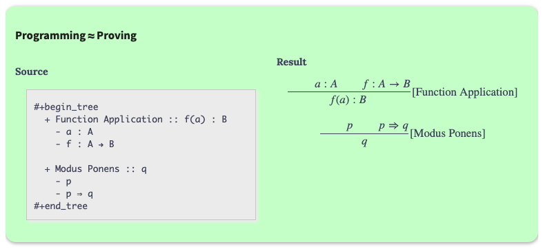

#+title: org-special-block-extras-graph
#+author: Musa Al-hassy
#+options: toc:2 num:nil

# Load the package during export so #+begin_graph blocks are handled.
#+begin_src emacs-lisp :results none :exports none
(add-to-list 'load-path (expand-file-name "lisp" (file-name-directory (or load-file-name buffer-file-name))))
(require 'org-special-block-extras)
(require 'org-defblock)
(require 'org-graph-block)
#+end_src

Every construct of a ~#+begin_graph~ block, on one page ---itself a graph. Hover a node for how it reads, and
click it for its section below:
#+begin_org :ignore t :demo live
#+macro: tint lightyellow

#+begin_graph =#+begin_graph=, at a glance ---hover a node for how, click it for more :direction right
#+name: syntax style="rounded,filled" fillcolor={{{tint}}}
#+name: topic penwidth=2 :syntax:
#+node: fontname=Courier
#+edge: color=gray40 fontsize=10

+ [[*An outline is already a graph][#+begin_graph TITLE :KEY V]]

  An outline is already a graph: every item is a node, and nesting is an arc. The words before the first
  :KEY title the graph; each :KEY V is a Graphviz graph attribute, and :node.KEY V or :edge.KEY V a default.
  C-c C-c renders the block beneath it; C-u C-c C-c shows the dot it compiles to.
  + arcs :: [[*Arcs that speak: description lists][+ child]] :topic:

    Indenting an item under another draws an arc from the parent to the child.
    + labelled :: [[*Arcs that speak: description lists][a labelled arc]] :syntax:
      | label | + L :: child |

      A description term labels the arc into its item.
    + up the tree :: [[*Arcs that leave the tree: targets and links][an inline link]] :syntax:
      | label | [[T][L]] |

      A link to a node's id is an arc to it, labelled L; C-c C-o jumps to that node.
    + as a child :: [[*A child that is just a link: references][a reference]] :syntax:
      | label | + [[T][L :S:]] |

      A child that is nothing but a link is a reference: an arc to T, declared elsewhere, labelled L and
      styled by template S; both are optional.
    + from every mention :: [[*Radio targets: arcs from every mention][a radio target]] :syntax:
      | label | <<<NUMBER>>>, … |

      A radio target is a node, and every item mentioning NUMBER, in any case, has an arc to it.
  + names :: [[*Ids and labels][+ <<id>> label]] :topic:

    A target gives the node an id, for links to name, apart from its drawn label.
  + styles :: [[*Styling: one key-value syntax][| key | value |]] :topic:

    A two-column table beneath an item sets the node's Graphviz attributes; values need no quotes.
    + the arc in :: [[*An arc's table: :edge.KEY][| :edge.KEY | V |]] :syntax:

      An :edge.KEY row styles the arc from the parent, rather than the node.
    + everything :: [[*When the preamble outgrows the line][#+node: shape=box]] :syntax:

      The lines #+graph:, #+node:, and #+edge: style the graph, every node, every arc; by a table below,
      or KEY=VALUE pairs on the line. Within a subtree, they reach only that subtree.
    + side by side :: [[*Side by side: ordered lists and :@X: tags][+ node :@X:]] :syntax:

      Nodes tagged :@X: share a rank, :@start: the first, :@end: the last; ordered children, 1. 2. 3.,
      share one in the order written.
  + templates :: [[*Saying it once: templates][#+name: T k=v]] :topic:

    A named bundle of rows, on its name's line or in a table below; one outside every graph serves the
    whole buffer.
    + applied by :: [[*Saying it once: templates][+ node :T:]] :syntax:

      A trailing tag applies template T; explicit rows win. This very node wears :syntax:, defined above.
    + explained by :: [[*Legends: a glossary of templates][- MEANING :T:]] :syntax:

      In a container titled Legend, an item is a sample of T, captioned MEANING; see the legend here.
    + [-] progress :: [[*Checkboxes are templates][checkboxes]] :syntax:
      | label | [X] [-] [ ] |

      A checkbox applies template checked, partial, or unchecked; C-c C-c on it toggles it.
    + single values :: [[*Macros name single values][#+macro: M V]] :syntax:

      Names a single value; M in triple braces is V, anywhere in the block, as this graph's tint is.
  + labels :: [[*Markup makes rich labels][*bold* /italic/ =code=]] :topic:

    Org's markup, entities, and sub- and superscripts make a rich label; the id stays plain text.
    + lines :: [[*\\ breaks a line, :wrap fills][a label,]] \\ broken in two :syntax:

      A \\ breaks a label, mid-line too; :wrap N fills every label to N characters.
  + asides :: [[*Footnotes are tooltips][footnotes]] [fn::A footnote leaves the label and becomes the node's tooltip, as this one does.] :topic:
    | label | [fn::NOTE] |
    + longer :: [[*Notes are longer tooltips][a later paragraph]] :syntax:

      Every paragraph after an item's first is a note: its tooltip, as this one is. :notes inline draws
      notes beneath their labels instead.
    + clickable :: [[*Web links are URLs, image links are images][a web link]] :syntax:
      | label | [[https://…]] |

      A web or section link makes the node clickable, as every node here is; an image link draws the image.
  + layout :: [[*Containers draw boxes][+ TITLE :container:]] :topic:

    A container draws a box around its children, its members; its table styles the box.
    + records :: [[*Records: a table of fields][| a | table |]] :syntax:

      A table under an item is its label, a record of fields; a <
> cell is a port, which =[[node::P]]= reaches.
    + mind maps :: [[*Mind maps: :layout twopi][:layout twopi]] :syntax:

      A radial layout; :theme mindmap gives an arrowless one, radiating from the first item.
  + documents :: [[*#+name: and #+caption: make a figure][#+name: N]] :topic:

    Above the block, it makes a figure that =[[N]]= reaches, and #+caption: captions it; a :graph: tag on a
    heading makes its whole section a graph.
+ Legend :container:
  - a family of constructs :topic:
  - a construct             :syntax:
#+end_graph
#+end_org

* An outline is already a graph

Say we are showing a friend how ~1 * 2 + 3 - 4~ parses. On paper, we would draw a tree. In Org, we would
reach for Graphviz ---and write that tree a second time, in a second language:
#+begin_src dot
digraph { "-" -> "+"; "-" -> 4; "+" -> "*"; "+" -> 3; "*" -> 1; "*" -> 2; }
#+end_src

Every arc there restates what an outline's indentation already says. So we write the outline, and let
the outline /be/ the graph. Each demo in this README shows what we write, then what we get:
#+begin_graph :demo live
+ -
  + +
    + *
      + 1
      + 2
    + 3
  + 4
#+end_graph

That is the whole idea. A ~#+begin_graph~ block compiles the Org we already write ---nested lists,
two-column tables, links, tags, footnotes--- into [[https://graphviz.org][Graphviz dot]]. Nesting is an arc; the rest of this
README refines that one sentence, one gap at a time, and every example stays with our running theme:
parsing ~1 * 2 + 3 - 4~, from characters to tokens to trees.

A wide graph shrinks to fit the page; a click on it shows it full size, and another shrinks it back.
LaTeX export draws it too, as a vector PDF by ~dot~, shrunk likewise to fit the line.

** Setup

~org-graph-block~ extends [[https://alhassy.com/org-special-block-extras][org-special-block-extras]]:
#+begin_src emacs-lisp
(require 'org-special-block-extras)
(require 'org-graph-block)
#+end_src

Graphviz must be on our ~PATH~: ~dot -V~ should work in a terminal.

** A REPL for pictures

The fun part is how quickly a picture grows. Start with the seven tokens as a flat list, one item each,
and press ~C-c C-c~ anywhere in the block: seven lonely nodes.
#+begin_graph :demo live
+ 1
+ *
+ 2
+ +
+ 3
+ -
+ 4
#+end_graph

Now ~M-S-<right>~ demotes an item, children and all ---Org's own list editing--- and another ~C-c C-c~
shows the new arc. A minute later, the flat list is the tree above. (Plain ~M-<right>~ demotes the item
alone, leaving its children behind, as anywhere in Org.)

~C-c C-c~ renders a PNG and links it beneath the block, under ~#+RESULTS:~. The file's name is made up,
unless ~:file~ picks one, as in ~#+begin_graph :file parse-tree.png~. When the picture surprises us,
~C-u C-c C-c~ shows the generated dot instead; see [[*Comforts while editing][Comforts while editing]].

* Arcs that speak: description lists

A bare arc says “related”, and little else. Explaining how our expression becomes a value, we want each
arc to say /how/: the source text is /lexed/ into tokens, which are /parsed/ into a tree. Org's description
list, ~- TERM :: DEFINITION~, already attaches a word to an item; in a graph, that word sits on the arc
into the item. Read left to right, the line /is/ the arc ---source, then /lexed into/, then tokens:
#+begin_graph :direction right :demo live
+ ="1 * 2 + 3 - 4"=
  + lexed into :: tokens
    + parsed into :: syntax tree
      + evaluated to :: -1
      + compiled to :: bytecode
#+end_graph

Two arcs between the same nodes are just two items. A parser both /consumes/ its tokens and /peeks/ at the
next one, unconsumed; two arcs, one stream:
#+begin_graph :direction right :demo live
+ parser
  + consumes :: token stream
  + /peeks at/ :: token stream
#+end_graph

- The term may be marked up, as ~/peeks at/~ is; it is then an HTML-like label.
- It is the terse spelling of ~| :edge.label | consumes |~, met [[*An arc's table: :edge.KEY][below]]; an explicit ~:edge.label~ row wins.
- A top-level item has no arc into it, so a term there is an error ---except for a legend entry, met
  [[*Legends: a glossary of templates][later]].
- As in Org, the ~::~ needs whitespace on both sides: ~std::vector~ is a name, not a description, and so
  is BNF's ~expr ::= term~, as ~::=~ is not ~::~.

* Arcs that leave the tree: targets and links

A tree gives each node one parent; grammars are not so tidy. An ~expr~ is made of ~term~'s, a ~term~ of
~factor~'s, and a ~factor~ is a number ---or a whole ~expr~ again, in parentheses. That last arc goes back
/up/ the tree, so it must reach a node declared elsewhere. Org already names places and points at them:
~<<expr>>~ is a place we can link to, and ~[[expr]]~ points there. In a graph, the target is the node's
id, and the link is an arc to it. Moreover, ~C-c C-o~ on the link jumps to its node:
#+begin_graph :demo live
+ <<expr>> expression
  + term
    + factor [[expr][( … )]]
      + number
#+end_graph

- The target and links vanish from the label; ~factor~ above is labelled just ~factor~.
- ~[[T][L]]~ labels the arc ~L~; an item may have any number of links. As in Org, an item's text is its
  whole first paragraph, so a long line of links may wrap onto the lines below it, before its table.
- Inside a graph block, Org shows links in full: we see ~[[expr][( … )]]~, not just ~( … )~, since both
  parts matter here. Links elsewhere in the buffer keep Org's usual display.
- Only links to nodes are arcs; ~[[https://orgmode.org][Org]]~ makes its node clickable, and stays ~Org~ in
  the label. See [[*Web links are URLs, image links are images][Web links]].

** A child that is just a link: references

An inline link is quick, but its arc has nowhere to keep a style of its own. So the arc graduates to a
child item that is nothing but a link: a /reference/ to its target. Nesting makes the arc, and a
description term labels it, exactly as for any other child:
#+begin_graph :demo live
+ <<expr>> expression
  + term
    + factor
      + number
      + in parentheses :: [[expr]]
#+end_graph

- A reference never declares its target: the target's own item names and labels it, even when that
  item comes later. Node attributes on a reference are an error; they belong on the target's item.
- ~+ [[expr][in parentheses]]~ is a reference too, its arc labelled ~in parentheses~; tags ending the
  description style the arc, ~+ [[expr][in parentheses :dashed:]]~, and alone leave it unlabelled,
  ~+ [[expr][:dashed:]]~. Tags /after/ a reference are an error, since its node is declared elsewhere.
- Two references to one target are two parallel arcs, each styled on its own.
- A reference may name a record's port, ~[[node::left]]~, or a container; both are met [[*Layout: ranks, boxes, and records][below]].

** Radio targets: arcs from every mention

When one node is mentioned everywhere, bracketing each mention is a chore. A grammar mentions its tokens
in rule after rule. In Org, a radio target ~<<<NUMBER>>>~ stays visible, and every mention of “NUMBER”
elsewhere becomes a link to it, sans brackets. In a graph, the radio target is a node, and every item
mentioning it ---in whatever case--- has an arc to it:
#+begin_graph :demo live
+ <<<NUMBER>>>, a run of digits
+ <<<PLUS>>>, the + sign
+ factor → NUMBER
+ expr → factor PLUS factor
+ a lone number, too
#+end_graph

The mention stays in the label, and the radio target's own item never arcs to itself. Mind that this is
Org's semantics exactly: a casual “number”, as in the last item, draws an arc too.

* Ids and labels

Links make us name things, and a name wants to be short where a label wants to be clear. So every node
has an /id/, which arcs and links name, and a /label/, which is drawn. By default both are the item's
text, so these three items, spelling it out more and more, all declare one and the same node:
#+begin_graph :demo live
+ expr

+ <<expr>> expr

+ <<expr>> expr
  | label | expr |
#+end_graph

When the two should differ, we set either one apart: a ~<<target>>~ gives the id, and a ~| label |~ row
gives the label:
#+begin_graph :demo live
+ <<expr>> Expression
  + <<term>> Term
    + factor
      | label | Factor: a number, or ( expr ) |
      + [[expr]]
+ Sum
  + [[term]]
#+end_graph

- The id is the ~<<target>>~, else the text ---sans markup, links, footnotes, and tags. So ~[[1]]~ reaches
  ~+ 1~, and ~C-c C-o~ on it jumps there, sans a ~<<1>>~; a target earns its place only when the id should
  differ from the text, or the text is long.
- The label is the ~label~ row, else the text; markup makes it an HTML-like one.
- Two items with one id are one node, so an item may appear twice to gain more children.

* Styling: one key-value syntax

Out of the box, every node wears the same cream box; soon we want our tokens to read apart from our rules.
Graphviz's attributes are key-value pairs, and Org's key-value syntax is the two-column table. So a table beneath an
item styles that item: one syntax, from a single node up to the whole graph.

** A node's table, and two kinds of keys

In a parse tree, the leaves are tokens, straight from the lexer; we tint them, so they read apart from the
grammar's rules:
#+begin_graph :demo live
+ term
  + factor
    + NUMBER 1
      | fillcolor | lightblue |
  + STAR
    | fillcolor | lightblue |
    | label     | *         |
  + factor
    + NUMBER 2
      | fillcolor | lightblue |
#+end_graph

A /plain/ key, such as ~fillcolor~, is a Graphviz attribute of the node, passed straight through. We quote its
value for you, so ~NUMBER 1~, ~#00ff00~, and ~x -> y~ all need no quotes; already-quoted values, and ~<…>~
HTML labels, are left alone.

A key prefixed ~:edge.~ is an attribute of an /arc/ rather than the node; a leading colon is never a
Graphviz attribute, so the two kinds cannot clash. Each is met in due time:

| Key            | Meaning                                    |
|----------------+--------------------------------------------|
| ~:edge.KEY~    | attribute ~KEY~ of the arc from the parent |
| ~:edge[T].KEY~ | attribute ~KEY~ of this item's arc to ~T~  |

Any other key ---a misspelt ~colour~, or ~:edge.colour~--- makes the table a [[*Records: a table of fields][record]], so the typo shows in
the picture, rather than silently vanishing.

** An arc's table: :edge.KEY

An arc is drawn from parent to child, so the child's table is where it is styled: an ~:edge.KEY~ row there
is attribute ~KEY~ of the arc into the item. Every attribute is its own row, exactly like a node's. Peeking
consumes nothing, so its arc should look tentative:
#+begin_graph :direction right :demo live
+ parser
  + consumes :: token stream
    | :edge.penwidth | 2 |
  + /peeks at/ :: token stream
    | :edge.style | dashed |
    | :edge.color | gray   |
#+end_graph

A reference is styled just the same; this is why an inline link graduates to one. The recursion back to
~expr~ is the arc that makes our grammar interesting, so we paint it:
#+begin_graph :demo live
+ <<expr>> expression
  + term
    + factor
      + number
      + in parentheses :: [[expr]]
        | :edge.color     | red |
        | :edge.fontcolor | red |
#+end_graph

- A parallel arc is simply a second child, styled on its own; a ~KEY~ given twice is an error.
- As in Org, an item's tables and directives may also follow its sub-items; they still belong to it.

** The whole graph: the #+begin_graph line

Small graphs deserve no preamble at all. So the header line takes the graph's title and any graph
attribute; a parse tree laid out left to right, every node a circle, every arc grey:
#+begin_graph How 1 * 2 + 3 - 4 parses :direction right :node.shape circle :edge.color grey :demo live
+ -
  + +
    + *
      + 1
      + 2
    + 3
  + 4
#+end_graph

- The title, the words before the first ~:key~, is the graph's ~label~. Every graph is directed; a
  ~#+edge: :undirected:~ line makes all its arcs arrowless, an undirected graph.
- ~:direction~ says which way arcs flow: ~down~, the default, ~up~, ~right~, or ~left~. It is Graphviz's
  ~rankdir~ ---~TB~, ~BT~, ~LR~, ~RL~--- spelled to be read; the header has no ~:rankdir~, while
  ~#+graph: rankdir=LR~ keeps Graphviz's spelling.
- ~:KEY V~ is a graph attribute; ~:node.KEY V~ and ~:edge.KEY V~ are node and edge defaults ---the same
  ~KEY~, ~node.KEY~, ~edge.KEY~ spelling as table rows.
- As on Org's own ~#+attr_html:~ lines, values need no quotes: ~:bgcolor #6c7086~,
  ~:fontname Helvetica,Arial~. A value with spaces does: ~:fontname "Helvetica Neue"~.
- ~:file~, ~:direction~, ~:theme~, ~:wrap~, ~:notes~, ~:unflatten~, ~:unknown-tags~,
  and ~:C-c_C-c~ belong to the block itself, never to Graphviz; each is met below. So do the Babel habits
  ~:exports~ and ~:results~, which the block ignores; and ~:demo~, which every block of this package
  understands.

** When the preamble outgrows the line

A real graph's settings outgrow one line. Then ~#+graph:~, ~#+node:~, and ~#+edge:~ lines style the graph,
every node, every arc ---by ~KEY=VALUE~ pairs, as Graphviz's own ~edge [fontsize=10 color=gray]~ writes
them, a value with spaces in double quotes, beside any ~:tags:~--- and they override the header. A drawer
of any name, ~:SETTINGS:~ or ~:PALETTE:~, folds them away with ~TAB~, along with ~#+name:~ lines:
#+begin_graph A compiler's front end :demo live
:SETTINGS:
#+graph: rankdir=LR fontname=Helvetica
#+node: style=rounded fontname=Helvetica
#+edge: fontsize=10 color=gray
:END:
+ characters
  + lexer :: tokens
    + parser :: syntax tree
#+end_graph

When the pairs outgrow their line, a two-column table below the keyword holds them instead, a row a key,
as a node's table does; a line's pairs and a table below it join:
#+begin_src org :tangle no
,#+node:
| style     | rounded,filled |
| fillcolor | white          |
| fontname  | Helvetica      |
| fontcolor | gray30         |
#+end_src
Anything else on such a line is an error, rather than silently ignored. In Emacs, the keyword stands out,
and so does each key that means something on its line ---a graph's attribute on ~#+graph:~, a node's on
~#+node:~, an arc's on ~#+edge:~, any on ~#+name:~. A key left plain is one Graphviz does not know there,
so a mistake shows before we export: a typo, as ~colour=red~, or a misplaced key, as ~shape=box~ on an
~#+edge:~ line.

** Subtrees inherit #+node: and #+edge:

Sometimes a style belongs to one branch, not the whole graph. A compiler folds constants: ~1 * 2~ is
known before the program runs, so its whole subtree collapses to ~2~. We want that subtree shaded. Org's
properties are inherited: a ~:PROPERTIES:~ drawer on a heading reaches its subheadings. So it is with an
item's ~#+node:~ and ~#+edge:~ lines: they style every node and arc beneath the item, while the item
itself keeps its own ~| key | value |~ rows:
#+begin_graph Constant folding :demo live
+ -
  + +
    + *
      | xlabel | folds to 2 |
      #+node: fillcolor=lightgrey
      #+edge: style=dotted
      + 1
      + 2
    + 3
  + 4
#+end_graph

Above, ~*~ keeps its plain look ---only what lies /beneath/ it is shaded--- just as a heading's own
properties drawer is not one of its subheadings'. Graphviz scopes such defaults by an anonymous
~subgraph~, which draws no box. A deeper item's lines override a shallower one's, as nested
~:PROPERTIES:~ do; a node first declared elsewhere keeps the defaults of where it was declared.

** Themes: a look for every graph

Every graph wears a theme, beneath all its own attributes: by default ~creamsicle~, after D2's theme 101,
Orange Creamsicle ---cream boxes, orange containers lightening as they nest, dark brown lines, and italic
arc labels. ~:theme NAME~ picks another of ~org-graph-themes~, and ~:theme nil~ wears Graphviz's own look:
#+begin_graph :theme nil :demo live
+ Org
  + exports to :: HTML
#+end_graph

A theme is data, ~#+graph:~, ~#+node:~, and ~#+edge:~ lines' pairs, plus a fill per depth of node and of
container; so a new one is a ~push~ away, and a new default a ~setq~:
#+begin_src emacs-lisp
(push '(ink :node "shape=box fontname=Helvetica" :edge "color=gray30" :container-colors "#eeeeee #ffffff")
      org-graph-themes)
(setq org-graph-theme 'ink)
#+end_src

* Saying it once: templates

A parse tree repeats itself: every token the same tint, every rule the same outline. Restating those rows
at each leaf is how styles drift apart. So we name them once: a ~#+name:~ line is a reusable bundle of
~KEY=VALUE~ pairs ---as [[*When the preamble outgrows the line][#+edge: lines]] take them--- and a tag applies it. On a headline,
~:work:urgent:~ classifies the entry; on an item, tags classify the node:
#+begin_graph :demo live
#+name: token fillcolor=lightblue
#+name: rule style=bold

+ expr :rule:
  + term :rule:
    + NUMBER 1 :token:
    + * :token:
    + NUMBER 2 :token:
  + PLUS :token:
    | fillcolor | pink |
  + NUMBER 3 :token:
#+end_graph

Several such lines in a row are several templates. A long template holds its rows in a table below its
name instead, as a ~#+node:~ line may; a line's pairs and a table below it join. In Emacs, each template
of a graph ---its name's line, and the table below it--- wears a background of its own, from
~org-graph-template-backgrounds~, so where one ends and the next begins shows at a glance.

Explicit rows win over a template's, so ~PLUS~ above is pink. A line may carry several tags,
~:token:rule:~, each a template, the earlier winning on a clash ---save colors: when the tags' templates
color it differently, a node shows every color as stripes, tinted, or wedges if it is round, and an arc
as parallel lines; a node's own ~fillcolor~ or ~style~ turns the stripes off. The same rule reaches every other line a
template could apply to; in a link's description, or a description term, a tag styles the arc:

| Line                                     | What its tags style                                           |
|------------------------------------------+---------------------------------------------------------------|
| ~+ NUMBER 1 :token:~                     | the node                                                      |
| ~+ [[expr][:recursion:]]~                | the arc to the reference; so too a link's mid-text           |
| ~+ reduces :rule-arc: :: expr :rule:~    | the arc, by the description term's tags; the node, by its own |
| ~#+node: :token:~                        | every node; likewise ~#+edge:~ and ~#+graph:~                 |
| ~#+name: keyword :token:~                | the template ~keyword~, which inherits ~token~                |

#+begin_graph :demo live
#+name: recursion color=red style=dashed
#+name: keyword fontname=Courier
#+node: :keyword:

+ <<expr>> expression
  + term
    + factor
      + in parentheses :recursion: :: [[expr]]
#+end_graph

** Everyday tags every graph has

Some looks are wanted so often that every graph has them, sans a ~#+name:~:
| Tags                                                                        | What they do                                                                   |
|-----------------------------------------------------------------------------+--------------------------------------------------------------------------------|
| ~:dashed:~ ~:dotted:~ ~:bold:~                                              | a node's outline, or an arc, so drawn                                          |
| ~:bidirectional:~ ~:undirected:~                                            | an arc's arrowheads: at either end, or none                                    |
| ~:red:~ ~:orange:~ ~:yellow:~ ~:green:~ ~:teal:~ ~:blue:~                   | a node's outline and text, or an arc and its label, so colored                 |
| ~:purple:~ ~:magenta:~ ~:pink:~ ~:brown:~ ~:gray:~ ~:black:~                | likewise                                                                       |
| ~:small:~ ~:large:~ ~:size_N:~                                              | a label at 10pt, 20pt, or N points                                             |
| ~:database:~ ~:note:~ ~:folder:~ ~:component:~ ~:tab:~                      | a node drawn as a cylinder, a dog-eared page, a folder, a UML component, a tab |
| ~:circle:~ ~:diamond:~ ~:hexagon:~ ~:star:~ ~:oval:~ ~:rectangle:~ ~:text:~ | a node so shaped; ~:text:~ is its label alone, sans outline                    |
| ~:person:~ ~:actor:~                                                        | a stick figure, in the node's color, above its label                           |
#+begin_graph :direction right :demo live
+ Musa :person:
  + writes :: Org :large:green:
    + exports to :dashed:bidirectional: :: HTML :blue:
    + [[Musa][:dotted:pink:]]
+ LaTeX :size_9:
#+end_graph
A style is a set of flags, so they join rather than override: ~:dashed:bold:~ is both, and a theme's fill
survives ~:dashed:~. Every other key overrides, the earlier tag winning, as ever. A ~fillcolor~ fills by
itself: Graphviz would ignore it, silently, sans ~style=filled~, so we add that flag for it.

In Emacs, each tag wears a color of its own name's ---the same on its ~#+name:~ line--- boxed as
org-modern draws tags. So a typo stands out: ~:hott:~ differs in color from ~:hot:~, as does a
~#+name: hott~. A tag every graph has wears a face of its own, ~org-graph-builtin-tag~.

** Templates build on templates

A template inherits others by the tags on its name's line, as an item does: ~#+name: keyword :token:~ is a
~token~, set in Courier. Its own rows win over those it inherits, as an item's explicit rows win over its
tags':
#+begin_graph :demo live
#+name: token fillcolor=lightblue
#+name: keyword :token: fontname=Courier

+ expression
  + if :keyword:
  + NUMBER :token:
#+end_graph

- A template that, directly or not, inherits itself contributes nothing the second time.
- A graph's own template sets only Graphviz attributes, and ~:edge.KEY~ ones; any other key, as a misspelt
  ~color~, is an error.
- A name that no ~#+name:~ defines gets a made-up template; see [[*Prototype first, name later][Prototype first, name later]].

As with Babel's named tables, a ~#+name:~ table anywhere in the buffer, outside any graph, is a template
every graph in the buffer may use; so a house style is named once per file rather than once per graph.
A graph's own template of the same name wins, and a template inside one graph stays that graph's own:
#+begin_org :ignore t :demo live
#+name: token fillcolor=lightblue

#+begin_graph Lexing
+ 1 * 2 :token:
  + NUMBER 1 :token:
  + STAR :token:
  + NUMBER 2 :token:
#+end_graph
#+end_org

** Which colons are tags

Tags are trailing ~:word:~ groups, exactly as on a headline; inside graph blocks, they wear Org's ~org-tag~
face, so they do not read as part of the label. Colons anywhere else are just text. A label that needs a
trailing ~:word:~ of its own ---Smalltalk's ~at:put:~ selector, say--- puts it in ~=verbatim=~, or in a
~| label |~ row:
#+begin_graph Colons that are just text :demo live
#+name: faint style=dotted

+ Python's xs[1:2]
+ C++'s std::vector
+ BNF's expr ::= term
+ Smalltalk's =at:put:=
+ a token, read at 12:30 :faint:
#+end_graph

Unlike Org's, our tags may be kebab-case: ~:rule-arc:~. A tag is never part of the label, even one naming
no template.

** Prototype first, name later

While prototyping, we want shapes before names. So a tag naming no template gets a made-up one ---a
color, a shape, a font--- the same at every use, so the tags read at a glance. A legend entry gives each
its meaning; when the design settles, ~#+name:~ tables replace the made-up templates, one tag at a time:
#+begin_graph Prototype first, name later :demo live
+ Legend :container:
  - a grammar rule :rule:
  - a token        :token:
  - a literal      :literal:
+ expr :rule:
  + term :rule:
    + NUMBER :token:
      + 1 :literal:
    + STAR :token:
  + PLUS :token:
#+end_graph

The Nth unknown tag takes the Nth of ~org-graph-random-template-colors~, ~-shapes~, and ~-fonts~, so
renders are stable, and the first eight tags differ in every way.

** Legends: a glossary of templates

A reader meeting blue boxes and red dashes asks what they mean. A legend answers: a glossary of
templates. Within a container titled ~Legend~, an item ~- MEANING :T:~ is a legend entry ---a sample styled
by template ~T~, captioned ~MEANING~--- rather than a node; it reads as prose, a caption tagged with what it
explains:
#+begin_graph :demo live
#+name: token fillcolor=lightblue
#+name: recursion color=red style=dashed

+ <<expr>> expression
  + term
    + factor
      + NUMBER :token:
      + [[expr][:recursion:]]
+ Legend :container:
  - a token, from the lexer         :token:
  - /back/ to an enclosing rule     :recursion:
#+end_graph

Equally, ~- :T: :: MEANING~ is a legend entry anywhere in a graph, boxed or not. Org's own glossary is the
description list: its term is the thing defined, here template ~T~, and its description says what it
means. An arc's label is a term too ---~+ calls :: f~ labels the arc from the parent--- yet a top-level
item has no parent to arc from; so its term, being just tags, can only name templates, and the item is a
legend entry. The two legends below are one and the same:
#+begin_src org :tangle no
+ Legend :container:             + Legend :container:
  - a token        :token:          - :token: :: a token
  - a literal      :literal:        - :literal: :: a literal
#+end_src

- The legend can never drift from the graph: change ~recursion~, and its sample changes too.
- A template that styles some arc in the graph ---by a link's or a term's tags, or an ~#+edge:~ line--- is
  sampled as an arc; any other, as a node.
- Several tags, ~- … :token:faint:~ or ~- :token:faint: :: …~, sample their templates together.
- The sample drops ~constraint~, which shapes the layout rather than the arc; and a backward arc's sample, ~dir=back~,
  points forward, its arrow the arc's ~arrowtail~, so a legend's arrows all point one way.
- A legend stacks as a column: in a top-down graph its entries are chained by invisible arcs, and in a
  left-right one they share a rank already. An ordered legend, ~1. 2. 3.~, is a row along the graph's foot
  instead: its entries share one rank, as ordered children do, beneath every other node. Graphviz's ~rankdir~
  is the whole graph's, so a container cannot have one of its own; the chain does that job for a legend.
- A legend's untitled boxes, ~+ :container:~, are legends too; so a legend of several ordered boxes is several rows,
  each beneath the one before ---say, its arcs, then its nodes.
- A legend tagged ~:@start:~, ~+ Legend :container:@start:~, sits atop the graph rather than at its foot.

** Checkboxes are templates

A checkbox says how far along a thing is; so a graph of tasks is just a checklist. Our calculator's
compiler is half built. ~[X]~, ~[-]~, and ~[ ]~ apply the templates ~checked~, ~partial~, and ~unchecked~,
as a ~:checked:~ tag would; and ~C-c C-c~ on a checkbox toggles it, as Org's own does, then renders the
graph:
#+begin_graph Our calculator, so far :demo live
#+name: unchecked style=dashed

+ [-] compiler
  + [X] lexer
  + [X] parser
  + [-] type checker
  + [ ] code generator
#+end_graph

~checked~ and ~partial~ default to green and orange, by ~org-graph-checkbox-templates~; a graph's own
~#+name:~ template wins. A checkbox whose template exists nowhere, such as ~unchecked~ by default, styles
nothing.

** Macros name single values

Templates name whole bundles of rows; sometimes we want to name one value. A palette repeats itself, and
Org's ~#+macro:~ names a value once, so ~{{{name}}}~ uses it ---in a table, an item, a container's title,
anywhere in the block:
#+begin_org :ignore t :demo live
#+macro: token-color #a6e3a1

#+begin_graph Tokens, in one color
+ 1 * 2
  + NUMBER
    | color | {{{token-color}}} |
  + STAR
    | :edge.color | {{{token-color}}} |
    | color       | {{{token-color}}} |
#+end_graph
#+end_org

An undefined macro is an error. In similar spirit, inline ~src_LANG{…}~ blocks and ~call_NAME()~ calls run
at export, as anywhere in Org, their results landing in the label; ~C-c C-c~ shows them as written.

* Richer labels

A label is more than a name: we want a rule in bold, a token in monospace, a formula, a second line.
Again, Org already has the syntax.

** Markup makes rich labels

~*bold*~, ~/italic/~, ~_underline_~, ~+strike+~, ~=code=~, and =~pre~= in an item's text make its label an
HTML-like one, while its id stays the plain text:
#+begin_graph :direction right :demo live
+ *expr* is =term= /op/ =term=
  + _left_ operand :: =term=
  + +ambiguous+ :: /fixed by precedence/
#+end_graph

We escape ~&~, ~<~, ~>~, and ~"~ for you. Graphviz has no way to tell ~=code=~ from =~pre~=, so both are
monospace. A record's cells keep their markup too. Names such as ~a_b~, ~C++~, and
~org-graph.el~ are not mistaken for markup.

** Entities, scripts, and snippets

Org's entities are their characters, and braced sub- and superscripts are Graphviz's own; as under Org's
~#+options: ^:{}~, an unbraced ~a_b~ stays text, so ~snake_case~ ids are safe. For whatever Org has no
markup for, a ~@@dot:…@@~ export snippet is raw label HTML; a snippet for any other backend vanishes:
#+begin_graph :direction right :demo live
+ x^{2} \to pow(x, 2)
+ parse : String \to Tree \times String
+ token_stream
+ @@dot:@@syntax error@@dot:@@ at line 3
#+end_graph

- Timestamps, statistics cookies, and citations show as written; LaTeX fragments too, since Graphviz has
  no math.
- Syntax that means nothing in a graph ---a headline, a ~#+begin_quote~, an unknown ~#+key:~--- is an
  error, rather than silently dropped. Comments, and footnote definitions, are fine.

** \\ breaks a line, :wrap fills

A long label makes a wide node, and a wide node a sprawling graph. In Org, a ~\\~ ending a line is a hard
line break; in a graph, it breaks the node's label. Since a label seldom wants a literal ~\\~, it may sit
mid-line too, so a two-line node stays one terse line:
#+begin_graph :demo live
+ parser
  + reports :: Unexpected token =)= \\ at line 3, column 7
  + *Recursive descent* \\
    one function per rule
  + every grammar \\ needs a lexer :: lexer
#+end_graph

The label becomes an HTML-like one, as with markup; the id joins the lines with a space, so a node reached
by a link usually wants a terse ~<<target>>~. It is the one line break wherever a label is
written: a description term, as above; a table value, ~| :edge.label | consumes \\ tokens |~; a
record's cell.

Breaking every long label by hand is tedious, though. ~#+begin_graph :wrap N~ fills node and arc labels to
lines of ~N~ characters, so long item text needs no ~\\~ at all; a label already broken by ~\\~ stays as
written:
#+begin_graph :wrap 20 :direction right :demo live
+ A parser turns a flat stream of tokens into a tree
  + by repeatedly asking which grammar rule the next token can begin :: recursive descent
#+end_graph

* Asides: footnotes, notes, and links

A label should be short; the story behind it belongs somewhere we reach on demand. Org has three places
for such asides ---footnotes, paragraphs, links--- and each keeps its meaning in a graph. Hover over the
nodes below to read them.

** Footnotes are tooltips

A footnote is an aside we read when we want it; so is a tooltip. An inline footnote leaves the label and
becomes the node's ~tooltip~ ---shown on hover in an HTML export, and in Emacs too:
#+begin_graph :demo live
+ -
  + +
  + 4 [fn::A NUMBER token: lexeme "4", line 1, column 13.]
#+end_graph

A named footnote serves too: ~[fn:NAME: NOTE]~ inline, or a bare ~[fn:NAME]~ whose ~[fn:NAME] NOTE~
definition sits elsewhere in the buffer ---say, below the graph. An explicit ~| tooltip | … |~ row wins.

** Notes are longer tooltips

A footnote is awkward for more than a line. An item's text is its first paragraph, as in Org; every
paragraph after it is a note, the tooltip of whatever its item's line describes: a node, or ---under a
reference--- an arc. ~#+begin_note :edge~, sitting in an item, describes the
arc into the item instead; it is the one place we need the block:
#+begin_graph :demo live
+ parser [fn::Recursive descent.]

  One function per grammar rule;
  each calls the others, as the grammar's rules mention each other.
  + syntax tree
    #+begin_note :edge
    What every call returns: the subtree for its rule.
    #+end_note
#+end_graph

The blank line matters: without it, the second paragraph continues the first, and so the label. Likewise
~+ <
> parser, by recursive descent~ names its node ~p~ and labels it with the whole line; a
~<<target>>~ names, but only a new paragraph begins a note.

# 💢 Having two newlines before an item breaks things! Having two lines after
# omits everything else: this is how org lists work, but we don't need this
# stringent behaviour...?

Tooltips need a hover, and a PNG pasted into an email has none. ~#+begin_graph :notes inline~ shows every
note beneath its label instead, in a smaller font, its markup kept and its lines filled to ~:wrap~ ---else
40--- characters:
#+begin_graph How a parser works :notes inline :wrap 28 :direction right :demo live
+ parser [fn::Recursive descent.]

  One function per grammar rule; each calls the others, as the rules /mention/ each other.
  + returns :: syntax tree
    #+begin_note :edge
    The subtree for its rule.
    #+end_note
#+end_graph

- A note's lines join, and each paragraph ---or ~\\~ break--- starts a new line.
- A note follows the item's footnotes, which stay tooltips; an explicit ~tooltip~, ~:edge.tooltip~, or
  ~label~ row wins.
- A note outside every item is the graph's: its tooltip, or ---inline--- the text beneath its title. One
  directly in a container is the box's.
- Within a graph, ~#+begin_note~ is never the callout of the same name, and ~C-c C-c~ in it renders the graph.

** Web links are URLs, image links are images

A link to anything but a node keeps its Org meaning. A web or file link makes the node clickable in an
HTML export, its description staying in the label; a description-less link to an image draws that image.
So a graph of parsing techniques doubles as a reading list, and a typing judgement may appear as a
picture of the rules it follows:
#+begin_graph :direction right :demo live
+ parsing
  + [[https://en.wikipedia.org/wiki/Recursive_descent_parser][Recursive descent]]
  + [[https://en.wikipedia.org/wiki/LR_parser][LR]] parsing
  + then, typing by :: 
#+end_graph

A node has one ~URL~, so an item with two web links is an error. Graphviz finds the image relative to the
Org file, as Org does; ~~/~ and ~$VARIABLES~ expand, and an image that does not exist is an error, rather
than a node silently sans its picture. An HTML export holds each image within the page, as a ~data:~ URI,
so a published page needs no image files beside it. An explicit ~URL~ or ~image~ row wins. A lone image is its own node, drawn sans
text, so the arc into it carries the words; for a tour of screenshots, ~:node.imagescale true~, with a
fixed ~width~ and ~height~, fits each picture to its node.

** Section links make a map of the document

A link to a section, ~[[*Heading]]~, is a URL too ---not an arc, since nodes are named without a star.
In an HTML export it leads to that section's anchor, which only Org knows; and in Emacs, a click on the
rendered node opens the section. So a graph may be a map of its own document; click a node below:
#+begin_org :ignore t :demo live
#+begin_graph This document :direction right
+ [[#lexing][Lexing]]
  + [[#parsing]]
#+end_graph

,* Lexing
:PROPERTIES:
:CUSTOM_ID: lexing
:END:
Characters become tokens.

,* Parsing
:PROPERTIES:
:CUSTOM_ID: parsing
:END:
Tokens become trees.
#+end_org

~[[*Heading]]~, ~[[#custom-id]]~, and ~[[id:…]]~ links work alike; a bare one, as ~[[#parsing]]~ above,
labels its node with the heading's title.

* Layout: ranks, boxes, and records

Graphviz lays out the graph for us, and mostly well; but sometimes the layout says something the graph
does not mean. Here is how we take the wheel back.

** Side by side: ordered lists and :@X: tags

Look again at our parse tree: ~1 * 2 + 3 - 4~ subtracts ~4~ from the rest, never the other way around, yet
nothing in an unordered list promises Graphviz will draw ~4~ on the right. Org's ~+ - *~ bullets say
“these things”; ~1. 2. 3.~ say “first, second, third”. So ordered children sit side by side, on one rank,
in the order written ---Graphviz no longer reshuffles them to save a crossing:
#+begin_graph :demo live
+ -
  1. +
     1. *
        1. 1
        2. 2
     2. 3
  2. 4
#+end_graph

- An ordered top-level list, or one inside a container, shares a rank too; a lone ordered child gets no
  rank at all.

Nodes with no common parent share a rank when each wears a tag naming their group, ~:@X:~, as Org's
~@home~ tags name a context. Every token is a leaf, so we line them all up, as the lexer emitted them:
#+begin_graph :demo live
+ -
  + +
    + *
      + 1 :@tokens:
      + 2 :@tokens:
    + 3 :@tokens:
  + 4 :@tokens:
#+end_graph

Two group names are reserved: ~:@start:~ sets its nodes on the first rank, Graphviz's ~rank=min~, and
~:@end:~ on the last, ~rank=max~ ---the top and bottom rows, or, under ~:direction right~, the left and right
columns. A legend's samples, say, may all sit beneath the graph, ~:@end:~.
- An ~@~ tag aligns a node; it names no template, so ~#+name: @X~ is an error, as is an ~@~ tag on an arc or
  a container.
- A group's name is a label, not a position: ~:@2:~ need not sit below ~:@1:~.
- A group reaching into a box sets ~newrank=true~; else Graphviz would pull its nodes out of the box.

Under ~splines=curved~, Graphviz drops the label of an arc between two nodes on one rank; so there, such an
arc's label becomes an ~xlabel~, which it still draws.

** Containers draw boxes

Some nodes belong together ---a compiler's front end, say--- and a box around them says so. An item tagged
~:container:~ is such a box: its children are its /members/, inside it, rather than the targets of its
arcs. Indentation says what is in the box, as D2's braces do, and an item folds with ~TAB~, as ever. Its
table styles the box, and its ~#+node:~ and ~#+edge:~ set defaults within it:
#+begin_graph :direction right :demo live
+ compiler
  + Front end :container:
    | bgcolor | lightgrey |
    #+node: fillcolor=white
    + lexer
      + parser
        + :container:
          + syntax tree
          + symbol table
  + Back end :container:
    | style | dashed |
    + code generator
#+end_graph

- A container is a child of its parent: above, ~compiler~ has an arc to ~Front end~. An arc to or from a
  container lands on its first member, clipped at its border.
- A reference among its children is an arc from the box, rather than a member; by way of example,
  ~+ uses :: [[T]]~.
- A box holds only the nodes declared within it: a member's reference to a node elsewhere draws the arc
  without pulling that node inside, though Graphviz would draw a node in the first box mentioning it.
- An item of tags alone, ~+ :container:~, is an untitled box, with no label and no name to draw arcs to.
- A container is a Graphviz /cluster/; ~| shape | cluster |~ is the same thing, spelled as a row.

Containers nest, each in the one around it. Unknown tags such as ~:Prophet:~ get made-up templates, as in
[[*Prototype first, name later][Prototype first, name later]]:
#+begin_graph :demo live
+ Islam :container:
  + Christianity :container:
    + Jesus :Prophet:
      + Simon :Heir:
    + Judaism :container:
      + Moses :Prophet:
        + Aaron :Heir:
  + Mohammad :Prophet:
    + Ali :Heir:
#+end_graph

A node may also join a container by a tag: ~:container_TITLE:~ puts it in the box ~TITLE~, its underscores
spaces, so ~:container_Holy_Land:~ is ~Holy Land~. A ~+ TITLE :container:~ item is the same box, so the
tag adds a node to it from anywhere in the graph; else the tags alone make the box. Several
tags of other kinds color the node in stripes, as above:
#+begin_graph :demo live
+ Moses :Prophet:Judaism:Christianity:Islam:
+ Jesus :Prophet:Christianity:Islam:container_Gospels:
+ Mohammad :Prophet:Islam:
+ Mark :container_Gospels:
+ John :container_Gospels:
#+end_graph

** Records: a table of fields

Some nodes have insides: an AST node has a left operand, an operator, and a right operand, and each arc
should leave from its own field. A record is a node drawn as a table, and Org already has tables: an
item's table is its label, laid out exactly as written ---unless it is the ~| key | value |~ rows of
[[*A node's table, and two kinds of keys][a node's table]]. A cell's ~[[link]]~ is an arc from that cell, its
/port/, named by its text; a ~<<target>>~ makes any cell a port; and an arc reaches a port by
~record::port~ ---just as Org's ~[[file:notes.org::target]]~ reaches into a file:
#+begin_graph Our expression, as an AST :demo live
+ minus
  | left [[plus]] | - | right [[4]] |
+ plus
  | left [[times]] | + | right [[3]] |
+ times
  | left [[1]] | * | right [[2]] |
+ 1
+ 2
+ 3
+ 4
+ evaluator
  + starts at :: [[minus::left]]
#+end_graph

Org tables have no merged cells, so two markers stand in for them: ~^~ continues the cell above, and an
empty cell continues the cell to its left ---or, in the first column, the one above. Together they draw
any layout that Graphviz's old ~{ }~ nesting could. A grammar rule with three alternatives spans its name
over three rows; a token's heading spans its two fields:
#+begin_graph :demo live
+ expr
  | expr \\ ::= | term =+= expr |
  | ^           | term =-= expr |
  | ^           | term          |
+ token
  | Token  |        |
  | kind   | lexeme |
  | NUMBER | ="42"= |
#+end_graph

Hlines and column cookies mean what they mean to Org. An hline draws a rule between rows, and a table with
any hline draws one outer border rather than a box around every cell ---so a UML class is just the table
we would write anyway. A row of ~<l>~, ~<c>~, and ~<r>~ cookies aligns its columns, and cells keep their
markup:
#+begin_graph :demo live
+ Parser
  | <l>                  |
  | *Parser*             |
  |----------------------|
  | tokens: =List Token= |
  | position: =Int=      |
  |----------------------|
  | parse(): =Tree=      |
  | peek(): =Token=      |
#+end_graph

- A table is ~| key | value |~ rows when each row is two cells, its key a Graphviz attribute or a
  ~:key~ of ours; any other table is a record. So a misspelt ~| colour | red |~ shows itself, drawn as a
  record, rather than vanishing; and a record whose first field names an attribute writes it ~=label=~.
- A record is otherwise an ordinary node: its children are nodes of their own, and its attributes, tags,
  and templates apply as usual; ~color~, ~fillcolor~, and ~fontcolor~ color the table. An item may carry
  both tables, a blank line between, since Org reads adjacent rows as one table.
- A record is ~shape=plain~, the table being its whole outline; an explicit ~shape~ row wins.
- A port's name is its cell's text sans links, spaces as underscores: ~[[minus::left operand]]~ reaches
  ~| left operand [[plus]] |~. A ~<<target>>~ names a cell sans link, or gives a long one a terse name:
  ~| <<x>> where the parse resumes |~ is ~[[rec::x]]~.
- Ports belong to their record, so all three records above have a ~left~ port: ~minus::left~, ~plus::left~.
- A link's tags style its arc, as in an item's text: ~| left [[plus][:dashed:]] |~ draws a dashed
  arc. A cell's trailing tags are an error; write ~=:x:=~ for literal text.
- ~a::b~ names a port only when ~a~ names a record; otherwise it is an ordinary node, such as
  ~std::vector~. Record and port names may contain dots: ~[[org.el::v1.2]]~.
- Graphviz spells ports ~record:port~; that is the spelling in the generated dot.

** Mind maps: :layout twopi

Every graph so far flows top to bottom; a mind map grows outward from its centre. Graphviz's ~layout~
attribute picks its engine, so the header line turns a tree into a mind map: ~twopi~ places ~root~ in the
middle and each generation on a ring around it. With ~:wrap~, long labels stay compact:
#+begin_graph Parsing, radially :layout twopi :root Parsing :wrap 12 :node.style rounded :demo live
#+edge: :undirected:
+ Parsing
  + Top-down
    + Recursive descent
    + LL(k)
    + Packrat
  + Bottom-up
    + LR(0)
    + LALR(1)
    + Shift-reduce
  + Chart
    + Earley
    + CYK
#+end_graph

Sans ~:root~, ~twopi~ picks a centre itself. ~neato~, ~fdp~, and ~circo~ suit graphs that are not trees.

** Wide trees: :unflatten N

A node with many children lays them out in one wide row: a ribbon, too wide for the page. Our lexer knows
nine kinds of token:
#+begin_graph Token kinds :demo live
+ token
  + NUMBER
  + IDENT
  + PLUS
  + MINUS
  + STAR
  + SLASH
  + LPAREN
  + RPAREN
  + EOF
#+end_graph

~:unflatten N~ passes the dot through Graphviz's own ~unflatten -l N~, which staggers those leaves over ~N~
ranks, so the graph is a block rather than a ribbon:
#+begin_graph Token kinds :unflatten 3 :demo live
+ token
  + NUMBER
  + IDENT
  + PLUS
  + MINUS
  + STAR
  + SLASH
  + LPAREN
  + RPAREN
  + EOF
#+end_graph

* Diagrams we draw: sequences, classes, states, entities, mindmaps

Many diagrams are graphs in disguise; they differ only in how their nodes and arcs look. So rather than a
syntax per kind, every graph has a few templates already, defined by ~org-defgraph-tag~; a tag applies
one, as with any ~#+name:~ template of our own, and our own of the same name wins. In Emacs, such a tag
wears a face of its own, ~org-graph-builtin-tag~, and clicking it says what it does.

~org-defgraph-tag~ is ~defvar~-like, a value with its docstring, yet ~setq~-like, since evaluating it anew
redefines the tag; so our own tags, used across documents, live in our init file:
#+begin_src emacs-lisp
(org-defgraph-tag hot "color=red penwidth=2"
  "Marks what needs attention now: red, and bold.")
#+end_src
Its pairs read as a ~#+name: hot color=red penwidth=2~ line does.

| Diagram         | Node tags                                 | Arc tags                                                            |
|-----------------+-------------------------------------------+---------------------------------------------------------------------|
| Class (UML)     | ---a class is a record table with hlines  | ~:inherits:~ ~:implements:~ ~:composes:~ ~:aggregates:~ ~:depends:~ |
| State machine   | ~:state:~ ~:start:~ ~:final:~ ~:choice:~  | ---a guard is the description term                                  |
| Entity-relation | ---an entity is any node                  | ~:one-to-one:~ ~:one-to-many:~ ~:many-to-one:~ ~:many-to-many:~     |
| Mindmap         | ~#+begin_graph :theme mindmap~, sans tags |                                                                     |

** A class diagram: records and UML arcs

A class is the table we would write anyway, as in [[*Records: a table of fields][Records]]; its relations are references, each link
tagged with its kind. The arrow points at what is inherited, implemented, or depended on; a diamond sits at the
owner's end:
#+begin_graph :direction up :demo live
+ Animal
  | <l>               |
  | *Animal*          |
  |-------------------|
  | name: =String=    |
  |-------------------|
  | speak(): =String= |
+ Dog
  | <l>             |
  | *Dog*           |
  |-----------------|
  | fetch(): =Bone= |
  + [[Animal][:inherits:]]
  + [[Pet][:implements:]]
  + [[Tail][:composes:]]
  + [[Owner][:aggregates:]]
  + [[Bone][:depends:]]
+ <<Pet>> «interface» Pet
+ Tail
+ Owner
+ Bone
#+end_graph

** A state machine: pseudo-states as tags

A state machine is an outline of what follows what; the description term is the event, or the guard,
that takes us along the arc. A ~:start:~, ~:final:~, or ~:choice:~ item of tags alone is a node of its
own, apart from every other; a composite state is a [[*Containers draw boxes][container]]:
#+begin_graph :direction right :demo live
+ :start:
  + Idle :state:
    + coin :: Paid :state:
      + push :: :choice:
        + [stock] :: Vending :state:
          + done :: [[Idle]]
        + [empty] :: Refunding :state:
          + done :: :final:
#+end_graph

** An entity-relationship diagram: cardinalities as tags

Each relationship is a description term, its cardinality a tag on that term, read from the parent's end
to the child's: a customer places /many/ orders, each order placed by /one/ customer. Graphviz draws the
crow's foot for “many” and the bar for “one”:
#+begin_graph :direction right :demo live
+ Customer
  + places :one-to-many: :: Order
    + contains :one-to-many: :: Line item
      + names :many-to-one: :: Product
  + has :one-to-one: :: Account
#+end_graph

** A mindmap: an outline, radiating

An Org outline already is a mindmap; ~:theme mindmap~ merely draws it so: arrowless, its first item at the
centre, the rest radiating out by Graphviz's ~twopi~ layout, every node a rounded box filled by its depth,
from the theme's ~:node-colors~. Any ~layout=twopi~ graph sans a ~root~ radiates from its first item, themed
or not. The header's own attributes still win; e.g., ~:ranksep 2~ spreads it out:
#+begin_graph :theme mindmap :demo live
+ Org mode
  + Outlines
    + Folding
    + Tags
  + Tables
    + Spreadsheet
  + Babel
    + Tangling
    + Results
  + Export
    + HTML
    + LaTeX
#+end_graph

A mindmap may instead grow one way, as a tree: ~:layout dot :direction right~ overrides the radial layout,
~:splines curved~ softens its arcs, and ~:wrap 40~ keeps long thoughts narrow. Each depth keeps its color,
and a label's Org markup is shown as markup:
#+begin_graph :theme mindmap :layout dot :direction right :splines curved :wrap 40 :demo live
+ Projects
  + Defined as:
    + Anything that can
      + Be finished in 1 year
      + Requires more than 1 step
  + *Note:* A lot of what I list as tasks should be projects
  + Project support material
    + Best kept out of sight
    + Next Action categories
      + Next Action list
        + Non-actionable items
          + Trash
            + Keeping trash will undermine system
          + Incubate
            + Someday/Maybe list
            + Tickler file
      + Waiting For list
    + Calendar
      + For tracking
        + Time-specific actions
          + Appointments
        + Day-specific actions
          + Things I need to do but don't have a set time
        + Day-specific information
          + Information useful for a certain date but not necessarily an action
      + *Important:* /Don't keep to-do lists on the calendar!/
        + If things that don't need to get done that day get tracked on the calendar, it will clutter and prevent getting done the things that do need to get done that day.
#+end_graph

** A sequence diagram: lifelines, ranks, and a turned arrow

No template draws a sequence diagram, yet ranks and templates do. Each actor's lifeline is a chain of
/moments/: points, whose arcs a ~moment~ template dashes, greys, and ---by a heavy ~weight~--- keeps
straight. An ~:@X:~ tag puts the moments of one instant side by side, and a message is a reference
from one moment to another. Graphviz orders a rank's nodes by its arcs' direction, so every message hangs
off the left lifeline, and a ~reply~ template turns its arrow back:
#+begin_graph Ordering a latte :labelloc t :demo live
#+name: actor style=rounded

#+name: moment
| shape           | point  |
| width           | 0.04   |
| :edge.style     | dashed |
| :edge.arrowhead | none   |
| :edge.color     | gray   |
| :edge.weight    | 100    |

#+name: reply dir=back style=dashed

+ Customer :actor:@actors:
  + :moment:@t1:
    + order a latte :: [[b1]]
    + :moment:@t2:
      + “that’s $5” :reply: :: [[b2]]
      + :moment:@t3:
        + pay :: [[b3]]
        + :moment:@t4:
          + here you go :reply: :: [[b4]]
+ Barista :actor:@actors:
  + <<b1>> :moment:@t1:
    + <<b2>> :moment:@t2:
      + <<b3>> :moment:@t3:
        + <<b4>> :moment:@t4:
#+end_graph

The ~moment~ template styles the arc /into/ each point, by its ~:edge.KEY~ rows, being a node's template;
~reply~ styles an arc itself, being a description term's, so its keys are plain. For a long conversation,
~#+begin_image mermaid~ or ~plantuml~ says it more tersely; see [[https://alhassy.com/org-special-block-extras#images][Images]].

* Graphs in their document

A graph rarely stands alone: prose refers to it, and an outline may already /be/ one. Org's own document
machinery reaches graphs too.

** #+name: and #+caption: make a figure

We want to write “as Figure 1 shows”, and have the number stay right. In Org, ~#+name:~ is what
~[[links]]~ reach, and ~#+caption:~ captions a table or an image. A graph is an image, so both mean what
they always do. Its point is an image file beside our document, so we show it as source alone:
#+begin_src org
As [[parse-tree]] shows, =*= binds tighter than =+=.

,#+name: parse-tree
,#+caption: How 1 * 2 + 3 parses
,#+begin_graph
+ +
  + *
    + 1
    + 2
  + 3
,#+end_graph
#+end_src

- The graph renders to ~parse-tree.png~ ---both on ~C-c C-c~ and on export--- and exports as that image,
  numbered and captioned: ~[[parse-tree]]~ reads “Figure 1” in HTML, and ~\ref~ in LaTeX.
- An explicit ~:file~ still wins: ~#+begin_graph :file elsewhere.png~ renders there, and the ~#+name:~
  still labels it; its extension picks the format, so ~:file parse-tree.svg~ makes the figure an SVG.
- An unnamed graph exports as before: inlined into HTML, or as dot source elsewhere.

** Sections are graphs: the :graph: tag

Sometimes a whole section is nothing but the outline we want drawn; wrapping it in a block is ceremony.
A ~#+begin_graph~ block is a function on a region; a ~:graph:~ tag is the same function on a section, its
subsections included. Its subheadings are the items; their ~:PROPERTIES:~ drawers ---Org's own home for
key-value settings--- are the items' tables; and the root's own drawer is the ~#+begin_graph~ line.

*** The equivalence, by example

Here is a block:
#+begin_src org
,#+begin_graph Our grammar :direction right
+ expr
  | shape | box |
  + term

    A product of factors.

    + factor
      1. NUMBER
      2. ( … ) :: [[expr]]
,#+end_graph
#+end_src

And here is the very same graph, as a section; both draw the same dot, and so the same picture:
#+begin_org :ignore t :demo live
,* Our grammar :graph:
:PROPERTIES:
:DIRECTION: right
:END:
,** expr
:PROPERTIES:
:SHAPE: box
:END:
,*** term
A product of factors.
,**** factor
:PROPERTIES:
:ORDERED: t
:END:
,***** NUMBER
,***** ( … ) :: [[expr]]
#+end_org

Every left cell is a block's spelling; the right, what a section says instead.

| Block                                              | Section                                                               |
|----------------------------------------------------+-----------------------------------------------------------------------|
| ~#+begin_graph TITLE :direction right~             | ~* TITLE :graph:~, its drawer holding ~:DIRECTION: right~             |
| ~+ child~ nested under ~+ parent~                  | ~** child~ under ~* parent~                                           |
| item text: markup, ~<<id>>~, ~[[T]]~, ~[fn::…]~    | the heading's title: the very same text                               |
| trailing ~:t₁:t₂:~ tags                            | the heading's own tags ---the very same spelling                      |
| ~+ LABEL :: CHILD~, labelling the arc into ~CHILD~ | ~** LABEL :: CHILD~                                                   |
| an item's ~shape~ / ~box~ row                      | ~:SHAPE: box~ in its drawer; the table still works too                |
| an item's ~:edge.color~ / ~red~ row                | ~:EDGE.COLOR: red~                                                    |
| an item's ~:edge[T].color~ / ~red~ row             | ~:EDGE[T].COLOR: red~, ~T~ keeping its case                           |
| ~#+node:~ under an item, for its subtree           | ~:NODE.SHAPE: box~; likewise ~:GRAPH.KEY:~; ~#+edge:~ stays as it is  |
| an item's later paragraphs, its notes              | the heading's body paragraphs                                         |
| ~1. 2.~ children, one rank in the order written    | the parent's ~:ORDERED: t~ ---Org's own property, meaning just this   |
| ~[X]~ / ~[ ]~ checkbox                             | a ~DONE~ / ~TODO~ keyword; a keyword ~K~ applies template ~k~, if any |
| ~#+graph:~, ~#+name:~, a legend, before the items  | the root's own text, before its first subheading                      |

- The heading titles the graph, as it does every tagged block; ~:graph_The_Grammar:~ retitles it ~The
  Grammar~, and a ~:TITLE:~ property does too.
- The heading stays a heading; its text and subsections become the graph, on export, and the next
  section is untouched. A node's own tags, such as ~:details:~, style it; they never fold its section.
- A drawer's keys are Graphviz attributes, regardless of case: ~:url:~ is ~URL~. Org's own properties, such
  as ~:CUSTOM_ID:~ and ~:CATEGORY:~, stay Org's ---bar ~:STYLE:~, which Graphviz names too--- and any other
  key is an error, so a typo never vanishes silently.
- ~COMMENT~ headings, and those tagged ~:noexport:~ or ~:ARCHIVE:~, are no nodes, their subtrees neither.
- A ~:graph:~ heading cannot hold another; a ~:container:~ tag draws a box.
- ~C-c C-c~ anywhere in the section's body renders it, its image right beneath the root's drawer; on a
  heading, ~C-c C-c~ stays Org's, setting tags.

*** Go only as deep as is comfortable

A section's body may hold a list, read exactly as a block's body is. So the sections need only go as deep
as is comfortable, and leaves stay terse:
#+begin_org :ignore t :demo live
,* Lineage :graph:
,** λ-calculus
,*** inspired :: Lisp
+ subset of :: Emacs Lisp
+ dialect :: Scheme
#+end_org

Hence a section holding a lone list, and no subheadings, is a graph too: as is [[*A section is a graph][this one]], further below.

*** Org is the graph editor

A block's editor is ~C-c '~ and our own commands; a section's is Org itself.
- ~M-←~ and ~M-→~ re-parent a node, its subtree in tow; ~M-↑~ and ~M-↓~ reorder siblings; ~C-c C-w~ refiles a
  node into another graph.
- Folding: a 200-node graph is a page of headings, not a page of nested bullets and tables.
- Column view, ~C-c C-x C-c~, is a spreadsheet of every node's attributes, editable in place; say, by
  ~#+columns: %ITEM %SHAPE %COLOR %EDGE.LABEL~.
- ~C-M-i~ in a drawer completes Graphviz's attributes, then their values, and eldoc explains them;
  ~C-c C-x p~ completes a value, and ~S-→~ cycles through them, as for any of Org's allowed values.
- ~TODO~ nodes reach the agenda; ~C-c ;~ comments a node out; ~C-c / m~ sparse-trees the graph by tag.

* Beyond Graphviz: smartdiagram

Graphviz lays out a graph; but a slide or a README's opening often wants something more posed than a
layout. LaTeX's [[https://ctan.org/pkg/smartdiagram][smartdiagram]] package typesets a handful of fixed pictures ---a planet amid its
satellites, a flow of boxes, a column of terms and their descriptions--- that suit it better than any
graph. ~#+begin_smartdiagram TITLE :type TYPE~ hands the very same list to smartdiagram instead: it is a
thin facade over ~#+begin_image latex~, so LaTeX export typesets it in place, any other backend shows its
image, and ~C-c C-c~ renders it atop the block. Our compiler's pipeline is a flow:
#+begin_smartdiagram From text to value :type flow:horizontal :demo live
+ characters
+ tokens
+ syntax tree
+ value
#+end_smartdiagram

- ~TYPE~ is one of ~constellation~, ~connected-constellation~, ~bubble~, ~flow~, ~flow:horizontal~,
  ~circular~, ~circular:clockwise~, ~descriptive~, ~priority-descriptive~, or ~sequence~.
- A constellation or bubble has one top item, its centre; that item's children orbit it. A descriptive
  diagram's items are ~+ TERM :: DESCRIPTION~. Every other type reads the top items, in order.
- The ~#+graph:~ rows are ~\smartdiagramset~'s, in smartdiagram's own words: ~| planet color | black!75 |~.
- An item's ~| color |~, ~| fontcolor |~, and ~| fontsize |~ rows ---Graphviz's names for them--- color
  its shape and its text, and size its text; its ~:tags:~ splice ~#+name:~ templates of those rows, as in
  any graph. An item's later paragraphs sit beneath its text.
- The title sits above the diagram; prose before the list, between the two; prose after it, beneath.
- ~:file~, ~:resolution~, and ~:as-image~ are ~#+begin_image~'s: they name its images, sharpen its PNG,
  and make it an image along LaTeX too.
- ~C-M-i~ and eldoc know which block they are in: in a ~#+begin_smartdiagram~, they offer
  smartdiagram's keys, with their defaults, rather than Graphviz's.
- Graphviz's own syntax ---~#+node:~, ~#+edge:~, links between items, records--- draws nothing
  here, so it is an error rather than silently dropped.

** Org's markup in place of LaTeX's

Why bother, when LaTeX could draw it directly? Here is a richer diagram, one that began life as a
~#+begin_src latex-as-png~ block, via [[https://github.com/alhassy/ob-latex-as-png][ob-latex-as-png]]: a constellation of how one syntax,
~(key map)~, replaces many. Its ~#+graph:~ rows, macro, and color links are where the LaTeX went:
#+begin_org :ignore t :demo live
#+macro: replaces \\ [[color:gray][replaces]] \\ [[color:gray][=$1=]]

#+begin_smartdiagram One syntax =(key map)= \\ where =key= is =number=, =:keyword=, ='symbol=, or ="string"=! :type constellation
#+graph:
| planet color              | black!75        |
| planet size               | 3.5cm           |
| planet text width         | 3.3cm           |
| satellite size            | 3.6cm           |
| satellite text width      | 3.5cm           |
| distance planet-satellite | 5.7cm           |
| connection color          | gray!60         |
| font                      | \small\sffamily |

+ *easy-access.el* \\ one syntax
  | fontcolor | white |
  + =(:k plist)= {{{replaces((plist-get plist :k))}}}
  + =(:k alist)= {{{replaces((cdr (assoc :k alist)))}}}
  + =(:k hash)= {{{replaces((gethash :k hash))}}}
  + =(:field instance)= {{{replaces((record-field instance))}}}
  + =(n sequence)= {{{replaces((seq-elt sequence n))}}}
  + =(setf (:k p) v)= {{{replaces((map-put p :k v))}}}

-----

=(:school 'math "jasim" :names 2 my-nested-life)=

[[color:gray][replaces]]

#+begin_src emacs-lisp
(seq-elt (-> my-nested-life
             (map-elt :school)
             (map-elt 'math)
             (map-elt "jasim")
             person-names)
         2)
#+end_src
#+end_smartdiagram
#+end_org

Every LaTeX incantation it needed has an Org counterpart that we already write daily:

| LaTeX                                                     | Org                                             |
|-----------------------------------------------------------+-------------------------------------------------|
| ~\smartdiagram[constellation diagram]{…}~                 | ~:type constellation~, over a nested list       |
| ~\smartdiagramset{planet color=black!75, …}~              | a ~#+graph:~ table, one row a key               |
| ~\newcommand{\old}[1]{\textcolor{black!70}{\texttt{#1}}}~ | ~#+macro: old [[color:gray][=$1=]]~             |
| ~\texttt{(:k plist)}~, ~\textbf{…}~                       | ~=(:k plist)=~, ~*…*~                           |
| ~\mbox{\texttt{…}}~, lest code break mid-circle           | nothing: code never breaks                      |
| ~\textcolor{black!70}{replaces}~                          | ~[[color:gray][replaces]]~                      |
| ~{\color{white}…}~ on the planet                          | a ~fontcolor~ row of ~white~                    |
| ~\centering{One syntax … \\ …}~ above the diagram         | the block's title                               |
| ~\vspace{1em}{\textcolor{black!44}\hrule}\vspace{1em}~    | ~-----~                                         |
| ~\hspace{7em} (map-elt :school)~, line by line            | a ~#+begin_src~ block, indented as we read it   |
| ~% \new{(N xs)} \replaces …~                              | ~# + =(N xs)= …~                                |
| ~\resizebox~, ~\vspace~, ~{\color{white} Bye!}~ padding   | nothing: the image is cropped to a small border |

The LaTeX column is a second language inside our Org file: its macros, its color syntax, and hand-tuned
~\hspace~'s that drift the moment a line changes. The Org column is the language the rest of the file is
already in; it folds, links, exports, and completes like everything around it. The only backslashes that
survive the move are ~\\~ ---which Org itself reads as a line break--- and the font names, such as
~\small~, that smartdiagram's own settings take as values.

* Beyond text: drawing by hand

Some pictures resist an outline: a whiteboard sketch, a doodle with arrows wherever we please, a layout
we would rather place than describe. For those, we put the keyboard down and pick up a pen.

- [[https://excalidraw.com/][Excalidraw]] is a lovely online tool for drawing diagrams easily: boxes, arrows, and text, in a
  hand-drawn style, with nothing to install. It exports to PNG or SVG, which ~[[file:sketch.svg]]~ then
  shows in our Org file like any other image.
- Screenbrush, a macOS app, draws on top of whatever is on screen. When presenting ---say, while screen
  sharing--- we use it to highlight things, or to draw arrows and boxes around stuff.

* Comforts while editing

Graphviz has 177 attributes, and nobody remembers them. So the block helps as we type, wherever we type.

1. ~C-M-i~ (~completion-at-point~) and eldoc know about graph keys ---in any Org buffer's graph blocks,
   and in the ~org-graph-edit-mode~ buffer that ~C-c '~ opens on one, as for a source block:
   - In a key cell, completion offers the attributes valid there, plus the reserved keys; after ~:edge.~
     or ~:edge[T].~, it offers only edge attributes, prefix and all. In a value cell, it offers the
     values of that row's attribute, such as ~vee~ for ~:edge.arrowhead~. Each candidate is annotated
     with its description.
   - On the ~#+begin_graph~ line, ~:r C-M-i~ offers ~:ratio~ and the other graph attributes, every
     ~:node.KEY~ and ~:edge.KEY~, and the block's own ~:file~, ~:direction~, and ~:C-c_C-c~;
     ~:direction r C-M-i~ then offers ~right~.
   - Eldoc shows the description of the key on the current row, or at point on the ~#+begin_graph~ line,
     ending with Graphviz's default; e.g., ~| :edge.arrowhead | vee |~ shows “Style of arrowhead on the
     head node of an edge.  Default: normal.”

2. A directive's line validates itself as we type: ~#+graph:~, ~#+node:~, ~#+edge:~, and ~#+name:~
   stand out, and so does each ~KEY~ of a ~KEY=VALUE~ pair that Graphviz knows on that line. A key left
   plain is a typo, or a misplaced key; see [[*When the preamble outgrows the line][When the preamble outgrows the line]]. Each ~#+name:~ template
   wears a background of its own.

3. When we would rather pick than type, ~C-u RET~ on any table row inside a graph inserts a new
   ~| key | value |~ row interactively: a completion menu for the key, then one for the value ---or a
   free-text prompt, when the attribute accepts arbitrary strings. Plain ~RET~ is unaffected. The menu
   shows only the attributes valid where the table sits:
   - Table under ~#+graph:~ ⟶ graph-level attributes (~rankdir~, ~splines~, ~bgcolor~, …)
   - Table under ~#+node:~ ⟶ default node attributes (~shape~, ~style~, ~color~, …)
   - Table under ~#+edge:~ ⟶ default edge attributes (~arrowhead~, ~dir~, ~penwidth~, …)
   - Table on a list item ⟶ node attributes, as above

   For a color ---~bgcolor~, ~fillcolor~, ~fontcolor~, or ~color~--- the value is picked from Helm's
   color list, when Helm is installed; ~RET~ inserts the color's hex code, and its name as a comment.
   (This replaces our old ritual of ~M-x helm-colors~, then ~C-z~, then ~C-c r~.) ~C-u RET~ works in the
   ~C-c '~ buffer too.

4. Where do the descriptions come from? ~org-graph-attributes~, which lives on its own in
   ~org-graph-attributes.el~: every Graphviz attribute, scraped from [[https://graphviz.org/doc/info/attrs.html][Graphviz's attribute table]]. To add
   or adjust one, edit its entry there, or ~M-x customize-variable RET org-graph-attributes~; each entry
   has the form:
   #+begin_src emacs-lisp
   (:name "shape" :valid-on (nodes) :default "ellipse"
    :values ("box" "polygon" "ellipse" …)  ;; nil → free-text prompt
    :description "Sets the shape of a node.")
   #+end_src
   Reserved keys are described by ~org-graph--reserved-key-docs~, and the header's own keys by
   ~org-graph--header-key-docs~.

5. When the picture is wrong, we want to see what we built. ~C-u C-c C-c~ shows the generated dot in a
   ~*org-graph dot*~ buffer instead of rendering a PNG, and inserts ---or replaces--- a ~#+RESULTS:~
   holding it as a ~#+begin_src dot~ block, so the source is preserved. For a block where we always want
   dot, ~:C-c_C-c dot~ in its header makes plain ~C-c C-c~ show dot, and ~C-u C-c C-c~ toggles back to PNG:
   the prefix always flips whatever the block's default is.

6. The image ~C-c C-c~ renders is clickable. Hovering over a node or cluster shows its tooltip ---its
   footnotes and notes--- and a click follows it: to its link's target, when its item has a web, file, or
   ~[[*Heading]]~ link; else to the item itself, in the ~#+begin_graph~ block. Graphviz writes an image map
   (~-Tcmapx~) beside the PNG, from the same layout, and its areas become the image's ~:map~; it is scaled
   as the image is, say by ~org-image-actual-width~. The map lives only as long as the image does: an image
   Org redisplays itself, say on reopening the file, is clickable again after another ~C-c C-c~.

7. Big graphs make big PNGs; ~(setq org-image-actual-width 700)~ keeps them on screen. In an HTML export,
   a graph shrinks to the page's width by itself, and a click toggles its full size.

8. In a ~:demo live~ graph, as throughout this README, ~C-c C-c~ still renders the graph: a live demo keeps
   no snapshot to take.

9. A tag is a link to its template: clicking it, or ~C-c C-o~ on it, jumps to its ~#+name:~ line ---the
   graph's own, else one outside every graph--- as a template's lookup goes. A tag every graph has, from
   ~org-defgraph-tag~, says what it does instead, as eldoc does with point on it; and an undefined tag says
   that a template is made up for it, and that ~:unknown-tags error~ forbids that.

* Reference

Once the demo is over, this is the page we keep open.

** Syntax at a glance

| Construct                                   | Dot equivalent                                                                         |
|---------------------------------------------+----------------------------------------------------------------------------------------|
| ~#+begin_graph TITLE~                       | ~graph [ label=TITLE ]~                                                                |
| ~#+begin_graph :KEY V~                      | ~graph [ KEY=V ]~; also ~:node.KEY V~ and ~:edge.KEY V~; ~V~ needs no quotes           |
| ~#+edge: :undirected:~                      | ~edge [ dir=none ]~: arrowless arcs, an undirected graph                               |
| ~#+begin_graph :direction right~            | ~graph [ rankdir=LR ]~; likewise ~down~ ~TB~, ~up~ ~BT~, ~left~ ~RL~                   |
| ~:dashed:~ ~:pink:~ ~:large:~ ~:size_N:~, … | everyday templates every graph has; see [[*Everyday tags every graph has][Everyday tags]]                                  |
| ~#+begin_graph :theme NAME~                 | the theme ~NAME~ of ~org-graph-themes~, beneath all else; ~nil~ for Graphviz's look    |
| ~#+begin_graph :theme mindmap~              | an arrowless ~twopi~ layout, radiating from the first item, nodes filled by depth      |
| ~#+name: N~ above ~#+begin_graph~           | renders to ~N.png~: a figure that ~[[N]]~ reaches, and ~#+caption:~ captions           |
| ~* HEADING :graph:~, with ~:PROPERTIES:~    | subheadings are nodes, drawers their attributes; the root's drawer, the header line    |
| ~:NAME:~ … ~:END:~ drawer                   | the directives inside, folded away                                                     |
| ~#+graph:~ table                            | ~graph [ … ]~                                                                          |
| ~#+node:~ table                             | ~node [ … ]~                                                                           |
| ~#+edge:~ table                             | ~edge [ … ]~                                                                           |
| ~#+edge: fontsize=10 color=gray :T:~        | ~edge [ fontsize=10 color=gray … ]~, with template ~T~; likewise ~#+graph:~, ~#+node:~ |
| ~#+name: T~ + table                         | style template ~T~, used via ~:T:~ tags; in or out of graphs                           |
| ~#+name: T :S:~                             | template ~T~, inheriting template ~S~                                                  |
| ~#+name: T color=red shape=box~             | template ~T~ on one line, of ~KEY=VALUE~ pairs; with or without a table below          |
| top-level ~- :T: :: MEANING~                | a legend entry: a sample of template ~T~, captioned ~MEANING~                          |
| ~- MEANING :T:~ in a ~Legend~ container     | the same legend entry, in prose                                                        |
| ~+ TITLE :container:~, then children        | ~subgraph cluster_TITLE { label=TITLE … }~, the children inside; its table styles it   |
| ~+ NAME :container_TITLE:~                  | node NAME, inside the box ~TITLE~                                                      |
| ~+ NAME~ list item                          | node ~NAME~ declaration                                                                |
| indent ~+ CHILD~ under ~+ PARENT~           | edge PARENT → CHILD                                                                    |
| ~+ L :: CHILD~ under ~+ PARENT~             | edge PARENT → CHILD, labelled ~L~                                                      |
| ~1. A~, ~2. B~ under ~+ PARENT~             | edges PARENT → A, B; ~{ rank=same; A; B }~, in that order                              |
| ~+ <<ID>> NAME~                             | node ~ID~, labelled ~NAME~                                                             |
| ~+ <<<NAME>>>~                              | node ~NAME~; every item mentioning ~NAME~ arcs to it                                   |
| ~+ NAME [[T]]~, ~+ NAME [[T][L]]~           | edge NAME → T, labelled ~L~                                                            |
| ~+ NAME [[T][L :S:]]~                       | edge NAME → T, labelled ~L~, with template ~S~; ~L~ is optional                        |
| ~+ NAME :T₁:T₂:~                            | node NAME, with templates ~T₁~ and ~T₂~ spliced in                                     |
| ~+ NAME :@X:~                               | node NAME, in group ~X~: ~{ rank=same; NAME; … }~                                      |
| ~+ NAME :@start:~, ~+ NAME :@end:~          | ~{ rank=min; NAME; … }~, ~{ rank=max; NAME; … }~                                       |
| ~+ NAME [fn::NOTE]~                         | node NAME, with ~tooltip=NOTE~                                                         |
| a later paragraph of ~+ NAME~               | a note: NAME's tooltip, or beneath its label under ~:notes inline~                     |
| ~+ NAME \\ MORE~                            | node ~NAME MORE~, its label broken over two lines; likewise in table cells             |
| ~+ NAME [[https://…]]~, ~[[file:x.png]]~    | node NAME, with ~URL="https://…"~, or ~image="x.png"~                                  |
| ~+ [X] NAME~, ~[-]~, ~[ ]~                  | node NAME, with template ~checked~, ~partial~, or ~unchecked~, if defined              |
| ~:inherits:~, ~:state:~, ~:one-to-many:~, … | templates every graph has; see ~org-defgraph-tag~                                      |
| ~{{{M}}}~, after ~#+macro: M V~             | ~V~, anywhere in the block                                                             |
| ~*b*~ ~/i/~ ~_u_~ ~+s+~ ~=c=~ =~p~=         | an HTML-like label: ~<B>~, ~<I>~, ~<U>~, ~<S>~, monospace                              |
| ~∣ key ∣ value ∣~                           | node attribute; values are quoted for you                                              |
| ~∣ :edge.KEY ∣ value ∣~                     | attribute of the arc from the parent; each KEY at most once                            |
| ~+ [[T][L :S:]]~ under ~+ PARENT~           | edge PARENT → T, a node declared elsewhere; ~record::port~ targets a port              |
| ~∣ :edge[T].KEY ∣ value ∣~                  | attribute of this item's arc to ~T~, from a ~[[T]]~ link; see Strictly tables          |
| ~∣ shape ∣ cluster ∣~                       | ~subgraph cluster_ID { … }~ around the children; see Strictly tables                   |
| any other table under ~+ NAME~              | node NAME, labelled by that table, a record; ~<
>~ in a cell is port ~P~             |

** Strictly tables: :edge[T].KEY and | shape | cluster |

Some of us prefer every attribute in a key-value table, never in the list's shape. Two spellings serve
that taste; the examples above avoid them, but they are fully supported.

An inline link's arc is styled by ~:edge[T].KEY~, naming the arc by where it goes; its tags,
~[[T][L :S:]]~, apply a template to it. A row with no ~[[T]]~ link in the item's text is an error:
#+begin_graph :demo live
+ <<expr>> expression
  + term
    + factor [[expr][( … )]]
      | :edge[expr].style | dotted |
      | :edge[expr].color | red    |
#+end_graph

A ~| shape | cluster |~ row makes an item a container, as the ~:container:~ tag does. Its children are then its
members rather than arc targets, so arcs out of them are inline links, styled as above:
#+begin_graph :direction right :demo live
+ compiler
  + Front end
    | shape | cluster |
    + lexer [[parser]]
    + parser
#+end_graph

* Gallery

The demo is done; here is what it adds up to, beyond parsing. Each graph below is live: ~C-c C-c~ in it,
and change things. Each fits the page; click one to see it full size.

** A decision tree

A decision tree is a tree whose nodes come in kinds: decisions we make (boxes), chances we take (circles),
and outcomes (bare text), with each chance's arcs labelled by how likely it is. Templates name the kinds,
description terms label the arcs, and an item's ~#+edge:~ dashes every arc of chance beneath it:
#+begin_graph Should our package go lexical? :direction right :demo live
#+name: decision shape=box
#+name: chance shape=circle label="" width=0.3
#+name: outcome shape=plaintext

+ Enable =lexical-binding=? :decision:
  + yes :: :chance:
    #+edge: style=dashed
    + 80% :: Closures capture \\ their environment :outcome:
    + 20% :: An undeclared special \\ breaks; we =defvar= it :outcome:
  + no :: Dynamic scope; \\ the byte-compiler warns :outcome:
#+end_graph

The chance node is tags alone, so it needs no name, and its template's empty ~label~ leaves a dot.

** A mind map from a book: /How to Take Smart Notes/

A chapter of Sönke Ahrens' /How to Take Smart Notes/, as we would outline it while reading. Each
connective, such as “is an aid for”, sits on its arc, as a description term; when every child of an item
shares one, an ~#+edge:~ line beneath the item says it once, and a child's own term still wins. Ordered
steps are numbered arcs; ~:smart_kind:~ marks the three kinds of note; and ~[[Fleeting]]~ arcs back to a
note met earlier:
#+begin_graph How to Take Smart Notes ---Sönke Ahrens :direction right :wrap 24 :demo live
#+graph: fontname=Helvetica
#+node: style="rounded,filled" fillcolor=white fontname=Helvetica
#+edge: :undirected: fontname=Helvetica fontsize=10 fontcolor=gray30 color=gray60
#+name: smart_kind :note: fillcolor="#fff5cc"

+ *Smart notes*
  + Writing
    #+edge: label="is an aid for"
    + thinking
    + studying
    + generating ideas
    + reading
    + understanding
  + Thinking
    + happens :: on paper
  + Rule
    + keep a pen at hand
  + Process
    + 1 :: collect notes
      + Fleeting :smart_kind:
        + reminders of thoughts
          + put in one place
          + process later
      + Literature :smart_kind:
        #+edge: label=taken
        + when reading
        + briefly
        + selectively, for your own topics
        + in your own words
        + with bibliographic data
        + kept :: in the reference system
      + Permanent :smart_kind:
        + review :: [[Fleeting]]
        + review :: [[Literature]]
        + review :: once a day
        + think :: how they relate to your research, reflections, interests
        + one note for each idea
        + written as if for another person \\ in full sentences, with sources, links; precisely, clearly, briefly
        + discard :: the fleeting notes
        + add :: behind the note it relates to directly
        + add :: links
        + make sure :: you can find it \\ from the index, or an entry point
    + 2 :: turn into a draft
    + 3 :: edit
#+end_graph

** Records, hands on

Records are the place to play: change a ~<<port>>~, add a ~^~, and press ~C-c C-c~. A multi-word port is
reached by its words, and a reference's ~:edge.KEY~ rows style the arc into it:
#+begin_graph :demo live
+ struct3
  | hello \\ world | b |                        |   | g | h |
  | ^              | c | <<x marks the spot>> d | e | ^ | ^ |
  | ^              | f |                        |   | ^ | ^ |

+ where am i looking?
  + 👀 :: [[struct3::x marks the spot]]
    | :edge.style | dotted  |
    | :edge.color | #f9e2af |
#+end_graph

Here ~b~ and ~f~ span three columns, and ~hello~, ~g~, and ~h~ three rows.

Next comes a section whose whole text is a graph, by its ~:graph_Lineage:~ tag ---which titles the graph
/Lineage/, rather than the heading's words; so it has no prose of its own, lest the prose become part of the
graph.

** A section is a graph :graph_Lineage:
:PROPERTIES:
:DIRECTION: right
:EDGE.COLOR: grey
:END:
+ λ-calculus
  + inspired :: Lisp
    + subset of :: Emacs Lisp
    + dialect :: Scheme

** From λ-calculus to Emacs Lisp

Now everything at once: ~#+graph:~, ~#+node:~, and ~#+edge:~ tables; ~:@X:~ alignments; arc templates by
tags, sampled in a legend; containers; and labels broken by ~\\~. Its palette is Catppuccin's; the colors
it repeats are named once, by Org's own macros:
#+begin_org :ignore t :demo live
#+macro: yellow #f9e2af
#+macro: mauve #cba6f7
#+macro: surface #45475a
#+macro: sky #89dceb

#+begin_graph :file images/lambda-to-emacs-fun.png
#+graph:
| rankdir  | TB                            |
| label    | From λ-Calculus to Emacs Lisp |
| labelloc | t                             |
| fontname | Helvetica                     |
| fontsize | 18                            |
| bgcolor  | #1e1e2e                       |
| splines  | curved                        |
| nodesep  | 0.6                           |
| ranksep  | 0.9                           |
| pad      | 0.4                           |

#+node:
| fontname  | Helvetica      |
| fontcolor | #cdd6f4        |
| color     | #89b4fa        |
| style     | filled,rounded |
| fillcolor | #313244        |
| shape     | box            |

#+edge: :lineage:
| fontname  | Helvetica |
| fontsize  | 10        |
| fontcolor | #a6e3a1   |
| color     | #6c7086   |
| arrowhead | vee       |

#+name: lineage style=solid
#+name: inspiration style=dashed
#+name: equivalence
| style      | dotted       |
| constraint | false        |
| color      | {{{yellow}}} |
| fontcolor  | {{{yellow}}} |
#+name: typed fillcolor=#2a1e3f color={{{mauve}}} fontcolor={{{mauve}}}

+ <<lambda>> λ-Calculus \\ (Church, 1930s) :@origins:
  | shape     | ellipse       |
  | fillcolor | {{{surface}}} |
  | color     | #f38ba8       |
  | fontcolor | #f38ba8       |
  | penwidth  | 2             |
  + encodes :: Church Encoding \\ ℕ, Bool, Pairs :@models:
    + Church– \\ Turing thesis :equivalence: :: Turing Machines \\ (equivalent power) :@models:
  + inspired :inspiration: :: Lisp \\ (McCarthy, 1958) \\ car · cdr · cons :@languages:
    | fillcolor | #1e3a5f   |
    | color     | {{{sky}}} |
    | fontcolor | {{{sky}}} |
    | penwidth  | 2         |
    + subset of :: Emacs Lisp \\ buffers · modes · hooks :@runtimes:
      | :edge.penwidth | 2             |
      | :edge.color    | {{{sky}}}     |
      | shape          | doubleoctagon |
      | fillcolor      | #7c3aed       |
      | color          | #a78bfa       |
      | fontcolor      | #ffffff       |
      | fontsize       | 13            |
      | penwidth       | 3             |
      + implements :: [[advice]]
    + enables :: [[macros]]
    + provides :: [[closures]]
  + formalises :inspiration: :: Haskell \\ pure · lazy · typed :typed:@languages:
    + GHC \\ Core → STG → Cmm :typed:@runtimes:
    + uses :inspiration: :: [[monad]]

+ Combinatory Logic \\ (Schönfinkel/Curry) :@origins:
  | shape     | ellipse       |
  | fillcolor | {{{surface}}} |
  | color     | #fab387       |
  | fontcolor | #fab387       |
  + equivalent :equivalence:bidirectional: :: [[lambda]]

+ Emacs Concepts :container:
  | fontcolor | #a6e3a1 |
  | color     | #313244 |
  | style     | dashed  |
  + <<macros>> Macros \\ (code-as-data)
  + <<closures>> Closures \\ (lexical scope)
  + <<advice>> Advice \\ (open recursion)

+ Category Theory :container:
  | fontcolor | {{{yellow}}}  |
  | color     | {{{surface}}} |
  | style     | dashed        |
  + <<monad>> Monad \\ η · μ · associativity
    | shape | parallelogram |
    + Adjunction \\ F ⊣ G
      | :edge.label     | every monad \\ is an adjunction |
      | :edge.color     | {{{yellow}}}                    |
      | :edge.fontcolor | {{{yellow}}}                    |
      | shape           | parallelogram                   |
    + models :equivalence: :: [[closures]]
  + Functor \\ F : C → D
    | shape | parallelogram |
    + F∘F with η,μ :: [[monad]]

+ Legend :container:
  | fontcolor | #cdd6f4       |
  | color     | {{{surface}}} |
  | fillcolor | #181825       |
  | fontsize  | 11            |
  - :lineage: :: direct lineage
  - :inspiration: :: inspiration
  - :equivalence: :: equivalence
#+end_graph
#+end_org

** The same, spelled long-hand

The graph above, as it was first written, before templates and legends existed: every arc styled by its
own ~:edge.KEY~ rows, every color spelled out, its settings folded in a ~:SETTINGS:~ drawer, and a legend
of plain-text nodes. Comparing the two is demonstrative of what each feature saves.
#+begin_graph :file images/lambda-to-emacs.png :demo live
:SETTINGS:
#+graph:
| rankdir  | TB                            |
| label    | From λ-Calculus to Emacs Lisp |
| labelloc | t                             |
| fontname | Helvetica                     |
| fontsize | 48                            |
| bgcolor  | #90ee90                       |
| splines  | curved                        |
| nodesep  | 0.6                           |
| ranksep  | 0.9                           |
| pad      | 0.4                           |

#+node:
| fontname  | Helvetica      |
| fontcolor | #cdd6f4        |
| color     | #Eea9b8        |
| style     | filled,rounded |
| fillcolor | #313244        |
| shape     | box            |

#+edge:
| fontname  | Helvetica |
| fontsize  | 10        |
| fontcolor | #a6e3a1   |
| color     | #6c7086   |
| arrowhead | vee       |
:END:
+ <<lambda>> λ-Calculus \\ (Church, 1930s) :@origins:
  | shape     | ellipse |
  | fillcolor | #45475a |
  | color     | #f38ba8 |
  | fontcolor | #f38ba8 |
  | penwidth  | 2       |
  + encodes :: <<church>> Church Encoding \\ ℕ, Bool, Pairs :@models:
    + <<turing>> Turing Machines \\ (equivalent power) :@models:
      | :edge.label      | Church– \\ Turing thesis |
      | :edge.style      | dotted                   |
      | :edge.color      | #f9e2af                  |
      | :edge.fontcolor  | #f9e2af                  |
      | :edge.constraint | false                    |
  + formalises :: <<haskell>> Haskell \\ pure · lazy · typed :@models:
    | :edge.style | dashed  |
    | fillcolor   | #2a1e3f |
    | color       | #cba6f7 |
    | fontcolor   | #cba6f7 |
    + <<ghc>> GHC \\ Core → STG → Cmm :@runtimes:
      | fillcolor | #2a1e3f |
      | color     | #cba6f7 |
      | fontcolor | #cba6f7 |
      + uses :: [[monad]]
        | :edge.style | dashed |
  + inspired :: <<lisp>> Lisp \\ McCarthy 1958 \\ car · cdr · cons :@models:
    | :edge.style | dashed  |
    | fillcolor   | #1e3a5f |
    | color       | #89dceb |
    | fontcolor   | #89dceb |
    | penwidth    | 2       |
        + models :: [[closures]]
          | :edge.style      | dotted |
          | :edge.constraint | false  |
        + [[macros]]
    + subset of :: Emacs Lisp \\ buffers · modes · hooks :@runtimes:
      | :edge.penwidth | 2             |
      | :edge.color    | #89dceb       |
      | shape          | doubleoctagon |
      | fillcolor      | #7c3aed       |
      | color          | #a78bfa       |
      | fontcolor      | #ffffff       |
      | fontsize       | 13            |
      | penwidth       | 3             |
      + [[advice]]
+ <<combinatory>> Combinatory Logic \\ (Schönfinkel/Curry) :@origins:
  | shape     | ellipse |
  | fillcolor | #45475a |
  | color     | #fab387 |
  | fontcolor | #fab387 |
  + equivalent :: [[lambda]]
    | :edge.dir   | both    |
    | :edge.color | #f9e2af |
+ Emacs Concepts :container:
  | fontcolor | #a6e3a1 |
  | color     | #313244 |
  | style     | dashed  |
  + <<advice>> Advice \\ (open recursion)
  + <<closures>> Closures \\ (lexical scope)
  + <<macros>> Macros \\ (code-as-data)
+ Category Theory :container:
  | fontcolor | #f9e2af |
  | color     | #45475a |
  | style     | dashed  |
  | fontsize  | 28      |

  + Functor \\ F : C → D
    | shape | parallelogram |
    + F∘F with η,μ :: [[monad]]

  + <<monad>> Monad \\ η · μ · associativity
    | shape | parallelogram |
    + [[adjoint]]
      | :edge.label     | every monad \\ is an adjunction |
      | :edge.color     | #f9e2af                         |
      | :edge.fontcolor | #f9e2af                         |
    + [[closures]]

  + <<adjoint>> Adjunction \\ F ⊣ G
    | shape | parallelogram |
+ Legend :container:
  | fontcolor | #8b008b |
  | color     | #45475a |
  | fillcolor | #181825 |
  | fontsize  | 11      |
  #+node:
  | shape     | plaintext |
  | fontcolor | #6c7086   |
  + Solid = Direct Lineage
  + Dashed = Inspiration
  + Dotted = Equivalence
#+end_graph

** Karbala ---the family of the Prophet
:PROPERTIES:
:CREATED:  [2026-05-20 Wed]
:END:

A genealogy of the prophetic lineage (Adam → Noah → Ibrahim → … → Muhammad ﷺ) and the family of Imam
Hussain ibn Ali at Karbala: his wives, his children, and the antagonists (Muawiya, Yazid, Ibn Ziyad, Shimr).
It is our biggest graph, a hundred nodes, and it lives in its own article: [[https://alhassy.com/karbala][alhassy.com/karbala]].
It is demonstrative of most of this README at once: a ~:SETTINGS:~ drawer, ~:container:~ items with scoped
~#+node:~ overrides, ~:@X:~ alignments, diamond shapes for key Karbala actors, ~\\~ multi-line labels,
footnote tooltips, templates for the pink marriage arcs and red martyrdom arrows, and a legend of them
---all without a single line of raw dot.
