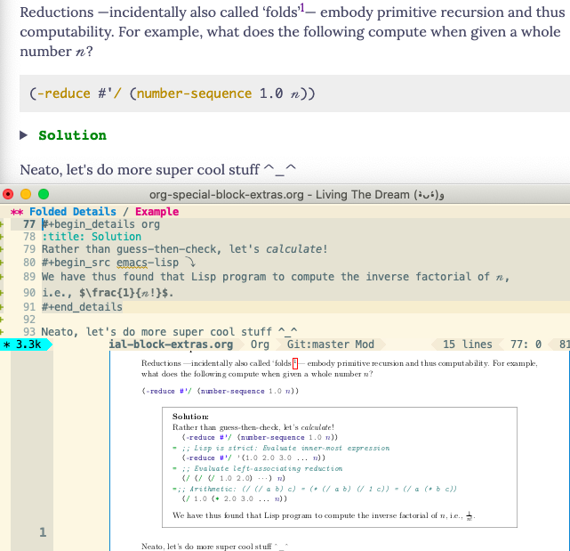
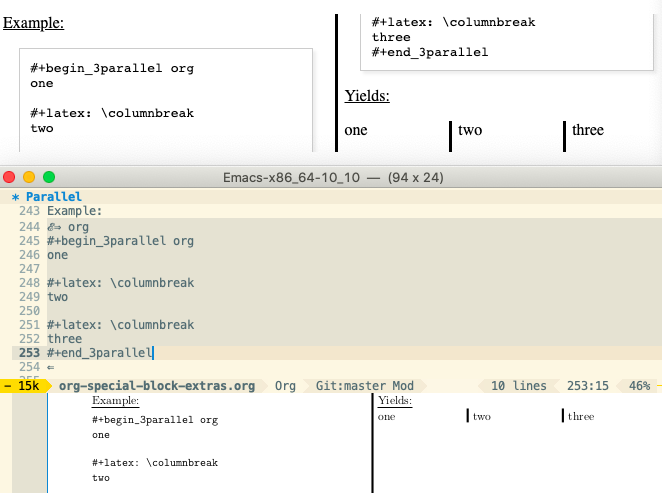
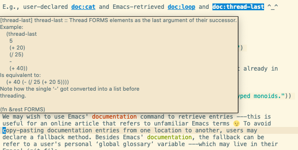
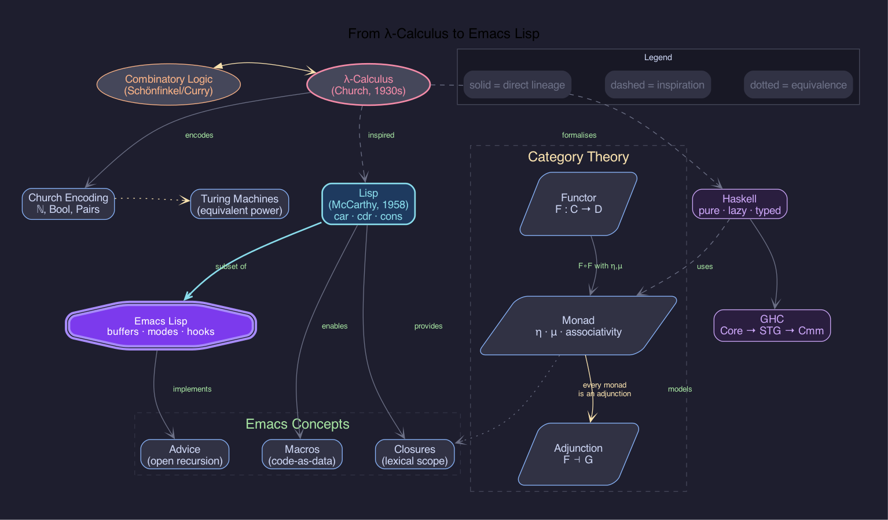
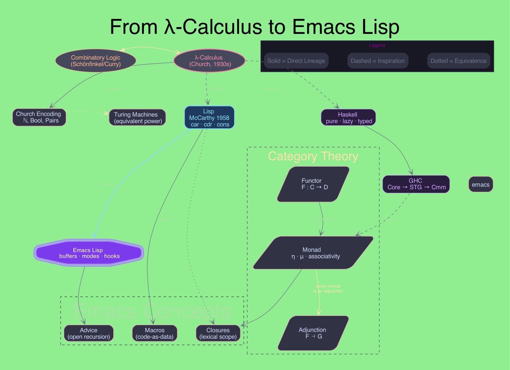

#+title: org-special-block-extras-graph
#+author: Musa Al-hassy
#+options: toc:2 num:nil

# Load the package during export so #+begin_graph blocks are handled.
#+begin_src emacs-lisp :results none :exports none
(add-to-list 'load-path (expand-file-name "lisp" (file-name-directory (or load-file-name buffer-file-name))))
(require 'org-special-block-extras)
(require 'org-defblock)
(require 'org-graph-block)
#+end_src

* Overview

~org-graph-block~ extends [[https://alhassy.com/org-special-block-extras][org-special-block-extras]] with a ~#+begin_graph~ block that
compiles native Org syntax — nested plain lists and two-column tables — into
[[https://graphviz.org][Graphviz dot]].

No raw dot required.  Nesting encodes edges; inline tables encode attributes.

** Setup

#+begin_src emacs-lisp
(require 'org-special-block-extras)
(require 'org-graph-block)
#+end_src

Graphviz must be on your ~PATH~ (~dot -V~ should work in a terminal).

** Pressing =C-c C-c=

Anywhere inside a ~#+begin_graph … #+end_graph~ block, ~C-c C-c~ renders a PNG
immediately.  The output filename is auto-generated unless you supply ~:file~:

#+begin_example
#+begin_graph :file my-diagram.png
…
#+end_graph
#+end_example

** Pressing =C-c '=, or =C-M-i=

~C-c '~ edits the block's body in its own ~org-graph-edit-mode~ buffer. There, and in any Org buffer's
graph blocks, ~C-M-i~ completes table keys and values, and eldoc explains the key at point; on the
~#+begin_graph~ line itself, they do the same for ~:rankdir~, ~:node.shape~, and friends. See item 3 of
[[*Quality of Life][Quality of Life]].

* Syntax Reference

| Construct                                    | Dot equivalent                                                                  |
|----------------------------------------------+---------------------------------------------------------------------------------|
| ~#+begin_graph TITLE~                        | ~graph [ label=TITLE ]~                                                         |
| ~#+begin_graph :KEY V~                       | ~graph [ KEY=V ]~; also ~:node.KEY V~ and ~:edge.KEY V~; ~V~ needs no quotes    |
| ~#+begin_graph :directed nil~                | ~graph { … }~, with ~--~ arcs                                                   |
| ~#+name: N~ above ~#+begin_graph~            | renders to ~N.png~: a figure that ~[[N]]~ reaches, and ~#+caption:~ captions    |
| ~* HEADING :graph:~, with ~:PROPERTIES:~     | the section's text is a graph; ~:RANKDIR: LR~ is ~:rankdir LR~, and so on       |
| ~:NAME:~ … ~:END:~ drawer                    | the directives inside, folded away                                              |
| ~#+graph:~ table                             | ~graph [ … ]~                                                                   |
| ~#+node:~ table                              | ~node [ … ]~                                                                    |
| ~#+edge:~ table                              | ~edge [ … ]~                                                                    |
| ~#+rank: n1 [[n 2]]~                         | ~{ rank=same; n1; "n 2" }~                                                      |
| ~#+name: T~ + table                          | style template ~T~, used via ~:T:~ tags or ~:inherit~ rows; in or out of graphs |
| top-level ~- :T: :: MEANING~                 | a legend entry: a sample of template ~T~, captioned ~MEANING~                   |
| ~#+begin_cluster TITLE :KEY V~               | ~subgraph cluster_TITLE { label=TITLE KEY=V … }~                                |
| ~+ NAME~ list item                           | node ~NAME~ declaration                                                         |
| indent ~+ CHILD~ under ~+ PARENT~            | edge PARENT → CHILD                                                             |
| ~+ L :: CHILD~ under ~+ PARENT~              | edge PARENT → CHILD, labelled ~L~                                               |
| ~1. A~, ~2. B~ under ~+ PARENT~              | edges PARENT → A, B; ~{ rank=same; A; B }~, in that order                       |
| ~+ <<ID>> NAME~                              | node ~ID~, labelled ~NAME~                                                      |
| ~+ NAME [[T]]~, ~+ NAME [[T][L]]~            | edge NAME → T, labelled ~L~                                                     |
| ~+ NAME :T₁:T₂:~                             | node NAME, with templates ~T₁~ and ~T₂~ spliced in                              |
| ~+ NAME [fn::NOTE]~                          | node NAME, with ~tooltip=NOTE~                                                  |
| ~+ NAME \\ MORE~                             | node ~NAME MORE~, its label broken over two lines; likewise in table cells      |
| ~+ NAME [[https://…]]~, ~[[file:x.png]]~     | node NAME, with ~URL="https://…"~, or ~image="x.png"~                           |
| ~+ [X] NAME~, ~[-]~, ~[ ]~                   | node NAME, with template ~checked~, ~partial~, or ~unchecked~, if defined       |
| ~{{{M}}}~, after ~#+macro: M V~              | ~V~, anywhere in the block                                                      |
| ~*b*~ ~/i/~ ~_u_~ ~+s+~ ~=c=~ =~p~=          | an HTML-like label: ~<B>~, ~<I>~, ~<U>~, ~<S>~, monospace                       |
| ~∣ key ∣ value ∣~                            | node attribute; values are quoted for you                                       |
| ~∣ :id ∣ alias ∣~                            | cross-reference name for this node                                              |
| ~∣ :edge.KEY ∣ value ∣~                      | attribute of the arc from the parent; each KEY at most once                     |
| ~+ [[T]]~ under ~+ PARENT~                   | edge PARENT → T, a node declared elsewhere; ~record::port~ targets a port       |
| ~∣ :edge[T].KEY ∣ value ∣~                   | attribute of this item's arc to ~T~, from a ~[[T]]~ link; see Strictly tables   |
| ~∣ :inherit ∣ T ∣~, ~∣ :edge.:inherit ∣ T ∣~ | inherit template ~T~'s rows; explicit rows win                                  |
| ~∣ :children-rank ∣ same ∣~                  | ~{ rank=same; <immediate children> }~                                           |
| ~∣ shape ∣ cluster ∣~                        | ~subgraph cluster_ID { … }~ around the children; see Strictly tables            |
| ~#+record:~ table under ~+ NAME~             | node NAME, labelled by that table; ~<
>~ in a cell is port ~P~                |

* Org's Own Syntax

We want a graph block to read like the Org it is. So wherever Org already has a construct whose
meaning /is/ the graph meaning, we use it; tables remain for everything else. Each construct below is
an alternative to a table row, never a replacement: ~<<lam>>~ and ~| :id | lam |~ both stay.

** ~<<targets>>~ name nodes, ~[[links]]~ draw arcs

In Org, ~<<lam>>~ is a place we can link to, and ~[[lam]]~ points there. In a graph, the target is the
node's id and the link is an arc to it. Moreover, ~C-c C-o~ on the link jumps to its node:
#+begin_src org
+ <<lam>> λ-calculus
  + church
+ lisp [[lam][inspired by]] [[church]]
#+end_src
#+begin_src dot
lam [ label="λ-calculus" ];
lam -> church;
lisp -> lam [ label="inspired by" ];
lisp -> church;
#+end_src

- Inside a graph block, Org shows links in full: we see ~[[lam][inspired by]]~, not just ~inspired by~,
  since both parts matter here. Links elsewhere in the buffer keep Org's usual display.
- The target and links vanish from the label; ~lisp~ above is labelled just ~lisp~.
- ~[[T][L]]~ labels the arc ~L~; an item may have any number of links. As in Org, an item's text is its
  whole first paragraph, so a long line of links may wrap onto the lines below it, before its table.
- An item that is nothing but a link, ~+ [[church][encodes]]~, is a /reference/ to the node ~church~:
  its parent's arc to it is labelled ~encodes~, and ~church~ is declared by its own item. See
  [[*Edges: nesting, ~:edge.KEY~, and links][Edges]].
- Only links to nodes are arcs; ~[[https://orgmode.org][Org]]~ makes its node clickable, and stays ~Org~ in
  the label. See [[*Web links are URLs, image links are images][Web links]].
- In a ~#+record:~ table, a cell's ~<<target>>~ is its port, and its ~[[links]]~ are arcs from that port.

** Description lists label arcs

Org's description list, ~- TERM :: DEFINITION~, attaches a word to an item. In a graph, that word sits on
the arc into the item ---read left to right, it /is/ the arc: client, then /request/, then server:
#+begin_src org
+ <<lam>> λ-calculus
+ client
  + request :: server
  + /retry/ :: server
+ Lisp
  + inspired by :: [[lam]]
#+end_src
#+begin_src dot
lam [ label="λ-calculus" ];
client -> server [ label=request ];
client -> server [ label=<<I>retry</I>> ];
Lisp -> lam [ label="inspired by" ];
#+end_src

- Two arcs between the same nodes are just two items: ~server~ above is one node, reached twice.
- The child may be a link to a node declared elsewhere: ~+ inspired by :: [[lam]]~ arcs to ~λ-calculus~.
- The tag may be marked up, as ~/retry/~ is; it is then an HTML-like label.
- It is the terse spelling of ~| :edge.label | request |~; an explicit ~:edge.label~ row wins.
- A top-level item has no arc into it, so a tag there is an error.
- As in Org, the ~::~ needs whitespace on both sides: ~std::vector~ is a name, not a description.

** Tags splice templates

On a headline, ~:work:urgent:~ classifies the entry. On an item, tags classify the node: each names a
~#+name:~ template whose rows are inherited, as an ~| :inherit | … |~ row would; explicit rows still win.
Inside graph blocks, the tags wear Org's ~org-tag~ face, so they do not read as part of the label:
#+begin_src org
,#+name: wife
| color | pink |
| shape | box  |
,#+name: faint
| style | dotted |

+ Khadija :wife:faint:
  | color | red |
#+end_src
#+begin_src dot
Khadija [ shape=box style=dotted color=red label=Khadija ];
#+end_src

Tags are trailing ~:word:~ groups, exactly as on a headline. So colons anywhere else are just text, and
a node label that needs a trailing ~:word:~ of its own puts it in ~=verbatim=~, or in a ~| label |~ row:
#+begin_src org
+ Ratio 1:2
+ std::vector
+ Meeting at 12:30 :faint:
+ Vim's =:wq:=
#+end_src
#+begin_src dot
"Ratio 1:2" [ label="Ratio 1:2" ];
"std::vector" [ label="std::vector" ];
"Meeting at 12:30" [ style=dotted label="Meeting at 12:30" ];
"Vim's :wq:" [ label=<Vim's :wq:> ];
#+end_src

A tag naming no template is an error, rather than a typo silently becoming part of the label. While
prototyping, though, we want shapes before names: ~#+begin_graph :unknown-tags random-templates~ makes
up a template for each unknown tag ---a colour, a shape, a font--- the same at every use, so the tags
read at a glance. A legend entry gives each its meaning; when the design settles, ~#+name:~ tables
replace the made-up templates, one tag at a time:
#+begin_graph Prototype first, name later :unknown-tags random-templates
#+begin_cluster Legend
- :theory: :: a calculus
- :language: :: a programming language
- :editor: :: an editor
#+end_cluster
+ λ-calculus :theory:
  + Combinatory logic :theory:
  + Lisp :language:
    + Scheme :language:
    + Emacs Lisp :language:
      + Emacs :editor:
#+end_graph

The Nth unknown tag takes the Nth of ~org-graph-random-template-colours~, ~-shapes~, and ~-fonts~, so
renders are stable, and the first eight tags differ in every way.

** Subtrees inherit ~#+node:~, ~#+edge:~, and ~#+rank:~

Org's properties are inherited: a ~:PROPERTIES:~ drawer on a heading reaches its subheadings. So it is
with an item's ~#+node:~ and ~#+edge:~ tables: they style every node and arc beneath the item, while the
item itself keeps its own ~| key | value |~ rows; its ~#+rank:~ lines apply there too. Graphviz scopes
such defaults by an anonymous ~subgraph~, which draws no box:
#+begin_src org
+ Weather
  ,#+node:
  | shape | box |
  ,#+edge:
  | style | dotted |
  + Rain
    + Umbrella
  + Sun
+ Climate
#+end_src
#+begin_src dot
Weather [ label=Weather ];
subgraph {
  node [ shape=box ]
  edge [ style=dotted ]
  Weather -> Rain;
  Rain [ label=Rain ];
  Rain -> Umbrella;
  Umbrella [ label=Umbrella ];
  Weather -> Sun;
  Sun [ label=Sun ];
}
Climate [ label=Climate ];
#+end_src

A deeper item's tables override a shallower one's, as nested ~:PROPERTIES:~ do; a node first declared
elsewhere keeps the defaults of where it was declared.

** Legends are description lists

A legend says what each style means: a glossary of templates. Org's glossary is the description list,
so a top-level ~- :T: :: MEANING~ ---which has no parent to arc from--- is a legend entry: a sample
styled by template ~T~, captioned ~MEANING~. Wrap the entries in a ~#+begin_cluster~ to box them:
#+begin_src org
,#+name: married
| color | pink |
| dir   | both |
,#+name: wife
| shape | box |

+ Muhammad
+ Khadija :wife:
  + [[Muhammad]] :married:
,#+begin_cluster Legend
- :married: :: marriage
- :wife: :: /wife/
,#+end_cluster
#+end_src
#+begin_src dot
subgraph cluster_Legend {
  label=Legend
  legend_1 [ shape=point style=invis ];
  legend_1_end [ shape=point style=invis ];
  legend_1 -> legend_1_end [ color=pink dir=both label=marriage ];
  legend_2 [ shape=box label=<<I>wife</I>> ];
}
#+end_src

- A template that styles some arc in the graph ---by a reference's or a term's tags, an
  ~:edge.:inherit~ row, or an ~#+edge:~ line--- is sampled as an arc; any other, as a node.
- Several tags, ~- :married:faint: :: …~, sample their templates together.
- The sample drops ~constraint~, which shapes the layout rather than the arc.
- The legend can never drift from the graph: change ~married~, and its sample changes too.

** Footnotes are tooltips

A footnote is an aside we read when we want it; so is a tooltip. An inline footnote leaves the label and
becomes the node's ~tooltip~ ---shown on hover in an ~:svg t~ HTML export:
#+begin_src org
+ Lisp [fn::McCarthy, 1958]
#+end_src
#+begin_src dot
Lisp [ tooltip="McCarthy, 1958" label=Lisp ];
#+end_src

A named footnote serves too: ~[fn:NAME: NOTE]~ inline, or a bare ~[fn:NAME]~ whose ~[fn:NAME] NOTE~ definition
sits elsewhere in the buffer ---say, below the graph. An explicit ~| tooltip | … |~ row wins.

** Notes are longer tooltips, or shown in the node

A footnote is awkward for more than a line. An item's text is its first paragraph, as in Org; every
paragraph after it is a note, the tooltip of whatever its item's line describes: a node, or ---under a
reference--- an arc. ~#+begin_note :edge~, sitting in an item as a ~#+begin_cluster~ may, describes the
arc into the item instead; it is the one place we need the block:
#+begin_src org
+ Lisp [fn::1958]

  McCarthy's /list processor/:
  code is data.
  + Scheme
    ,#+begin_note :edge
    Steele and Sussman distilled it.
    ,#+end_note
#+end_src
#+begin_src dot
Lisp [ tooltip="1958\nMcCarthy's list processor: code is data." label=Lisp ];
Lisp -> Scheme [ tooltip="Steele and Sussman distilled it." ];
#+end_src

The blank line matters: without it, ~McCarthy's list processor:~ continues the first paragraph, and so
the label. Likewise ~+ <<lisp>> Lisp, the list processor~ names its node ~lisp~ and labels it with the
whole line; a ~<<target>>~ names, but only a new paragraph begins a note.

Tooltips need a hover, and an exported PNG has none. ~#+begin_graph :notes inline~ shows every note
beneath its label instead, in a smaller font, its markup kept and its lines filled to ~:wrap~ ---else 40---
characters:
#+begin_graph Lisp's family :notes inline :wrap 24 :rankdir LR
+ Lisp [fn::1958]

  McCarthy's /list processor/: code is data.
  + distils :: Scheme
    #+begin_note :edge
    Steele and Sussman.
    #+end_note
#+end_graph

- A note's lines join, and each paragraph ---or ~\\~ break--- starts a new line.
- A note follows the item's footnotes, which stay tooltips; an explicit ~tooltip~, ~:edge.tooltip~,
  or ~label~ row wins.
- A note outside every item is the graph's: its tooltip, or ---inline--- the text beneath its title. One
  directly in a ~#+begin_cluster~ is the box's.
- Within a graph, ~#+begin_note~ is never the callout of the same name, and ~C-c C-c~ in it renders the graph.

** Markup makes rich labels

~*bold*~, ~/italic/~, ~_underline_~, ~+strike+~, ~=code=~, and =~pre~= in an item's text make its label an
HTML-like one, while its id stays the plain text:
#+begin_src org
+ *Church* encodes =Bool=
#+end_src
#+begin_src dot
"Church encodes Bool" [ label=<<B>Church</B> encodes Bool> ];
#+end_src

We escape ~&~, ~<~, ~>~, and ~"~ for you. Graphviz has no way to tell ~=code=~ from =~pre~=, so both are
monospace. A ~#+record:~ table's cells keep their markup too. Names such as ~a_b~, ~C++~, and
~org-graph.el~ are not mistaken for markup.

** ~\\~ breaks a line

In Org, a ~\\~ ending a line is a hard line break; in a graph, it breaks the node's label. Since a label
seldom wants a literal ~\\~, it may sit mid-line too, so a two-line node stays one terse line:
#+begin_src org
+ Emacs
  + provides :: <<closures>> Closures \\ (lexical scope)
  + *Lisp* \\
    McCarthy, 1958
#+end_src
#+begin_src dot
Emacs -> closures [ label=provides ];
closures [ label=<Closures (lexical scope)> ];
Emacs -> "Lisp McCarthy, 1958";
"Lisp McCarthy, 1958" [ label=<<B>Lisp</B> McCarthy, 1958> ];
#+end_src

The label becomes an HTML-like one, as with markup; the id joins the lines with a space, so a node
reached by a link usually wants a ~<<target>>~, as ~closures~ above.

It is the one line break wherever a label is written: a description term, a table value, a ~#+record:~
cell. So an arc's label breaks just as its node's does:
#+begin_src org
+ Monad
  + every monad \\ is an adjunction :: Adjunction
  + Turing
    | :edge.label | Church– \\ Turing thesis |
#+end_src
#+begin_src dot
Monad -> Adjunction [ label=<every monad is an adjunction> ];
Monad -> Turing [ label="Church–\nTuring thesis" ];
#+end_src

** Web links are URLs, image links are images

A link to anything but a node keeps its Org meaning. A web or file link makes the node clickable in
an ~:svg t~ HTML export, its description staying in the label; a description-less link to an image
draws that image:
#+begin_src org
+ [[https://orgmode.org][Org]] mode
+ <<emacs>> Emacs [[file:emacs.png]]
+ [[file:gnu.png]]
#+end_src
#+begin_src dot
"Org mode" [ URL="https://orgmode.org" label="Org mode" ];
emacs [ image="emacs.png" label=Emacs ];
"gnu.png" [ image="gnu.png" label="" ];
#+end_src

A node has one ~URL~, so an item with two web links is an error. Graphviz finds the image relative to
the Org file, as Org does; an explicit ~URL~ or ~image~ row wins.

So a graph of screenshots is a tour. A lone image is its own node, drawn sans text, so the arc into it
carries the words; ~imagescale~ fits each picture to its node's fixed size:
#+begin_graph This package, at a glance :rankdir LR :node.shape box :node.fixedsize true :node.width 2.4 :node.height 1.6 :node.imagescale true
+ org-special-block-extras
  + folds :: 
  + sets side by side :: 
  + explains on hover :: 
#+end_graph

A link to a section, ~[[*Heading]]~, is a URL too ---not an arc, since nodes are named without a star.
In an ~:svg t~ HTML export it leads to that section's anchor, which only Org knows; and in Emacs, a click on
the rendered node opens the section. So a graph may be a map of its own document:
#+begin_src org
,#+begin_graph Org's own syntax :svg t :rankdir LR
+ [[*Org's Own Syntax][Syntax]]
  + [[*Footnotes are tooltips][Footnotes]]
  + [[*Notes are longer tooltips, or shown in the node][Notes]]
,#+end_graph
#+end_src
A bare ~[[*Footnotes are tooltips]]~ labels its node with the heading's title; ~[[#custom-id]]~ and
~[[id:…]]~ links work alike.

** Checkboxes are templates

A checkbox says how far along a thing is; so a graph of tasks is just a checklist. ~[X]~, ~[-]~, and ~[ ]~
apply the templates ~checked~, ~partial~, and ~unchecked~, as a ~:checked:~ tag would; and ~C-c C-c~
on a checkbox toggles it, as Org's own does, then renders the graph:
#+begin_src org
,#+name: unchecked
| style | dashed |

+ [-] compile
  + [X] parse
  + [ ] typecheck
#+end_src
#+begin_src dot
compile [ color=darkorange fontcolor=darkorange label=compile ];
parse [ color=forestgreen fontcolor=forestgreen label=parse ];
typecheck [ style=dashed label=typecheck ];
#+end_src

~checked~ and ~partial~ default to green and orange, by ~org-graph-checkbox-templates~; a graph's own
~#+name:~ template wins. A checkbox whose template exists nowhere, such as ~unchecked~ by default,
styles nothing.

** Macros name values

A palette repeats itself. Org's ~#+macro:~ names a value once, and ~{{{name}}}~ uses it ---in a table, an
item, anywhere in the block:
#+begin_src org
,#+macro: gold #f9e2af
,#+begin_graph
+ Church
  + Turing
    | :edge.color     | {{{gold}}} |
    | :edge.fontcolor | {{{gold}}} |
,#+end_graph
#+end_src

Templates name whole bundles of rows; macros name single values. An undefined macro is an error.

** Ordered lists keep their order

~+ - *~ say “these things”; ~1. 2. 3.~ say “first, second, third”. So ordered children sit side by side,
on one rank, in the order written ---Graphviz no longer reshuffles them to save a crossing:
#+begin_src org
+ λ-calculus
  1. Church
  2. Turing
  3. Kleene
#+end_src
#+begin_src dot
"λ-calculus" [ ordering=out label="λ-calculus" ];
"λ-calculus" -> Church;
"λ-calculus" -> Turing;
"λ-calculus" -> Kleene;
{ rank=same; Church; Turing; Kleene }
#+end_src

An ordered top-level list, or one inside a cluster, shares a rank too. An explicit
~| :children-rank | min |~ wins over the ~rank=same~; a lone ordered child gets no rank at all. For
same rank /without/ the fixed order, use ~| :children-rank | same |~ with ~+~ bullets.

Nodes with no common parent share a rank by ~#+rank:~, which takes bare ids or links; a link spares a
multi-word id its quotes:
#+begin_src org
+ Logic
  + λ calculus
+ Lisp
,#+rank: Lisp [[λ calculus]]
#+end_src
#+begin_src dot
{ rank=same; "λ calculus"; Lisp }
#+end_src

Under ~splines=curved~, Graphviz drops the label of an arc between two nodes on one rank; so there, such
an arc's label becomes an ~xlabel~, which it still draws.

** The ~#+begin_graph~ line

The header line takes the graph's title and any graph attribute, so small graphs need no preamble:
#+begin_src org
,#+begin_graph Lambda calculus :rankdir LR :node.shape box :edge.color grey
+ λ
  + Lisp
,#+end_graph
#+end_src
#+begin_src dot
graph [ label="Lambda calculus" rankdir=LR ]
node [ shape=box ]
edge [ color=grey ]
#+end_src

- The title, the words before the first ~:key~, is the graph's ~label~; ~:directed nil~ makes the graph
  undirected.
- ~:KEY V~ is a graph attribute; ~:node.KEY V~ and ~:edge.KEY V~ are node and edge defaults ---the
  same ~KEY~, ~node.KEY~, ~edge.KEY~ spelling as table rows.
- ~:wrap N~ fills node and arc labels to lines of ~N~ characters, so long item text needs no ~\\~ breaks;
  a label already broken by ~\\~ stays as written.
- ~:notes inline~ shows notes beneath labels rather than as tooltips; ~:unknown-tags random-templates~
  makes up templates for unknown tags; ~:unflatten N~ staggers wide rows of leaves.
- ~:file~, ~:svg~, ~:directed~, ~:wrap~, ~:notes~, ~:unflatten~, ~:unknown-tags~, and ~:C-c_C-c~ belong to
  the block itself, never to Graphviz; so do the
  Babel habits ~:exports~ and ~:results~, which the block ignores.
- The block's own ~#+graph:~, ~#+node:~, and ~#+edge:~ tables override the header.
- As on Org's own ~#+attr_html:~ lines, values need no quotes: ~:bgcolor #6c7086~,
  ~:fontname Helvetica,Arial~. A value with spaces does: ~:fontname "Helvetica Neue"~.
- When the preamble outgrows the line, a drawer of any name ---~:SETTINGS:~, ~:PALETTE:~--- folds
  its ~#+graph:~, ~#+node:~, ~#+edge:~, ~#+rank:~, and ~#+name:~ lines away with ~TAB~.

** Mind maps: ~:layout twopi~

Graphviz's ~layout~ attribute picks its engine, so the header line turns a tree into a mind map: ~twopi~
places ~root~ in the middle and each generation on a ring around it. With ~:wrap~, long labels stay compact:
#+begin_graph Org mode, radially :layout twopi :root "Org mode" :wrap 12 :directed nil :node.shape box :node.style rounded
+ Org mode
  + Agenda
    + TODO keywords
    + Scheduling and deadlines
  + Babel
    + Tangling
    + Evaluating source blocks
  + Export
    + HTML
    + LaTeX
#+end_graph

Sans ~:root~, ~twopi~ picks a centre itself. ~neato~, ~fdp~, and ~circo~ suit graphs that are not trees.

** A mind map from a book: /How to Take Smart Notes/

A chapter of Sönke Ahrens' /How to Take Smart Notes/. Each connective, such as “is an aid for”, sits on its
arc, as a description term; ordered steps are numbered arcs; ~:smart_kind:~ marks the three kinds of note;
and ~[[fleeting]]~ arcs back to a note met earlier:
#+name: smart_kind
| shape     | note      |
| fillcolor | "#fff5cc" |

#+begin_graph How to Take Smart Notes ---Sönke Ahrens :rankdir LR :wrap 24 :directed nil :fontname Helvetica :node.shape box :node.style "rounded,filled" :node.fillcolor white :node.fontname Helvetica :edge.fontname Helvetica :edge.fontsize 10 :edge.fontcolor gray30 :edge.color gray60
+ <<notes>> *Smart notes*
  + Writing
    + is an aid for :: thinking
    + is an aid for :: studying
    + is an aid for :: generating ideas
    + is an aid for :: reading
    + is an aid for :: understanding
  + Thinking
    + happens :: on paper
  + Rule
    + keep a pen at hand
  + Process
    + 1 :: collect notes
      + <<fleeting>> Fleeting :smart_kind:
        + reminders of thoughts
          + put in one place
          + process later
      + <<literature>> Literature :smart_kind:
        + taken :: when reading
        + taken :: briefly
        + taken :: selectively, for your own topics
        + taken :: in your own words
        + taken :: with bibliographic data
        + kept :: in the reference system
      + Permanent :smart_kind:
        + review :: [[fleeting]]
        + review :: [[literature]]
        + review :: once a day
        + think :: how they relate to your research, reflections, interests
        + one note for each idea
        + written as if for another person \\ in full sentences, with sources, links; precisely, clearly, briefly
        + discard :: the fleeting notes
        + add :: behind the note it relates to directly
        + add :: links
        + make sure :: you can find it \\ from the index, or an entry point
    + 2 :: turn into a draft
    + 3 :: edit
#+end_graph

** Wide trees: ~:unflatten N~

A node with many children lays them out in one wide row. ~:unflatten N~ passes the dot through Graphviz's
own ~unflatten -l N~, which staggers those leaves over ~N~ ranks, so the graph is a block rather than a ribbon:
#+begin_graph Lisp's children :unflatten 3
+ Lisp
  + Scheme
  + Common Lisp
  + Clojure
  + Racket
  + Emacs Lisp
  + Fennel
  + Janet
  + Hy
#+end_graph

** Decision trees

A decision tree is a tree whose nodes come in kinds: decisions we make (boxes), chances we take
(circles), and outcomes (bare text), with each chance's arcs labelled by how likely it is. Templates name
the kinds, description terms label the arcs, and an item's ~#+edge:~ dashes every arc of chance beneath it:
#+begin_graph Should our package go lexical? :rankdir LR
#+name: decision
| shape | box |
#+name: chance
| shape | circle |
| label | ""     |
| width | 0.3    |
#+name: outcome
| shape | plaintext |

+ Enable =lexical-binding=? :decision:
  + yes :: <<specials>> :chance:
    #+edge:
    | style | dashed |
    + 80% :: Closures capture \\ their environment :outcome:
    + 20% :: An undeclared special \\ breaks; we =defvar= it :outcome:
  + no :: Dynamic scope; \\ the byte-compiler warns :outcome:
#+end_graph

The chance node is all target: ~<<specials>>~ names it, and its template's empty ~label~ leaves a dot.

** Smart diagrams: ~:smartdiagram TYPE~

Graphviz lays out a graph; LaTeX's [[https://ctan.org/pkg/smartdiagram][smartdiagram]] package typesets a handful of fixed pictures
---a planet amid its satellites, a flow of boxes, a column of terms and their descriptions--- that suit a
README's opening better than any graph. ~:smartdiagram TYPE~ hands the very same list to smartdiagram
instead; ~C-c C-c~ renders it with ~pdflatex~, and LaTeX export typesets it in place:
#+macro: replaces \\ [[color:gray][replaces]] \\ [[color:gray][=$1=]]
#+begin_graph One syntax =(key map)= \\ where =key= is =number=, =:keyword=, ='symbol=, or ="string"=! :smartdiagram constellation
#+graph:
| planet color              | black!75        |
| planet size               | 3.5cm           |
| planet text width         | 3.3cm           |
| satellite size            | 3.6cm           |
| satellite text width      | 3.5cm           |
| distance planet-satellite | 5.7cm           |
| connection color          | gray!60         |
| font                      | \small\sffamily |

+ *easy-access.el* \\ one syntax
  | fontcolor | white |
  + =(:k plist)= {{{replaces((plist-get plist :k))}}}
  + =(:k alist)= {{{replaces((cdr (assoc :k alist)))}}}
  + =(:k hash)= {{{replaces((gethash :k hash))}}}
  + =(:field instance)= {{{replaces((record-field instance))}}}
  + =(n sequence)= {{{replaces((seq-elt sequence n))}}}
  + =(setf (:k p) v)= {{{replaces((map-put p :k v))}}}

-----

=(:school 'math "jasim" :names 2 my-nested-life)=

[[color:gray][replaces]]

#+begin_src emacs-lisp
(seq-elt (-> my-nested-life
             (map-elt :school)
             (map-elt 'math)
             (map-elt "jasim")
             person-names)
         2)
#+end_src
#+end_graph

- ~TYPE~ is one of ~constellation~, ~connected-constellation~, ~bubble~, ~flow~, ~flow:horizontal~,
  ~circular~, ~circular:clockwise~, ~descriptive~, ~priority-descriptive~, or ~sequence~.
- A constellation or bubble has one top item, its centre; that item's children orbit it. A descriptive
  diagram's items are ~+ TERM :: DESCRIPTION~. Every other type reads the top items, in order.
- The ~#+graph:~ rows are ~\smartdiagramset~'s, in smartdiagram's own words: ~| planet color | black!75 |~.
- An item's ~| color |~, ~| fontcolor |~, and ~| fontsize |~ rows ---Graphviz's names for them--- colour
  its shape and its text, and size its text; its ~:tags:~ splice ~#+name:~ templates of those rows, as in
  any graph. An item's later paragraphs sit beneath its text.
- The title sits above the diagram; prose before the list, between the two; prose after it, beneath.
- ~:dpi N~ sets the PNG's resolution, 300 by default. ~C-u C-c C-c~ shows the LaTeX.
- ~C-M-i~ and eldoc know which kind of graph they are in: under ~:smartdiagram~, they offer
  smartdiagram's keys, with their defaults, rather than Graphviz's.
- Graphviz's own syntax ---~#+node:~, ~#+edge:~, ~#+rank:~, links between items, records--- draws
  nothing here, so it is an error rather than silently dropped.

*** Org's markup in place of LaTeX's

The diagram above began life as a ~#+begin_src latex-as-png~ block, via [[https://github.com/alhassy/ob-latex-as-png][ob-latex-as-png]].
Every LaTeX incantation it needed has an Org counterpart that we already write daily:

| LaTeX                                                     | Org                                                    |
|-----------------------------------------------------------+--------------------------------------------------------|
| ~\smartdiagram[constellation diagram]{…}~                 | ~:smartdiagram constellation~, over a nested list      |
| ~\smartdiagramset{planet color=black!75, …}~              | a ~#+graph:~ table, one row a key                      |
| ~\newcommand{\old}[1]{\textcolor{black!70}{\texttt{#1}}}~ | ~#+macro: old [[color:gray][=$1=]]~                    |
| ~\texttt{(:k plist)}~, ~\textbf{…}~                       | ~=(:k plist)=~, ~*…*~                                  |
| ~\mbox{\texttt{…}}~, lest code break mid-circle           | nothing: code never breaks                             |
| ~\textcolor{black!70}{replaces}~                          | ~[[color:gray][replaces]]~                             |
| ~{\color{white}…}~ on the planet                          | a ~fontcolor~ row of ~white~                           |
| ~\centering{One syntax … \\ …}~ above the diagram         | the block's title                                      |
| ~\vspace{1em}{\textcolor{black!44}\hrule}\vspace{1em}~    | ~-----~                                                |
| ~\hspace{7em} (map-elt :school)~, line by line            | a ~#+begin_src~ block, indented as we read it          |
| ~% \new{(N xs)} \replaces …~                              | ~# + =(N xs)= …~                                       |
| ~\resizebox~, ~\vspace~, ~{\color{white} Bye!}~ padding   | nothing: the image is cropped to a small border        |

The LaTeX column is a second language inside our Org file: its macros, its colour syntax, and hand-tuned
~\hspace~'s that drift the moment a line changes. The Org column is the language the rest of the file is
already in; it folds, links, exports, and completes like everything around it. The only backslashes
that survive the move are ~\\~ ---which Org itself reads as a line break--- and the font names, such as
~\small~, that smartdiagram's own settings take as values.

** ~#+name:~ and ~#+caption:~ make a figure

In Org, ~#+name:~ is what ~[[links]]~ reach, and ~#+caption:~ captions a table or an image. A graph
is an image, so both mean what they always do:
#+begin_src org
As [[lineage]] shows, Emacs is a Lisp.

,#+name: lineage
,#+caption: How Emacs came to be
,#+begin_graph
+ λ-calculus
  + Lisp
    + Emacs Lisp
,#+end_graph
#+end_src

- The graph renders to ~lineage.png~ ---both on ~C-c C-c~ and on export--- and exports as that image,
  numbered and captioned: ~[[lineage]]~ reads “Figure 1” in HTML, and ~\ref~ in LaTeX.
- An explicit ~:file~ still wins: ~#+begin_graph :file elsewhere.png~ renders there, and the
  ~#+name:~ still labels it. With ~:svg t~, the figure is ~lineage.svg~.
- An unnamed graph exports as before: inlined into HTML, or as dot source elsewhere.

** Sections are graphs: the ~:graph:~ tag

A ~#+begin_graph~ block is a function on a region; a ~:graph:~ tag is the same function on a section.
The section's text is the graph, and its ~:PROPERTIES:~ drawer ---Org's own home for key-value
settings--- is the ~#+begin_graph~ line: ~:RANKDIR: LR~ is ~:rankdir LR~, ~:NODE.SHAPE: box~ is
~:node.shape box~, and ~:FILE:~ is ~:file~. See [[*Fun Examples #4: A Section Is a Graph][the live example]]:
#+begin_src org
,* Emacs's lineage :graph:
:PROPERTIES:
:RANKDIR: LR
:NODE.SHAPE: box
:END:
+ λ-calculus
  + inspired :: Lisp
    + Emacs Lisp
#+end_src

- The heading stays a heading; only its text becomes the graph, on export.
- ~:graph_Some_Title:~ titles the graph ~Some Title~, as the words before the first ~:key~ would.
- Org's own properties, such as ~:CUSTOM_ID:~ and ~:CATEGORY:~, stay Org's; they never reach Graphviz.

* Keys, Edges, Records, and Ports

** Ids and labels

Every node has an /id/, which arcs and links name, and a /label/, which is drawn. By default both are
the item's text; so these three items, spelling it out more and more, all declare one and the same node:
#+begin_src org
+ Lisp

+ <<Lisp>> Lisp

+ Lisp
  | :id   | Lisp |
  | label | Lisp |
#+end_src
#+begin_src dot
Lisp [ label=Lisp ];
#+end_src

When the two should differ, we set either one apart: a ~<<target>>~ or an ~| :id |~ row gives the id,
and a ~| label |~ row gives the label:
#+begin_src org
+ <<lam>> λ-calculus
+ Combinatory Logic
  | :id | combinatory |
+ Church
  | label | Alonzo Church |
#+end_src
#+begin_src dot
lam [ label="λ-calculus" ];
combinatory [ label="Combinatory Logic" ];
Church [ label="Alonzo Church" ];
#+end_src

- The id is the ~:id~ row, else the ~<<target>>~, else the text ---sans markup, links, footnotes,
  and tags.
- The label is the ~label~ row, else the text; markup makes it an HTML-like one.
- Two items with one id are one node, so an item may appear twice to gain more children.

** Two kinds of keys

By way of example, this item has one row of each kind:
#+begin_src org
+ Alonzo
  | label | Alonzo Church |
  | :id   | church        |
#+end_src
#+begin_src dot
church [ label="Alonzo Church" ];
#+end_src

A /plain/ key, such as ~label~, is a Graphviz attribute of the node, passed straight through. We
quote its value for you, so ~Alonzo Church~, ~#00ff00~, and ~x -> y~ all need no quotes; already-quoted
values, and ~<…>~ HTML labels, are left alone.

A key starting with a colon is /reserved/: it means something to the ~graph~ block itself, never to
Graphviz. A leading colon is never a Graphviz attribute, so the two kinds cannot clash. The reserved
keys are listed in ~org-graph-reserved-keys~:

| Key              | Meaning                                                                    |
|------------------+----------------------------------------------------------------------------|
| ~:id~            | the node's name for cross-references; else its ~<<target>>~, else its text |
| ~:edge.KEY~      | attribute ~KEY~ of the arc from the parent                                 |
| ~:edge[T].KEY~   | attribute ~KEY~ of this item's arc to ~T~                                  |
| ~:inherit~       | inherit the rows of ~#+name:~ templates; also ~:NAME:~ tags                |
| ~:children-rank~ | ~{ rank=… }~ over this item's immediate children                           |

An unknown ~:key~ is an error rather than a silently ignored attribute.

** Edges: nesting, ~:edge.KEY~, and links

Nesting makes an arc from parent to child; ~:edge.KEY~ rows on the child style that arc. Every
attribute is its own row, exactly like a node's, so there is one key-value syntax throughout. For a
mere label, the description list ~+ request :: server~ is terser; see
[[*Description lists label arcs][Description lists label arcs]].
A parallel arc is simply a second child, styled on its own; a ~KEY~ given twice is an error:
#+begin_src org
+ client
  + request :: server
    | :edge.color | blue |
  + retry :: server
    | :edge.style | dashed |
#+end_src
#+begin_src dot
client -> server [ label=request color=blue ];
client -> server [ label=retry style=dashed ];
#+end_src

Arcs that nesting cannot express ---to a node declared elsewhere--- are links. A child item that is
nothing but a link is a /reference/ to its target; nesting makes the arc, and the child's ~:edge.KEY~
rows style it, exactly as for any other child. So each arc is its own small paragraph:
#+begin_src org
+ <<lam>> λ-calculus
+ Fortran
+ Lisp
  + borrows :: [[lam]]
    | :edge.style | dotted |
  + [[Fortran]]
#+end_src
#+begin_src dot
Lisp -> lam [ label=borrows style=dotted ];
Lisp -> Fortran;
#+end_src

- A reference never declares its target: the target's own item names and labels it, even when that
  item comes later. Node attributes on a reference are an error; they belong on the target's item.
- Two references to one target are two parallel arcs, each styled on its own.
- A reference may name a record's port, ~[[struct1::mid]]~, or a cluster.

For a quick arc, a link may also sit in the item's own text; once the arc wants styling, it graduates
to a reference child:
#+begin_src org
+ <<lam>> λ-calculus
+ Fortran
+ Lisp [[lam][borrows]] [[Fortran]]
#+end_src
#+begin_src dot
Lisp -> lam [ label=borrows ];
Lisp -> Fortran;
#+end_src

As in Org, an item's tables and directives may also follow its sub-items; they still belong to it.

** Templates: ~#+name:~, ~:tags:~, and ~:inherit~

A family tree repeats itself: every marriage is the same pink, two-headed arc, and every wife the same
boxed node. Rather than restate those rows each time, we name them once. A ~#+name:~ table is a
reusable bundle of rows, and a tag applies it to whatever its line describes ---after an item, its
node; after a reference, its arc:
#+begin_src org
,#+name: married
| color | "#cc3399" |
| dir   | both      |
,#+name: wife
| shape | box |

+ Muhammad
+ Khadija :wife:
  + [[Muhammad]] :married:
    | :edge.color | red |
#+end_src
#+begin_src dot
Muhammad [ label=Muhammad ];
Khadija [ shape=box label=Khadija ];
Khadija -> Muhammad [ dir=both color=red ];
#+end_src

Explicit rows win over a template's, so the marriage above is red. A line may carry several tags,
~:married:faint:~, each a template. The same rule reaches every other line a template could apply to:

| Line                                | What its tags style                                           |
|-------------------------------------+---------------------------------------------------------------|
| ~+ Khadija :wife:~                  | the node                                                      |
| ~+ [[Muhammad]] :married:~          | the arc to the reference                                      |
| ~+ wed :married: :: Khadija :wife:~ | the arc, by the description term's tags; the node, by its own |
| ~#+node: :wife:~                    | every node; likewise ~#+edge:~ and ~#+graph:~                 |
| ~#+name: wife :base1:base2:~        | the template ~wife~, which inherits ~base1~ and ~base2~       |

Each tag is terse sugar for an ~:inherit~ row, which names one or more templates and is often the
clearer choice in a long-lived graph: ~| :inherit | wife |~ in an item's table or under ~#+node:~,
~| :edge.:inherit | married |~ for the arc into an item. Wherever it sits, the item's explicit rows
still win.

A template may inherit others; one that, directly or not, inherits itself contributes nothing the
second time. A name that no ~#+name:~ defines is an error, rather than a silent nothing.

As with Babel's named tables, a ~#+name:~ table anywhere in the buffer, outside any graph, is a
template every graph in the buffer may use; so a house style ---~wife~, ~married~--- is named once per
file rather than once per graph. A graph's own template of the same name wins, and a template inside
one graph stays that graph's own.

** Records: a ~#+record:~ table

A record is a node drawn as a table, and Org already has tables: under ~#+record:~, an item's table is
its label, laid out exactly as written ---just as ~#+graph:~, ~#+node:~, and ~#+edge:~ name what the
table below them is. A cell's ~<<target>>~ is its /port/, a cell's ~[[link]]~ is an arc from that
port, and an arc reaches a port by ~record::port~ ---just as Org's ~[[file:notes.org::target]]~ reaches
into a file:
#+begin_src org
+ struct1
  ,#+record:
  | left | <<mid>> middle [[struct2::one]] | right |
+ struct2
  ,#+record:
  | <<one>> one | two   |
  | ^           | three |
+ reader
  + [[struct1::mid]]
#+end_src
#+begin_src dot
struct1 [ shape=plain label=<<TABLE …><TR><TD>left</TD><TD PORT="mid">middle</TD><TD>right</TD></TR></TABLE>> ];
struct1:mid -> struct2:one;
struct2 [ shape=plain label=<<TABLE …><TR><TD PORT="one" ROWSPAN="2">one</TD><TD>two</TD></TR><TR><TD>three</TD></TR></TABLE>> ];
reader -> struct1:mid;
#+end_src

Org tables have no merged cells, so two markers stand in for them: ~^~ continues the cell above, as
~one~ does, and an empty cell continues the cell to its left ---or, in the first column, the one
above. Together they draw any layout that Graphviz's old ~{ }~ nesting could:
#+begin_src org
+ struct3
  ,#+record:
  | hello \\ world | b |            |   | g | h |
  | ^              | c | <<here>> d | e | ^ | ^ |
  | ^              | f |            |   | ^ | ^ |
#+end_src
Here ~b~ and ~f~ span three columns, ~hello~, ~g~, and ~h~ three rows; a ~\\~ breaks a line, as in an item.

Hlines and column cookies mean what they mean to Org. An hline draws a rule between rows, and a table
with any hline draws one outer border rather than a box around every cell ---so a UML class is just
the table we would write anyway. A row of ~<l>~, ~<c>~, and ~<r>~ cookies aligns its columns, and
cells keep their markup:
#+begin_src org
+ Person
  ,#+record:
  | <l>            |
  | *Person*       |
  |----------------|
  | name: =String= |
  | age: =Int=     |
  |----------------|
  | greet()        |
#+end_src
#+begin_src dot
Person [ shape=plain label=<<TABLE BORDER="1" CELLBORDER="0" CELLSPACING="0"><TR><TD ALIGN="LEFT" BALIGN="LEFT"><B>Person</B></TD></TR>
…</TABLE>> ];
#+end_src

- A record is otherwise an ordinary node: its children are nodes of their own, and its attributes,
  tags, and templates apply as usual; ~color~, ~fillcolor~, and ~fontcolor~ colour the table. Its
  attribute table goes /above/ ~#+record:~, since rows right below the record table are part of it.
- A record is ~shape=plain~, the table being its whole outline; an explicit ~shape~ row wins.
- A cell with a link but no target is ported by its text, spaces as underscores; ~<<x marks the
  spot>>~ is likewise reached as ~[[struct3::x marks the spot]]~.
- Ports belong to their record, so two records may both have a ~head~ port: ~r1::head~ and ~r2::head~.
- A cell's trailing tags style its arcs, as a reference's style its arc:
  ~| <<mid>> middle [[struct2::one]] :dashed: |~ draws a dashed arc. A cell with tags but no link is an
  error; write ~=:x:=~ for literal text.
- ~a::b~ names a port only when ~a~ names a record; otherwise it is an ordinary node, such as
  ~std::vector~. Record and port names may contain dots: ~[[org.el::v1.2]]~.
- Graphviz spells ports ~record:port~; that is the spelling in the generated dot.

** Clusters

A cluster is a box drawn around some nodes: a /subgraph/, so it gets the graph's own spelling. A
~#+begin_cluster~ block takes a title and ~:KEY V~ attributes, ~:node.KEY~ and ~:edge.KEY~ defaults
included, exactly as the ~#+begin_graph~ line does; and, being a block, it folds with ~TAB~:
#+begin_src org
+ Emacs
  ,#+begin_cluster Packages :bgcolor lightgrey :node.shape box
  + Org
    ,#+begin_cluster
    + agenda
    + babel
    ,#+end_cluster
  + Magit
  ,#+end_cluster
#+end_src
#+begin_src dot
graph [ compound=true ]
subgraph cluster_Packages {
  label=Packages
  bgcolor=lightgrey
  node [ shape=box ]
  Org [ label=Org ];
  subgraph cluster_anonymous_1 { label="" agenda; babel; }
  Org -> agenda [ lhead=cluster_anonymous_1 ];
  Magit [ label=Magit ];
}
Emacs -> Org [ lhead=cluster_Packages ];
#+end_src

- A cluster block inside an item is that item's child: above, ~Emacs~ has an arc to ~Packages~.
- An untitled cluster is an anonymous box, with no label and no name to draw arcs to.
- When the attributes outgrow the line, a table opening the block styles the box, as an item's table
  styles its node; ~#+node:~ and ~#+edge:~ tables set defaults inside it, as usual:
  #+begin_src org
  ,#+begin_cluster Prophets
  | style     | filled  |
  | fillcolor | #ddeeff |
  ,#+node:
  | fillcolor | #aaccff |
  + Adam
  ,#+end_cluster
  #+end_src
- The title runs up to the first ~:KEY~; ~#+begin_cluster Time 12:30~ is titled ~Time 12:30~.
- ~C-c C-c~, ~C-M-i~, and eldoc work inside a cluster block just as anywhere else in the graph.

An arc to or from a cluster lands on the cluster's first node, clipped at its border, as ~lhead~ shows above.

** Strictly tables: ~:edge[T].KEY~ and ~| shape | cluster |~

Some of us prefer every attribute in a key-value table, never in the list's shape. Two spellings
serve that taste; the examples above avoid them, but they are fully supported.

An inline link's arc is styled by ~:edge[T].KEY~, naming the arc by where it goes; ~:edge[T].:inherit~
applies a template to it. A row with no ~[[T]]~ link in the item's text is an error:
#+begin_src org
+ <<lam>> λ-calculus
+ Lisp [[lam][borrows]]
  | :edge[lam].style | dotted |
#+end_src
#+begin_src dot
Lisp -> lam [ label=borrows style=dotted ];
#+end_src

A ~| shape | cluster |~ row makes an item a cluster, as ~#+begin_cluster~ does. Its children are then
its members rather than arc targets, so arcs out of them are inline links, styled as above:
#+begin_src org
+ Emacs
  + Packages
    | shape | cluster |
    + Org
    + Magit
#+end_src
#+begin_src dot
graph [ compound=true ]
subgraph cluster_Packages { label=Packages Org; Magit; }
Emacs -> Org [ lhead=cluster_Packages ];
#+end_src

* Minimal Example

#+begin_graph
+ A
  + calls them :: B
    + returns :: C
    + spawns :: D
      | :edge.style | dashed |
      + merges into :: E
#+end_graph
#+RESULTS:
[[file:graph-20260520-183215.png]]

* Quality of Life

#+begin_graph
+ Functor \\ F : C → D
  | shape | parallelogram |
#+end_graph
#+RESULTS:
[[file:graph-20260517-142140.png]]

1. Pressing ~C-u C-c C-c~ inside a ~#+begin_graph~ block shows the generated Graphviz dot source in
   a ~*org-graph dot*~ buffer instead of rendering a PNG.  A ~#+RESULTS:~ block containing a fenced
   ~#+begin_src dot … #+end_src~ is inserted (or replaced) in the org file so the source is preserved.

   For blocks where you always want dot output, add ~:C-c_C-c dot~ to the header:
   #+begin_example
   #+begin_graph :C-c_C-c dot
   …
   #+end_graph
   #+end_example
   Plain ~C-c C-c~ on such a block shows dot; ~C-u C-c C-c~ toggles back to PNG.
   The two controls compose via XOR — prefix always flips whatever the block default is.

2. Pressing ~C-u RET~ on any table row inside a ~#+begin_graph~ block inserts a new ~| key | value |~
   row interactively — a completion menu for the key, then one for the value (or a free-text prompt
   when the attribute accepts arbitrary strings).

   The menu is context-aware: it shows only attributes valid for the structural location of the table:
   - Table under ~#+graph:~ → graph-level attributes (~rankdir~, ~splines~, ~bgcolor~, …)
   - Table under ~#+node:~ → default node attributes (~shape~, ~style~, ~color~, …)
   - Table under ~#+edge:~ → default edge attributes (~arrowhead~, ~dir~, ~penwidth~, …)
   - Table on a list item → node attributes (same as above)

   The full attribute catalogue lives in the ~org-graph-attributes~ defcustom, in
   ~org-graph-attributes.el~ (customise via ~M-x customize-variable RET org-graph-attributes~); each
   entry has the form:
   #+begin_src emacs-lisp
   (:name "shape" :valid-on (nodes) :default "ellipse"
    :values ("box" "polygon" "ellipse" …)  ;; nil → free-text prompt
    :description "Sets the shape of a node.")
   #+end_src

   For a colour ---~bgcolor~, ~fillcolor~, ~fontcolor~, or ~color~--- the value is picked from Helm's colour
   list, when Helm is installed; ~RET~ inserts the colour's hex code, and its name as a comment.

   Plain ~RET~ is unaffected — only the prefixed ~C-u RET~ triggers the completion.

3. ~C-M-i~ (~completion-at-point~) and eldoc know about graph keys ---in any Org buffer's graph blocks,
   and in the ~org-graph-edit-mode~ buffer that ~C-c '~ opens on one:
   - In a key cell, completion offers the attributes valid there, plus the reserved keys; after
     ~:edge.~ or ~:edge[T].~, it offers only edge attributes, prefix and all. In a value cell, it
     offers the values of that row's attribute, such as ~vee~ for ~:edge.arrowhead~. Each candidate is
     annotated with its description.
   - On the ~#+begin_graph~ line, ~:r C-M-i~ offers ~:rankdir~ and the other graph attributes, every
     ~:node.KEY~ and ~:edge.KEY~, and the block's own ~:file~, ~:svg~, ~:directed~, and ~:C-c_C-c~;
     ~:rankdir L C-M-i~ then offers ~LR~.
   - Eldoc shows the description of the key on the current row, or at point on the ~#+begin_graph~
     line, ending with Graphviz's default; e.g., ~| :edge.arrowhead | vee |~ shows “Style of
     arrowhead on the head node of an edge.  Default: normal.”
   - ~C-u RET~ works in the ~C-c '~ buffer too.

   The descriptions come from ~org-graph-attributes~, which lives on its own in ~org-graph-attributes.el~:
   every Graphviz attribute, scraped from [[https://graphviz.org/doc/info/attrs.html][Graphviz's attribute table]]. To add or adjust an attribute,
   edit its entry there, or ~M-x customize-variable RET org-graph-attributes~. Reserved keys are
   described by ~org-graph--reserved-key-docs~, and the header's own keys by ~org-graph--header-key-docs~.

4. The image ~C-c C-c~ renders is clickable. Hovering over a node or cluster shows its tooltip ---its
   footnotes and notes--- and a click follows it: to its link's target, when its item has a web, file, or
   ~[[*Heading]]~ link; else to the item itself, in the ~#+begin_graph~ block. Graphviz writes an image
   map (~-Tcmapx~) beside the PNG, from the same layout, and its areas become the image's ~:map~; it is
   scaled as the image is, say by ~org-image-actual-width~.

   The map lives only as long as the image does: an image Org redisplays itself, say on reopening the file,
   is clickable again after another ~C-c C-c~.

* Fun Example

Its palette is Catppuccin's; the colours it repeats are named once, by Org's own macros:
#+macro: yellow #f9e2af
#+macro: mauve #cba6f7
#+macro: surface #45475a
#+macro: sky #89dceb

#+begin_graph :file images/lambda-to-emacs-fun.png
#+graph:
| rankdir  | TB                            |
| label    | From λ-Calculus to Emacs Lisp |
| labelloc | t                             |
| fontname | Helvetica                     |
| fontsize | 18                            |
| bgcolor  | #1e1e2e                       |
| splines  | curved                        |
| nodesep  | 0.6                           |
| ranksep  | 0.9                           |
| pad      | 0.4                           |

#+node:
| fontname  | Helvetica      |
| fontcolor | #cdd6f4        |
| color     | #89b4fa        |
| style     | filled,rounded |
| fillcolor | #313244        |
| shape     | box            |

#+edge: :lineage:
| fontname  | Helvetica |
| fontsize  | 10        |
| fontcolor | #a6e3a1   |
| color     | #6c7086   |
| arrowhead | vee       |

#+rank: lambda combinatory
#+rank: church turing
#+rank: lisp haskell
#+rank: emacs ghc

#+name: lineage
| style | solid |
#+name: inspiration
| style | dashed |
#+name: equivalence
| style      | dotted |
| constraint | false  |

+ <<lambda>> λ-Calculus \\ (Church, 1930s)
  | shape     | ellipse       |
  | fillcolor | {{{surface}}} |
  | color     | #f38ba8       |
  | fontcolor | #f38ba8       |
  | penwidth  | 2             |
  + encodes :: <<church>> Church Encoding \\ ℕ, Bool, Pairs
    + Church– \\ Turing thesis :equivalence: :: <<turing>> Turing Machines \\ (equivalent power)
      | :edge.color     | {{{yellow}}} |
      | :edge.fontcolor | {{{yellow}}} |
  + inspired :inspiration: :: <<lisp>> Lisp \\ (McCarthy, 1958) \\ car · cdr · cons
    | fillcolor | #1e3a5f   |
    | color     | {{{sky}}} |
    | fontcolor | {{{sky}}} |
    | penwidth  | 2         |
    + subset of :: <<emacs>> Emacs Lisp \\ buffers · modes · hooks
      | :edge.penwidth | 2             |
      | :edge.color    | {{{sky}}}     |
      | shape          | doubleoctagon |
      | fillcolor      | #7c3aed       |
      | color          | #a78bfa       |
      | fontcolor      | #ffffff       |
      | fontsize       | 13            |
      | penwidth       | 3             |
      + implements :: [[advice]]
    + enables :: [[macros]]
    + provides :: [[closures]]
  + formalises :inspiration: :: <<haskell>> Haskell \\ pure · lazy · typed
    | fillcolor | #2a1e3f     |
    | color     | {{{mauve}}} |
    | fontcolor | {{{mauve}}} |
    + <<ghc>> GHC \\ Core → STG → Cmm
      | fillcolor | #2a1e3f     |
      | color     | {{{mauve}}} |
      | fontcolor | {{{mauve}}} |
    + uses :inspiration: :: [[monad]]

+ <<combinatory>> Combinatory Logic \\ (Schönfinkel/Curry)
  | shape     | ellipse       |
  | fillcolor | {{{surface}}} |
  | color     | #fab387       |
  | fontcolor | #fab387       |
  + equivalent :: [[lambda]]
    | :edge.dir   | both         |
    | :edge.color | {{{yellow}}} |

#+begin_cluster Emacs Concepts :fontcolor #a6e3a1 :color #313244 :style dashed
+ <<macros>> Macros \\ (code-as-data)
+ <<closures>> Closures \\ (lexical scope)
+ <<advice>> Advice \\ (open recursion)
#+end_cluster

#+begin_cluster Category Theory :fontcolor {{{yellow}}} :color {{{surface}}} :style dashed
+ <<monad>> Monad \\ η · μ · associativity
  | shape | parallelogram |
  + <<adjoint>> Adjunction \\ F ⊣ G
    | :edge.label     | every monad \\ is an adjunction |
    | :edge.color     | {{{yellow}}}                    |
    | :edge.fontcolor | {{{yellow}}}                    |
    | shape           | parallelogram                   |
  + models :equivalence: :: [[closures]]
+ <<functor>> Functor \\ F : C → D
  | shape | parallelogram |
  + F∘F with η,μ :: [[monad]]
#+end_cluster

#+begin_cluster Legend :fontcolor #cdd6f4 :color {{{surface}}} :style filled :fillcolor #181825 :fontsize 11
- :lineage: :: direct lineage
- :inspiration: :: inspiration
- :equivalence: :: equivalence
#+end_cluster
#+end_graph
#+RESULTS:

* Full Example — λ-Calculus → Emacs Lisp

This is the complete graph from the design conversation: λ-calculus,
Combinatory Logic, Church Encodings, Lisp, Haskell, Emacs, GHC, and Category
Theory — all in one diagram.

NOTE: To get colour codes, I use `M-x helm-colors` then ~C-z~ (for additional
actions) then ~C-c r~ to insert the hex-code at point. Within a graph's table, ~C-u RET~ does this for us:
on a ~bgcolor~, ~fillcolor~, ~fontcolor~, or ~color~ row, it opens that same picker, and ~RET~ inserts
the colour's hex code, and its name as a comment.

#+begin_graph :file images/lambda-to-emacs.png
:SETTINGS:
#+graph:
| rankdir  | TB                            |
| label    | From λ-Calculus to Emacs Lisp |
| labelloc | t                             |
| fontname | Helvetica                     |
| fontsize | 48                            |
| bgcolor  | #90ee90                       |
| splines  | curved                        |
| nodesep  | 0.6                           |
| ranksep  | 0.9                           |
| pad      | 0.4                           |

#+node:
| fontname  | Helvetica      |
| fontcolor | #cdd6f4        |
| color     | #Eea9b8        |
| style     | filled,rounded |
| fillcolor | #313244        |
| shape     | box            |

#+edge:
| fontname  | Helvetica |
| fontsize  | 10        |
| fontcolor | #a6e3a1   |
| color     | #6c7086   |
| arrowhead | vee       |

#+rank: lambda combinatory
#+rank: church turing
#+rank: emacs ghc
:END:
+ <<lambda>> λ-Calculus \\ (Church, 1930s)
  | shape          | ellipse |
  | fillcolor      | #45475a |
  | color          | #f38ba8 |
  | fontcolor      | #f38ba8 |
  | penwidth       | 2       |
  | :children-rank | same    |
  + encodes :: <<church>> Church Encoding \\ ℕ, Bool, Pairs
    + <<turing>> Turing Machines \\ (equivalent power)
      | :edge.label      | Church– \\ Turing thesis |
      | :edge.style      | dotted                   |
      | :edge.color      | #f9e2af                  |
      | :edge.fontcolor  | #f9e2af                  |
      | :edge.constraint | false                    |
  + formalises :: <<haskell>> Haskell \\ pure · lazy · typed
    | :edge.style | dashed  |
    | fillcolor   | #2a1e3f |
    | color       | #cba6f7 |
    | fontcolor   | #cba6f7 |
    + <<ghc>> GHC \\ Core → STG → Cmm
      | fillcolor | #2a1e3f |
      | color     | #cba6f7 |
      | fontcolor | #cba6f7 |
      + uses :: [[monad]]
        | :edge.style | dashed |
  + inspired :: <<lisp>> Lisp \\ McCarthy 1958 \\ car · cdr · cons
    | :edge.style | dashed  |
    | fillcolor   | #1e3a5f |
    | color       | #89dceb |
    | fontcolor   | #89dceb |
    | penwidth    | 2       |
        + models :: [[closures]]
          | :edge.style      | dotted |
          | :edge.constraint | false  |
        + [[macros]]
    + subset of :: Emacs Lisp \\ buffers · modes · hooks
      | :edge.penwidth | 2             |
      | :edge.color    | #89dceb       |
      | shape          | doubleoctagon |
      | fillcolor      | #7c3aed       |
      | color          | #a78bfa       |
      | fontcolor      | #ffffff       |
      | fontsize       | 13            |
      | penwidth       | 3             |
      + [[advice]]
+ <<combinatory>> Combinatory Logic \\ (Schönfinkel/Curry)
  | shape     | ellipse |
  | fillcolor | #45475a |
  | color     | #fab387 |
  | fontcolor | #fab387 |
  + equivalent :: [[lambda]]
    | :edge.dir   | both    |
    | :edge.color | #f9e2af |
#+begin_cluster Emacs Concepts :fontcolor #a6e3a1 :color #313244 :style dashed
+ <<advice>> Advice \\ (open recursion)
+ <<closures>> Closures \\ (lexical scope)
+ <<macros>> Macros \\ (code-as-data)
#+end_cluster
#+begin_cluster Category Theory :fontcolor #f9e2af :color #45475a :style dashed :fontsize 28

+ Functor \\ F : C → D
  | shape | parallelogram |
  + F∘F with η,μ :: [[monad]]

+ <<monad>> Monad \\ η · μ · associativity
  | shape | parallelogram |
  + [[adjoint]]
    | :edge.label     | every monad \\ is an adjunction |
    | :edge.color     | #f9e2af                         |
    | :edge.fontcolor | #f9e2af                         |
  + [[closures]]

+ <<adjoint>> Adjunction \\ F ⊣ G
  | shape | parallelogram |
#+end_cluster
#+begin_cluster Legend
| fontcolor | #8b008b |
| color     | #45475a |
| style     | filled  |
| fillcolor | #181825 |
| fontsize  | 11      |
#+node:
| shape     | plaintext |
| fontcolor | #6c7086   |
+ Solid = Direct Lineage
+ Dashed = Inspiration
+ Dotted = Equivalence
#+end_cluster
#+end_graph
#+RESULTS:

Also, useful
(setq org-image-actual-width 700)

# 💢 Having two newlines before an item breaks things! Having two lines after
# omits everything else: this is how org lists work, but we don't need this
# stringent behaviour...?

* Fun Examples #1
:PROPERTIES:
:CREATED:  [2026-05-20 Wed 18:32]
:END:
The expression ~1 * 2 + 3 - 4~ is parsed as:
#+begin_graph
+ -
  + 4
  + +
    + 3
    + *
      + 1
      + 2
#+end_graph
#+RESULTS:
[[file:graph-20260520-184912.png]]
a
;; MA: I think this is a fun example to demo how we get REPL-like behaviour for graphs.
;; Start by converting the exrepsssion "1 * 2 + 3 - 4" into 7 nodes: “+ 1, + *, + 2, + 4 …”, then C-c C-c, then use org list features along with C-c C-c to quickly add more and more structure :wink:
;;
;; However, M-<left> and M-<right> should promote/demote the current list item
and all its children, currently I don't have that behaviour for some reason! 💢

#+begin_graph
+ start
  + middle
    + end
#+end_graph
#+RESULTS:
[[file:/var/folders/1s/wxmh4wdd2sn3j3jx0ygh3lm80000gn/T/graph-d6683045e63e.png]]

* Fun Examples #2
:PROPERTIES:
:CREATED:  [2026-05-20 Wed 18:39]
:END:

Insert “| |” then do “C-u org-graph--insert-attribute-row” to get completing
read menu for graph properties!
* Fun Examples #3: Records  pt1 
:PROPERTIES:
:CREATED:  [2026-05-20 Wed 19:13]
:END:

An item's ~#+record:~ table is its label, drawn as laid out; ~<<mid>>~ makes ~The Middle~ a port,
whose link is an arc from it:

#+begin_graph
+ struct1
  #+record:
  | left | <<mid>> The Middle [[struct2::one]] | right |
+ struct2
  #+record:
  | <<one>> one | two |
#+end_graph
#+RESULTS:
[[file:graph-20260520-194138.png]]
* Records pt2
:PROPERTIES:
:CREATED:  [2026-05-20 Wed 19:41]
:END:

Spans replace ~{ }~ nesting: ~^~ continues the cell above, and an empty cell the one to its left.
#+begin_graph
+ struct3
  #+record:
  | hello \\ world | b |                        |   | g | h |
  | ^              | c | <<x marks the spot>> d | e | ^ | ^ |
  | ^              | f |                        |   | ^ | ^ |

+ where am i looking?
  + 👀 :: [[struct3::x marks the spot]]
    | :edge.style | dotted  |
    | :edge.color | #f9e2af |

# label="Church–\nTuring thesis" style=dotted color="#f9e2af" fontcolor="#f9e2af" constraint=false |
#+end_graph
#+RESULTS:
[[file:graph-20260520-195608.png]]

* Fun Examples #4: A Section Is a Graph :graph_Lineage:
:PROPERTIES:
:RANKDIR: LR
:NODE.SHAPE: box
:EDGE.COLOR: grey
:END:
+ λ-calculus
  + inspired :: Lisp
    + subset of :: Emacs Lisp
    + dialect :: Scheme

* Karbala — Family of the Prophet
:PROPERTIES:
:CREATED:  [2026-05-20 Wed]
:END:
 
A genealogy of the prophetic lineage (Adam → Noah → Ibrahim → … → Muhammad ﷺ)
and the family of Imam Hussain ibn Ali at Karbala — including his wives,
children, the antagonists (Muawiya, Yazid, Ibn Ziyad, Shimr), and a legend.
Showcases: ~:SETTINGS:~ drawers, ~#+begin_cluster~ blocks with scoped ~#+node:~ overrides,
~#+rank:~ groupings, diamond shapes for key Karbala actors, ~\\~ multi-line labels, footnote
tooltips, bidirectional pink marriage edges, and red martyrdom arrows ---all without a single line
of raw dot.

#+begin_graph :file ~/Downloads/karbala.png :svg t
:SETTINGS:
#+graph:
| label    | The Karbala Tragedy |
| labelloc |                   t |
| fontsize |                  36 |
| rankdir  |                  TB |
| splines  |              curved |
| nodesep  |                 0.6 |
| ranksep  |                 1.0 |
| pad      |                 0.5 |

#+node:
| shape     | ellipse |
| style     | filled  |
| fillcolor | #d4a96a |
| fontname  | Georgia |
| fontcolor | #2b1a00 |

#+edge:
| style     | solid   |
| color     | #7a5c2e |
| arrowhead | vee     |
:END:

# Style templates ---applied by :NAME: tags: after an item, to its node; after a reference, to its arc.
#+name: married
| color | #cc3399 |
| dir   | both    |
| style | solid   |

#+name: motherhood
| color | #00aa44 |
| style | solid   |

#+name: killed-by
| color     | red  |
| style     | bold |
| arrowhead | dot  |
| dir       | back |

#+name: ancestry
| style | dashed  |
| color | #888888 |

#+name: mention
| style | dashed  |
| color | #9955cc |

#+name: imprisoned
| color | #cc6600 |
| style | dashed  |

#+begin_cluster Prophets (عليهم السلام)
| style     | filled  |
| fillcolor | #ddeeff |
| color     | #3355aa |
| fontcolor | #003388 |
#+node:
| fillcolor | #aaccff |
| color     | #3355aa |
+ <<idris>> Idris \\ (إدريس)
  [fn::Idris — mentioned in Quran (19:56-57). Raised to a high station. Often identified with the biblical Enoch.]
+ <<hud>> Hud \\ (هود)
  [fn::Hud — sent to the ʿĀd people (southern Arabia). They rejected him; destroyed by a violent wind.]
+ <<salih>> Salih \\ (صالح)
  [fn::Salih — sent to the Thamud people. Brought a she-camel as a divine sign; they killed it and were destroyed.]
+ <<adam>> Adam \\ (آدم)
  [fn::Adam — first human and first prophet. Created from clay; placed in Paradise then sent to Earth.]
+ <<noah>> Noah \\ (نوح)
  [fn::Noah (Nuh) — preached for 950 years. Built the Ark; the Flood destroyed those who rejected him.]
  + [[adam]] :ancestry:
+ <<ibrahim>> Ibrahim \\ (إبراهيم)
  [fn::Ibrahim (Abraham) — Friend of God (Khalilullah). Destroyed idols, survived fire. Father of Ismail and Ishaaq; built the Kaaba.]
  + [[noah]] :ancestry:
+ <<lut>> Lut \\ (لوط)
  [fn::Lut (Lot) — nephew of Ibrahim. Sent to the people of Sodom; they were destroyed for their transgressions.]
  + [[ibrahim]] :ancestry:
+ <<ismail>> Ismail \\ (إسماعيل)
  [fn::Ismail (Ishmael) — eldest son of Ibrahim; ancestor of the Arab peoples and of Muhammad ﷺ. He and Ibrahim built the Kaaba in Mecca.]
  + [[ibrahim]] :ancestry:
+ <<ishaaq>> Ishaaq \\ (إسحاق)
  [fn::Ishaaq (Isaac) — son of Ibrahim and Sarah. Father of Yaqub; ancestor of the Israelite prophets.]
  + [[ibrahim]] :ancestry:
+ <<yaqub>> Yaqub \\ (يعقوب)
  [fn::Yaqub (Jacob / Israel) — son of Ishaaq. Father of the twelve tribes of Israel, including Yusuf.]
  + [[ishaaq]] :ancestry:
+ <<yusuf>> Yusuf \\ (يوسف)
  [fn::Yusuf (Joseph) — son of Yaqub. Sold into slavery by brothers; rose to power in Egypt. His beauty is legendary — Layla invoked it at Karbala.]
  + [[yaqub]] :ancestry:
+ <<ayyub>> Ayyub \\ (أيوب)
  [fn::Ayyub (Job) — prophet of patience. Afflicted with severe trials for years; restored after steadfast faith.]
+ <<shuayb>> Shuayb \\ (شعيب)
  [fn::Shuayb (Jethro) — sent to the people of Midian; warned against dishonest trade. Some traditions identify him as father-in-law of Moses.]
+ <<yunus>> Yunus \\ (يونس)
  [fn::Yunus (Jonah) — swallowed by a whale after leaving his people without permission. Remembered for his repentance (Dhul-Nun).]
+ <<moses>> Moses \\ (موسى)
  [fn::Moses (Musa) — the prophet most mentioned in the Quran. Led the Exodus; received the Torah on Mount Sinai. Lineage traced through Ismail's descendants.]
  + [[ismail]] :ancestry:
+ <<aaron>> Aaron \\ (هارون)
  [fn::Aaron (Harun) — brother of Moses; assisted him in the mission to Pharaoh.]
+ <<dawood>> Dawood \\ (داود)
  [fn::Dawood (David) — king and prophet of Israel. Slew Goliath; given the Psalms (Zabur). Father of Sulayman.]
+ <<sulayman>> Sulayman \\ (سليمان)
  [fn::Sulayman (Solomon) — son of Dawood; given extraordinary wisdom, control over jinn and wind, and speech with animals.]
  + [[dawood]] :ancestry:
+ <<ilyas>> Ilyas \\ (إلياس)
  [fn::Ilyas (Elias) — prophet of Israel; called his people to abandon the idol Baal.]
+ <<alyasa>> Al-Yasa \\ (اليسع)
  [fn::Al-Yasa (Elisha) — successor of Ilyas; praised in the Quran among the best.]
  + [[ilyas]] :ancestry:
+ <<zakariya>> Zakariya \\ (زكريا)
  [fn::Zakariya (Zechariah) — prayed for a son in old age; miraculously given Yahya as a gift from God.]
+ <<yahya>> Yahya \\ (يحيى)
  [fn::Yahya (John the Baptist) — son of Zakariya; forerunner to Jesus. Praised in the Quran as wise from childhood.]
  + [[zakariya]] :ancestry:
+ <<jesus>> Jesus \\ (عيسى)
  [fn::Jesus (Isa) — born miraculously to Maryam; given the Gospel (Injil). Performed miracles; raised to heaven; will return before the Day of Judgment.]
+ <<dhulkifl>> Dhul-Kifl \\ (ذو الكفل)
  [fn::Dhul-Kifl — mentioned twice in the Quran among the patient and righteous. Identity debated; some identify with Ezekiel or another prophet.]
# Pre-Ibrahim tribal prophets — sent to regional peoples (ʿĀd, Thamud)
#+rank: hud salih
# Contemporaries of Ibrahim's immediate family
#+rank: lut ismail ishaaq
# Next generation: Yaqub, and roughly contemporary regional prophets
#+rank: yaqub ayyub shuayb yunus
# Moses and Aaron — the Exodus era
#+rank: moses aaron
# Israelite king-prophets
#+rank: dawood ilyas
# Sulayman (son of Dawood), Al-Yasa (successor of Ilyas), Zakariya
#+rank: sulayman alyasa zakariya
# Late Israelite prophets — Yahya (John the Baptist), Jesus, and Dhul-Kifl
#+rank: yahya jesus dhulkifl
#+end_cluster

# Hadith: the four greatest women of paradise — Khadija, Fatimah, Maryam, Asiya
#+begin_cluster Ladies of Heaven (سيدات الجنة) :style filled :fillcolor #fff0f5 :color #aa3366 :fontcolor #660033
+ <<khadija>> Khadija \\ (خديجة) \\ First wife of Muhammad
  [fn::Khadija bint Khuwaylid — the first Muslim and the Prophet's most beloved wife. A wealthy merchant; she proposed to Muhammad ﷺ. He took no other wife while she lived.]
  + [[muhammad]] :married:
+ <<fatimah>> Fatimah \\ (فاطمة) \\ Daughter of Muhammad
  [fn::Fatimah al-Zahra ('the Radiant') — daughter of Muhammad ﷺ and Khadija; wife of Ali; mother of Hasan, Hussain, and Zaynab. The Prophet said: 'Fatimah is a part of me — whoever angers her angers me.' In Shia tradition: after Abu Bakr's succession, Umar led a party to her house to force Ali's pledge of allegiance; the door was set alight or forced open, Fatimah was struck, and she miscarried her unborn son Muhsin (the fifth child of Ali and Fatimah). She died ~75–95 days after the Prophet — at most 18 years old — and was buried secretly at night, her grave kept hidden from the new government. Fadak (a fertile estate the Prophet had gifted her) was confiscated by Abu Bakr on the grounds that prophets leave no inheritance, a hadith Shia scholars hold as fabricated. She never spoke to Abu Bakr again until her death.]
  + [[muhammad]]
  + Fadak / Muhsin :: [[abubakr]] :killed-by:
  + door incident :: [[umar]] :killed-by:
+ <<maryam>> Maryam \\ (مريم) \\ Mother of Jesus
  [fn::Maryam (Mary) — the only woman named directly in the Quran, with a full chapter (Sura 19) devoted to her. Gave birth to Jesus without a father; a virgin chosen above all women.]
  + [[jesus]] :motherhood:
+ <<asiya>> Asiya \\ (آسية) \\ Wife of Pharaoh
  [fn::Asiya bint Muzahim — wife of Pharaoh who adopted Moses as an infant. Believed in God and was tortured to death by Pharaoh; her prayer for a house in Paradise is in Quran 66:11.]
#+end_cluster

+ <<hashim>> Hashim \\ (هاشم)
  [fn::Hashim ibn Abd Manaf — great-grandfather of Muhammad ﷺ; ancestor of the Hashimite clan of Quraysh. Known for feeding pilgrims in Mecca.]
  + [[ismail]] :ancestry:
+ <<abdmutallib>> Abd Al Mutallib \\ (عبد المطلب)
  [fn::Abd al-Muttalib — grandfather of Muhammad ﷺ and guardian after Abdullah's death. He discovered the Zamzam well and led the Quraysh against Abraha's elephant army.]
  + [[hashim]]
+ <<abdullah>> Abdullah \\ (عبدالله)
  [fn::Abdullah ibn Abd al-Muttalib — father of Muhammad ﷺ. Died before Muhammad's birth; his death and that of Aminah left Muhammad an orphan in infancy.]
  + [[abdmutallib]]
+ <<abutalib>> Abu Talib \\ (أبو طالب)
  [fn::Abu Talib ibn Abd al-Muttalib — paternal uncle and guardian of Muhammad ﷺ after age 8; father of Ali. Protected the Prophet for decades though he did not publicly accept Islam.]
  + [[abdmutallib]]
+ <<aqil>> Aqil \\ (عقيل) \\ brother of Ali
  [fn::Aqil ibn Abi Talib — elder brother of Ali; son of Abu Talib. Renowned for his genealogical knowledge. Father of Muslim ibn Aqil, Hussain's envoy to Kufa. Initially supported Muawiya after the arbitration, though this is a contested point in Shia sources.]
  + [[abutalib]]
+ <<jafaribnabutalib>> Ja'far \\ (جعفر) \\ brother of Ali
  [fn::Ja'far ibn Abi Talib — brother of Ali; led the early Muslim emigration to Abyssinia and presented Islam to the Negus. Died at the Battle of Mu'ta (629 CE) fighting Byzantine forces; called 'Dhu'l-Janahayn' (the one with two wings) for his bravery.]
  + [[abutalib]]
+ <<aminah>> Aminah \\ (آمنة) \\ Mother of Muhammad
  [fn::Aminah bint Wahb — mother of Muhammad ﷺ. Died when Muhammad was ~6 years old; he was left in the care of his grandfather Abd al-Muttalib. Her grave is in al-Abwa' on the road between Mecca and Medina.]
  + [[muhammad]] :motherhood:
+ <<muhammad>> Muhammad ﷺ \\ (محمد)
  [fn::Muhammad ibn Abdullah ﷺ — the Seal of the Prophets. Born ~570 CE in Mecca; received the Quran over 23 years. United the Arabian peninsula through both preaching and key battles: Badr (624 CE), Uhud (625 CE), Khandaq (627 CE), and the Conquest of Mecca (630 CE). His family (Ahl al-Bayt) are central to both Sunni and Shia Islam.]
  | shape     | doublecircle |
  | fillcolor | #2d6a1f      |
  | color     | #1a4d00      |
  | fontcolor | #ffffff      |
  + [[abdullah]]
  + declared Ali his successor :: [[ghadir]] :ancestry:
# Ghadir Khumm is the theological fulcrum of Shia Islam — the moment Muhammad ﷺ explicitly
# designated Ali as his successor, making the Saqifa succession a wilful violation in Shia eyes.
+ <<ghadir>> Ghadir Khumm \\ (غدير خم) \\ 18 Dhul-Hijja 10 AH
  [fn::Ghadir Khumm — 18 Dhul-Hijja 10 AH (March 632 CE), three months before the Prophet's death. Returning from the Farewell Pilgrimage, Muhammad ﷺ halted 100,000+ pilgrims at a pond (ghadir) near Khumm and declared: 'Whoever takes me as their mawla (master/guardian), Ali is also their mawla.' In Shia Islam this is the unambiguous designation of Ali as successor — the foundational event of the Imamate. Sunni tradition interprets 'mawla' as 'friend/ally' rather than 'leader.' The Saqifa assembly two months later — while Ali was preparing the Prophet's body for burial — is viewed in Shia tradition as a deliberate circumvention of this declaration.]
  | shape     | rectangle |
  | fillcolor | #e8f4e8   |
  | color     | #006600   |
  | fontcolor | #004400   |
  + designated successor :: [[ali]] :motherhood:
+ <<shahrbanu>> Shahr Banu \\ (شهربانو) \\ wife of Hussain
  [fn::Shahr Banu — Persian princess, daughter of Yazdegerd III (last Sasanid emperor). Married Hussain after her father's defeat; mother of Ali al-Sajjad (4th Imam). Her lineage connects the Imam line to Persian royalty.]
+ <<rabab>> Rabab \\ (رباب) \\ wife of Hussain
  [fn::Rabab bint Imru al-Qays — wife of Hussain; mother of Ali Asghar (the infant martyr) and Sukaynah. She was present at Karbala and held her son as he was martyred by an arrow.]
+ <<layla>> Layla \\ (ليلى) \\ wife of Hussain
  [fn::Layla bint Abi Murra — mother of Ali al-Akbar. At Karbala, pleading for her son's life, she invoked Prophet Yusuf's legendary beauty to describe Ali al-Akbar — 'there is no youth more like the Prophet.']
  + mentioned @ Karbala :: [[yusuf]] :mention:
+ <<ummsalamah>> Umm Salamah \\ (أم سلمة) \\ wife of Muhammad
  [fn::Umm Salamah (Hind bint Abi Umayyah) — one of Muhammad's wives; survived him by decades. Deeply close to Ahl al-Bayt; transmitted many hadith about Fatimah and the Imams. When Hussain departed for Karbala she wept, recalling a prophecy of his martyrdom.]
  + [[muhammad]] :married:
+ <<ummalbanin>> Umm al-Banin \\ (أم البنين) \\ wife of Ali
  [fn::Umm al-Banin (Fatimah bint Hizam) — second wife of Ali; mother of Abbas and three other sons, all martyred at Karbala alongside Hussain. Renowned for her elegies mourning them.]
+ <<ali>> Ali \\ (علي)
  [fn::Ali ibn Abi Talib — cousin and son-in-law of Muhammad ﷺ; 1st Imam (Shia) and 4th Caliph (Sunni). Renowned for justice, bravery, and wisdom. Assassinated in the mosque of Kufa, 661 CE.]
  + [[abutalib]]
  + [[fatimah]] :married:
  + [[ummalbanin]] :married:
  + <<hussain>> Hussain \\ (الحسين)
    [fn::Hussain ibn Ali — 3rd Imam; grandson of Muhammad ﷺ. Refused to pledge allegiance to Yazid. Martyred with 72 companions at Karbala (10 Muharram 61 AH / 680 CE). His stand is the axis of Shia commemoration.]
    | shape | diamond |
    + [[ali]]
    + [[shahrbanu]] :married:
    + [[rabab]] :married:
    + [[layla]] :married:
    + [[shimr]] :killed-by:
    + [[amribnsaad]] :killed-by:
    + [[ibnziyad]]
      | :edge.color | red    |
      | :edge.style | dashed |
      | :edge.dir   | back   |
    + <<sajjad>> Ali Al-Sajjad \\ (السجاد) \\ 4th Imam
      [fn::Ali ibn Hussain al-Sajjad (Zayn al-Abidin) — 4th Imam; survived Karbala as he was too ill to fight. His Sahifa al-Sajjadiyya (the Psalms of the Ahl al-Bayt) is a landmark of Islamic spirituality.]
    + <<sukaynah>> Sukaynah \\ (سكينة)
      [fn::Sukaynah bint Hussain — known for her piety and eloquence. Witnessed Karbala as a child; taken captive to Kufa and Damascus. She famously mourned her father's severed head.]
    + <<ruqayyah>> Ruqayyah \\ (رقية)
      [fn::Ruqayyah bint Hussain — the young daughter of Hussain taken captive after Karbala. Tradition holds she died in the dungeon of Damascus from grief after seeing her father's head.]
    + <<abbas>> Abbas \\ (العباس)
      [fn::Abbas ibn Ali (Abu al-Fadl) — half-brother of Hussain; son of Umm al-Banin. Standard-bearer at Karbala. Martyred at the Euphrates trying to fetch water for the children; his shrine in Karbala stands beside Hussain's.]
      + [[ummalbanin]] :motherhood:
    + <<aliakbar>> Ali Al-Akbar \\ (الأكبر)
      [fn::Ali al-Akbar ibn Hussain — eldest son of Hussain; son of Layla. The Prophet's companions said no youth resembled the Prophet more in appearance and character. Martyred at Karbala aged ~18.]
    + <<qasim>> Qasim \\ (قاسم)
      [fn::Qasim ibn Hasan — son of Hasan; nephew of Hussain. Betrothed to Hussain's daughter before Karbala; martyred in battle there. His marriage and martyrdom on the same day is a poignant motif in Shia lamentation.]
    + <<aliasghar>> Ali Asghar \\ (علي الأصغر) \\ infant martyr
      [fn::Ali Asghar ibn Hussain — the infant son of Hussain and Rabab; only months old at Karbala. Hussain held him up to the enemy army asking for water; he was killed by a three-pronged arrow. The youngest martyr of Karbala.]
      | fillcolor | #aaffaa |
      | color     | #007700 |
      + [[rabab]] :motherhood:
  + <<hasan>> Hasan \\ (الحسن) \\ 2nd Imam
    [fn::Hasan ibn Ali — 2nd Imam; grandson of Muhammad ﷺ. Abdicated the caliphate to Muawiya to prevent civil war, under a treaty. Died 670 CE, reportedly poisoned; buried in Medina.]
    + [[ali]]
  + <<zaynab>> Zaynab \\ (زينب)
    [fn::Zaynab bint Ali — sister of Hussain; survived Karbala and became its voice. Her speech before Yazid in Damascus is celebrated as one of the most defiant addresses in Islamic history. Called 'the heroine of Karbala.']
    + [[ali]]
  + <<ummkulthum>> Umm Kulthum \\ (أم كلثوم)
    [fn::Umm Kulthum bint Ali — sister of Hussain and Zaynab; also taken captive after Karbala. She delivered passionate elegies in Kufa and Damascus alongside Zaynab.]
    + [[ali]]
#+rank: hussain hasan zaynab ummkulthum
#+rank: sajjad sukaynah ruqayyah abbas aliakbar qasim aliasghar

# Muslim was Hussain's envoy to Kufa — executed before Karbala.
# Hurr was the Umayyad commander who defected to Hussain's side on Ashura morning.
+ <<muslibinaqil>> Muslim ibn Aqil \\ (مسلم بن عقيل) \\ Hussain's envoy
  [fn::Muslim ibn Aqil — cousin of Hussain (son of Aqil ibn Abi Talib); sent as envoy to Kufa to assess support before Karbala. Initially received pledges from thousands; abandoned when Ibn Ziyad arrived and crushed the uprising. Executed on Ibn Ziyad's orders in 680 CE.]
  + [[aqil]]
  + [[hussain]] :ancestry:
  + [[ibnziyad]] :killed-by:
+ <<hurr>> Hurr al-Riyahi \\ (الحر الرياحي) \\ Defected to Hussain
  [fn::Hurr ibn Yazid al-Riyahi — Umayyad cavalry commander sent to intercept Hussain. On the morning of Ashura, he defected to Hussain's side, knowing it meant death. His repentance is one of the most celebrated acts in Shia literature; he was martyred in the battle.]
  | fillcolor | #ccffcc |
  | color     | #006600 |
  + [[hussain]] :ancestry:

# Zayd and Ismail are sons of Imams whose followings became separate Shia branches.
# Their placement here, adjacent to the Imam chain, shows where the sectarian splits occurred.
+ <<zayd>> Zayd ibn Ali \\ (زيد بن علي) \\ Zaydi Shia eponym
  [fn::Zayd ibn Ali — son of Imam Sajjad (4th Imam); brother of Imam Baqir. Led an armed uprising against Umayyad Caliph Hisham in Kufa, 740 CE. Was killed in battle, but his followers became Zaydi ('Fiver') Shia — the branch that holds Imams must be active, just rulers willing to fight for their rights.]
  + [[sajjad]]
  + [[hisham]] :killed-by:
+ <<ismailbnjafar>> Ismail ibn Jafar \\ (إسماعيل بن جعفر) \\ Ismaili Shia eponym
  [fn::Ismail ibn Jafar — eldest son of Imam Sadiq (6th Imam). Died before his father, yet a group held the Imamate passed through him to his son Muhammad ibn Ismail. This became Ismaili ('Sevener') Shia Islam — the branch behind the Fatimid Caliphate, and today the Nizari (Aga Khanis), Dawoodi Bohoras, and others.]
  + [[sadiq]]
#+rank: zayd ismailbnjafar

# Muhammad al-Nafs al-Zakiyya is a Hasanid martyr — grandson of Hasan, not in the Husayni Imam chain,
# but his uprising against al-Mansur shows the Abbasids targeted the entire Alid family, not just the Imams.
+ <<nafs>> Muhammad al-Nafs al-Zakiyya \\ (محمد النفس الزكية) \\ Hasanid Martyr
  [fn::Muhammad ibn Abdullah al-Mahd al-Nafs al-Zakiyya ('the Pure Soul') — grandson of Imam Hasan (2nd Imam). Led an armed uprising in Medina, 762 CE, against Abbasid Caliph al-Mansur, who had his family imprisoned. Many believed him to be the awaited Mahdi. Killed in battle; his brother Ibrahim's simultaneous revolt in Basra was also crushed. Venerated as a martyr; pivotal in Zaydi tradition.]
  + [[hasan]]
  + [[almansur]] :killed-by:

# The first 4 Imams (Ali, Hasan, Hussain, Sajjad) are declared above as standalone
# nodes; this cluster adds Imams 5–12 as a chain descending from Ali Al-Sajjad.
# All 12 are descendants of Ali ibn Abi Talib through the line of Hussain.
#+begin_cluster The Twelve Imams (عليهم السلام)
| style     | filled  |
| fillcolor | #eeffee |
| color     | #006600 |
| fontcolor | #004400 |
#+node:
| fillcolor | #ccffcc |
| color     | #006600 |
+ <<baqir>> Muhammad al-Baqir \\ (محمد الباقر) \\ 5th Imam
  [fn::Muhammad al-Baqir ('the one who opens up knowledge') — son of Sajjad; 5th Imam. Renowned for expansive religious scholarship; established the foundations of Shia jurisprudence in Medina.]
  + [[sajjad]]
+ <<sadiq>> Jafar al-Sadiq \\ (جعفر الصادق) \\ 6th Imam
  [fn::Jafar al-Sadiq ('the truthful') — son of Baqir; 6th Imam. The most prolific scholarly Imam; his students included Abu Hanifa and Malik ibn Anas. Shia fiqh is called the Ja'fari school in his honor.]
  + [[baqir]]
+ <<kadhim>> Musa al-Kadhim \\ (موسى الكاظم) \\ 7th Imam
  [fn::Musa al-Kadhim ('the forbearing') — son of Sadiq; 7th Imam. Imprisoned repeatedly by the Abbasid caliphs Mahdi and Harun al-Rashid; died in prison in Baghdad, 799 CE.]
  + [[sadiq]]
+ <<ridha>> Ali al-Ridha \\ (علي الرضا) \\ 8th Imam
  [fn::Ali al-Ridha ('the pleased one') — son of Kadhim; 8th Imam. Appointed heir-apparent by Abbasid Caliph al-Ma'mun (a political move). His shrine in Mashhad, Iran is one of the largest mosques in the world.]
  + [[kadhim]]
+ <<taqi>> Muhammad al-Taqi \\ (محمد التقي) \\ 9th Imam
  [fn::Muhammad al-Taqi ('the pious') — son of Ridha; 9th Imam. Became Imam at age 8 after his father's death. Married a daughter of the Abbasid caliph al-Ma'mun. Died aged ~25, reportedly poisoned.]
  + [[ridha]]
+ <<hadi>> Ali al-Hadi \\ (علي الهادي) \\ 10th Imam
  [fn::Ali al-Hadi ('the guide') — son of Taqi; 10th Imam. Placed under house arrest in Samarra by Abbasid authorities for most of his life. Father of Hasan al-Askari.]
  + [[taqi]]
+ <<askari>> Hasan al-Askari \\ (الحسن العسكري) \\ 11th Imam
  [fn::Hasan al-Askari — son of Hadi; 11th Imam. Named 'al-Askari' for the military garrison city of Samarra where he was confined. Father of the 12th Imam. Died 874 CE, reportedly poisoned.]
  + [[hadi]]
+ <<mahdi>> Muhammad al-Mahdi \\ (محمد المهدي) \\ 12th Imam
  [fn::Muhammad al-Mahdi — son of Askari; 12th and final Imam. Believed to be in 'occultation' (ghayba) since 874 CE — hidden from sight but alive, to return at the end of times as the Mahdi who establishes justice.]
  + [[askari]]
#+end_cluster

# Narjis Khatun is theologically indispensable — as mother of the 12th Imam, she anchors the eschatological
# narrative of the Major Occultation. Her Byzantine origin and conversion are part of the tradition's telling.
+ <<narjis>> Narjis Khatun \\ (نرجس خاتون) \\ Mother of the Mahdi
  [fn::Narjis Khatun — wife of Imam Hasan al-Askari (11th Imam); mother of Imam Muhammad al-Mahdi (12th Imam). Of Byzantine/Roman origin; the tradition holds she was a princess who converted to Islam and was brought to Samarra. Her role as mother of the hidden Imam makes her a figure of profound theological significance in Twelver Shia eschatology.]
  + [[askari]] :married:
  + [[mahdi]] :motherhood:

# Companions of Ali — figures whose loyalty to the Ahl al-Bayt defined early Shia social identity.
# Salman's hadith ("Salman is from us, Ahl al-Bayt"), Ammar's martyrdom at Siffin, and
# Malik al-Ashtar's generalship are cornerstones of Shia historical memory.
#+begin_cluster Companions of Ali
| style     | filled  |
| fillcolor | #fef3c7 |
| color     | #92400e |
| fontcolor | #78350f |
#+node:
| fillcolor | #fde68a |
| color     | #92400e |
+ <<salman>> Salman al-Farisi \\ (سلمان الفارسي) \\ Persian Companion
  [fn::Salman al-Farisi — Persian companion of the Prophet; converted from Zoroastrianism after a long spiritual quest. The Prophet declared: 'Salman is from us, Ahl al-Bayt.' Became a close companion of Ali and later Governor of Ctesiphon (al-Madain) under him. Considered the first Persian Muslim of note.]
  + [[muhammad]] :ancestry:
  + [[ali]] :ancestry:
+ <<ammar>> Ammar ibn Yasir \\ (عمار بن ياسر) \\ Martyr of Siffin
  [fn::Ammar ibn Yasir — one of the earliest Muslims; his mother Sumayyah was the first martyr of Islam. The Prophet foretold: 'Ammar will be killed by the transgressing group.' Fought for Ali at the Battle of Siffin (657 CE) and was killed by Muawiya's forces — fulfilling the prophecy and cementing Ali's legitimacy in Shia eyes.]
  + [[ali]] :ancestry:
  + [[muawiya]] :killed-by:
+ <<malikashtar>> Malik al-Ashtar \\ (مالك الأشتر) \\ Ali's Foremost General
  [fn::Malik ibn al-Harith al-Ashtar — Ali's most trusted and capable general; appointed Governor of Egypt by Ali. Reportedly poisoned by Muawiya's agents (via honey laced with poison) before he could take up his Egyptian post. Ali mourned him: 'Malik was to me as I was to the Prophet.' An unrivalled figure in Shia military and moral tradition.]
  + [[ali]] :ancestry:
  + [[muawiya]] :killed-by:
#+end_cluster

# The Rashidun (Rightly Guided) Caliphs — Sunni Islam's first four successors to Muhammad.
# Ali (4th Caliph) is already in the graph above; Muawiya (1st Umayyad) is in Antagonists.
# Aisha (daughter of Abu Bakr, wife of Muhammad) was a major hadith transmitter and
# political figure — she led opposition to Ali at the Battle of the Camel (656 CE).
#+begin_cluster Rashidun Caliphs (الخلفاء الراشدون)
| style     | filled  |
| fillcolor | #fff8e1 |
| color     | #aa7700 |
| fontcolor | #664400 |
#+node:
| fillcolor | #ffe082 |
| color     | #aa7700 |
+ <<abubakr>> Abu Bakr \\ (أبو بكر) \\ 1st Caliph
  [fn::Abu Bakr al-Siddiq — 1st Caliph (632–634 CE). Sunni tradition venerates him as the Prophet's closest companion and first successor. In Shia tradition: the Saqifa assembly that chose him convened while Ali was still washing and shrouding Muhammad ﷺ for burial — bypassing the Prophet's explicit designation of Ali at Ghadir Khumm (18 Dhul-Hijja 10 AH). He confiscated Fadak from Fatimah, citing a solitary hadith ('prophets leave no inheritance') that Shia scholars hold as fabricated. Fatimah never reconciled with him; she died unreconciled and was buried secretly.]
+ <<umar>> Umar ibn al-Khattab \\ (عمر) \\ 2nd Caliph
  [fn::Umar ibn al-Khattab — 2nd Caliph (634–644 CE). Sunni tradition credits him with vast Islamic expansion into Persia, Syria, and Egypt, and with administrative reform. In Shia tradition: Umar was the driving force behind the Saqifa succession that sidelined Ali. He led the party to Fatimah's house to compel Ali's pledge of allegiance — in Shia narrations, the door was forced or set alight, Fatimah was struck by the door or directly, and she miscarried Muhsin. He also enforced the confiscation of Fadak. These events are among the deepest grievances in Shia historical memory.]
+ <<uthman>> Uthman ibn Affan \\ (عثمان) \\ 3rd Caliph
  [fn::Uthman ibn Affan — 3rd Caliph (644–656 CE). Compiled the standard Quran text (Uthmanic codex). His favoritism toward Umayyad relatives bred rebellion; he was assassinated in his home in Medina.]
+ <<aisha>> Aisha \\ (عائشة) \\ wife of Muhammad
  [fn::Aisha bint Abi Bakr — youngest and most prominent wife of Muhammad ﷺ; 'Mother of the Believers.' The primary transmitter of thousands of hadith. Led the Battle of the Camel (656 CE) against Ali — a defining Sunni-Shia fault line.]
  + daughter :: [[abubakr]]
  + [[muhammad]] :married:
#+end_cluster

# Umayyad caliphs who oppressed the early Imams after the Karbala period.
# The Umayyad dynasty (661–750 CE) persecuted Imams 4–6.
#+begin_cluster Umayyad Caliphs (الأمويون)
| style     | filled  |
| fillcolor | #fff3e0 |
| color     | #b34700 |
| fontcolor | #7a2e00 |
#+node:
| fillcolor | #ffe0b2 |
| color     | #b34700 |
+ <<abdmalik>> Abd al-Malik \\ (عبد الملك) \\ Umayyad Caliph
  [fn::Abd al-Malik ibn Marwan — 5th Umayyad Caliph (685–705 CE). The dominant caliph during Imam Sajjad's era; sent al-Hajjaj ibn Yusuf to crush Iraqi uprisings. Centralised power and Arabised the administration.]
  + oppressed :: [[sajjad]] :imprisoned:
+ <<walid1>> al-Walid I \\ (الوليد الأول) \\ Umayyad Caliph
  [fn::al-Walid ibn Abd al-Malik — 6th Umayyad Caliph (705–715 CE). Son of Abd al-Malik; continued his father's oppressive policies. Imam Sajjad died during his reign, reportedly at his instigation.]
  + [[abdmalik]]
  + [[sajjad]] :killed-by:
+ <<hisham>> Hisham \\ (هشام) \\ Umayyad Caliph
  [fn::Hisham ibn Abd al-Malik — 10th Umayyad Caliph (724–743 CE). The main political oppressor of Imams Baqir and Sadiq; summoned both Imams to Damascus and subjected them to interrogation. Reportedly had Imam Baqir poisoned.]
  + [[abdmalik]] :ancestry:
  + [[baqir]] :killed-by:
  + oppressed :: [[sadiq]] :imprisoned:
#+end_cluster

# The Abbasids overthrew the Umayyads in 750 CE but continued — and intensified —
# persecution of the Imams, shifting from open warfare to imprisonment and poisoning.
# Each node here is the primary oppressor of the corresponding Imam.
#+begin_cluster Abbasid Caliphs (العباسيون)
| style     | filled  |
| fillcolor | #f3e5f5 |
| color     | #6a0dad |
| fontcolor | #3d0066 |
#+node:
| fillcolor | #e1bee7 |
| color     | #6a0dad |
+ <<almansur>> al-Mansur \\ (المنصور) \\ 2nd Abbasid
  [fn::Abu Ja'far al-Mansur — 2nd Abbasid Caliph (754–775 CE). Founded Baghdad. Repeatedly summoned and interrogated Imam Sadiq; according to most Shia sources, had him poisoned in 765 CE.]
  + [[sadiq]] :killed-by:
+ <<harun>> Harun al-Rashid \\ (هارون الرشيد) \\ 5th Abbasid
  [fn::Harun al-Rashid — 5th Abbasid Caliph (786–809 CE). Famous for the tales of 1001 Nights. Imprisoned Imam Kadhim repeatedly in Baghdad; the Imam died in prison in 799 CE, most likely by Harun's order.]
  + [[almansur]] :ancestry:
  + [[kadhim]] :killed-by:
+ <<mamun>> al-Ma'mun \\ (المأمون) \\ 7th Abbasid
  [fn::al-Ma'mun — 7th Abbasid Caliph (813–833 CE). Son of Harun. Appointed Imam Ridha as heir-apparent (a political manoeuvre to co-opt Shia support), then likely had him poisoned in 818 CE in Khurasan.]
  + [[harun]] :ancestry:
  + [[ridha]] :killed-by:
+ <<mutasim>> al-Mu'tasim \\ (المعتصم) \\ 8th Abbasid
  [fn::al-Mu'tasim — 8th Abbasid Caliph (833–842 CE). Brother of al-Ma'mun. Summoned Imam Taqi to Baghdad and reportedly had him poisoned; Imam Taqi died aged ~25 in 835 CE.]
  + [[mamun]] :ancestry:
  + [[taqi]] :killed-by:
+ <<mutawakkil>> al-Mutawakkil \\ (المتوكل) \\ 10th Abbasid
  [fn::al-Mutawakkil — 10th Abbasid Caliph (847–861 CE). Notorious for anti-Shia policies: demolished the Karbala shrine, forbade pilgrimage, and forcibly relocated Imam Hadi to the garrison city of Samarra under house arrest.]
  + [[mutasim]] :ancestry:
  + imprisoned :: [[hadi]] :imprisoned:
+ <<mutamid>> al-Mu'tamid \\ (المعتمد) \\ 15th Abbasid
  [fn::al-Mu'tamid — 15th Abbasid Caliph (870–892 CE). Kept Imam Askari under strict house arrest in Samarra; the Imam died under suspicious circumstances in 874 CE during his reign, triggering the Major Occultation of the 12th Imam.]
  + [[mutawakkil]] :ancestry:
  + [[askari]] :killed-by:
#+end_cluster

# Hamza is Muhammad's paternal uncle — a son of Abd al-Muttalib, same as Abu Talib.
# Green fill marks him as a hero; his martyrdom at Uhud is mourned alongside Hussain in Shia tradition.
+ <<hamza>> Hamza ibn Abd al-Muttalib \\ (حمزة) \\ Lion of God
  [fn::Hamza ibn Abd al-Muttalib — uncle of Muhammad ﷺ; among the earliest and fiercest converts to Islam. Called 'Asad Allah' (Lion of God) and 'Sayyid al-Shuhada' (Master of Martyrs). Martyred at Uhud (625 CE) by Wahshi ibn Harb, a spear-thrower hired by Hind bint Utbah for personal revenge (her father was killed at Badr). Hind then mutilated his body. His martyrdom is mourned alongside Hussain in Shia tradition.]
  | fillcolor | #ccffcc |
  | color     | #006600 |
  + [[abutalib]] :ancestry:
  + [[uhud]] :killed-by:

# Khalid converted after years as a foe; amber fill signals moral ambiguity — neither pure hero nor villain.
# His flanking maneuver at Uhud broke the Muslim line; his later conquests were under Abu Bakr and Umar.
+ <<khalid>> Khalid ibn al-Walid \\ (خالد بن الوليد) \\ Sword of God
  [fn::Khalid ibn al-Walid — 'Sayf Allah al-Maslul' (the Drawn Sword of God). Fought against Muslims at Uhud (his flanking maneuver broke the Muslim line). Converted to Islam in 629 CE; became Islam's greatest military commander. Conquered much of Persia and Syria under Abu Bakr and Umar. Complex figure in Shia tradition: celebrated for military genius, yet his loyal service to the caliphs who sidelined Ali colours his legacy.]
  | fillcolor | #fff3cc |
  | color     | #886600 |
  + fought against Muslims :: [[uhud]] :mention:
  + [[fath]] :ancestry:

# The four key battles of the Prophet's life — each a turning point in the narrative arc from
# persecuted minority in Mecca to unified force that transformed the Arabian peninsula.
#+begin_cluster Battles of the Prophet
| style     | filled  |
| fillcolor | #f0f4ff |
| color     | #334499 |
| fontcolor | #1a2266 |
#+node:
| fillcolor | #dce8ff |
| color     | #334499 |
+ <<badr>> Battle of Badr \\ (غزوة بدر) \\ 624 CE
  [fn::Battle of Badr — first major battle of Islam (17 Ramadan 2 AH / 624 CE). ~313 Muslims vs. ~1,000 Quraysh; decisive Muslim victory. Abu Jahl killed here. The Quran calls it 'the Day of Distinction' (يوم الفرقان). This victory established the Muslim community as a political and military force.]
  + [[muhammad]] :ancestry:
+ <<uhud>> Battle of Uhud \\ (غزوة أحد) \\ 625 CE
  [fn::Battle of Uhud — Quraysh retaliation for Badr (7 Shawwal 3 AH / 625 CE). Initial Muslim advantage reversed when archers abandoned their post for plunder. Hamza martyred; Muhammad ﷺ wounded. Khalid ibn al-Walid's flanking maneuver decided the day. A Quranic lesson in discipline and the cost of disobedience.]
  + [[muhammad]] :ancestry:
+ <<khandaq>> Battle of Khandaq \\ (غزوة الخندق) \\ 627 CE
  [fn::Battle of Khandaq ('the Trench', also Ahzab) — Quraysh-led coalition of ~10,000 besieged Medina (5 AH / 627 CE). Salman al-Farisi proposed the Persian tactic of digging a defensive trench. The siege collapsed after ~20 days; a turning point that ended Quraysh's ability to threaten Medina.]
  + [[muhammad]] :ancestry:
  + Salman's idea :: [[salman]] :ancestry:
+ <<fath>> Conquest of Mecca \\ (فتح مكة) \\ 630 CE
  [fn::Conquest of Mecca (فتح مكة) — 20 Ramadan 8 AH / January 630 CE. 10,000-strong Muslim force entered Mecca with near-zero bloodshed. Muhammad ﷺ granted general amnesty; Abu Sufyan converted at the last moment. The Kaaba was purified of idols. Khalid ibn al-Walid commanded the right flank.]
  + [[muhammad]] :ancestry:
  + surrendered :: [[abusufyan]] :ancestry:
#+end_cluster
#+rank: badr uhud khandaq fath

#+begin_cluster Antagonists
| style     | filled  |
| fillcolor | #ffeeee |
| color     | #cc0000 |
| fontcolor | #990000 |
#+node:
| fillcolor | #ff9999 |
| color     | #cc0000 |
| fontcolor | #660000 |
+ <<abusufyan>> Abu Sufyan \\ (أبو سفيان)
  [fn::Abu Sufyan ibn Harb — leader of the Quraysh and chief opponent of Muhammad ﷺ for two decades. Accepted Islam only at the conquest of Mecca (630 CE). Father of Muawiya; progenitor of the Umayyad dynasty.]
+ <<muawiya>> Muawiya \\ (معاوية)
  [fn::Muawiya ibn Abi Sufyan — 1st Umayyad Caliph (661–680 CE). Fought Ali at the Battle of Siffin; gained control through the arbitration. His decision to appoint his son Yazid as successor broke the principle of the Shura and set up the Karbala tragedy.]
  + [[abusufyan]]
+ <<yazid>> Yazid \\ (يزيد)
  [fn::Yazid ibn Muawiya — 2nd Umayyad Caliph. His demand that Hussain pledge allegiance triggered the march to Karbala. His forces massacred Hussain and his companions on Ashura, 680 CE — an act condemned even by many Sunni scholars.]
  + [[muawiya]]
+ <<ziyad>> Ziyad ibn Abih \\ (زياد بن أبيه)
  [fn::Ziyad ibn Abih ('son of his father' — his paternity disputed) — powerful governor under Muawiya; claimed as a half-brother by Muawiya's decree. Father of Ibn Ziyad; notorious for harsh governance of Iraq.]
  + claimed half-brother :: [[muawiya]]
    | :edge.style | dashed |
+ <<ibnziyad>> Ibn Ziyad \\ (عبيد الله بن زياد) \\ Governor of Kufa
  [fn::Ubayd Allah ibn Ziyad — Governor of Kufa at the time of Karbala; the logistical architect of the massacre. He sent Muslim ibn Aqil (Hussain's envoy) to execution, then dispatched the army that surrounded Karbala.]
  | shape | diamond |
  + [[ziyad]]
  + [[yazid]] :ancestry:
+ <<amribnsaad>> Amr ibn Sa'd \\ (عمر بن سعد) \\ Commander at Karbala
  [fn::Amr ibn Sa'd ibn Abi Waqqas — field commander of the Umayyad army at Karbala; son of a revered companion. He wavered before obeying Ibn Ziyad's orders; his complicity haunted him. He was later killed by Mukhtar al-Thaqafi in revenge.]
  | shape | diamond |
  + [[ibnziyad]]
+ <<shimr>> Shimr \\ (شمر) \\ Killed Hussain
  [fn::Shimr ibn Dhi al-Jawshan — the man who delivered the killing blow to Hussain at Karbala, severing his head. Reviled across Islamic traditions; killed in revenge by Mukhtar al-Thaqafi shortly after.]
  | shape | diamond |
  + [[amribnsaad]]
+ <<ibnmuljam>> Ibn Muljam \\ (ابن ملجم) \\ Assassin of Ali
  [fn::Abd al-Rahman ibn Muljam al-Muradi — Kharijite assassin who struck Ali with a poisoned sword in the mosque of Kufa on 19 Ramadan 40 AH (661 CE). Ali died two days later. His act split the caliphate and deepened the Sunni-Shia divide permanently.]
  | shape | diamond |
  + [[ali]] :killed-by:
+ <<abujahl>> Abu Jahl \\ (أبو جهل) \\ Pharaoh of the Nation
  [fn::Abu Jahl ibn Hisham al-Makhzumi — chief persecutor of early Muslims in Mecca; Muhammad ﷺ called him 'the Pharaoh of this nation.' Led Quraysh forces at Badr; killed there (624 CE) — his death was a pivotal blow to Qurayshi leadership. Of the rival Makhzum clan, not the Umayyad line.]
  + [[badr]] :killed-by:
+ <<hind>> Hind bint Utbah \\ (هند بنت عتبة)
  [fn::Hind bint Utbah — wife of Abu Sufyan; mother of Muawiya. Her father was killed at Badr, fuelling her hatred. At Uhud she hired Wahshi ibn Harb to kill Hamza (personal revenge), then mutilated his body and bit into his liver. Accepted Islam at the Conquest of Mecca. Her conversion, and Muawiya's parentage through her, are a recurrent irony in Shia historical memory.]
  + wife :: [[abusufyan]] :ancestry:
  + [[muawiya]] :motherhood:
  + [[uhud]] :mention:
#+end_cluster
#+rank: muawiya ali

# Mukhtar al-Thaqafi is the avenger of Karbala — the man who hunted down and killed the architects
# of the massacre. Green fill matches Hurr al-Riyahi (the other figure who redeemed himself at Karbala).
+ <<mukhtar>> Mukhtar al-Thaqafi \\ (المختار الثقفي) \\ Avenger of Karbala
  [fn::Mukhtar ibn Abi Ubaid al-Thaqafi — led the uprising of 685–687 CE to avenge Hussain. He captured and killed Ubaydullah ibn Ziyad (the architect of Karbala) in 686 CE, and hunted down Shimr and other perpetrators. His forces were eventually defeated by Abd al-Malik. A complex figure: celebrated avenger in popular Shia piety, yet theologically controversial in some Shia scholarly circles for his messianic claims on behalf of Muhammad ibn al-Hanafiyya.]
  | fillcolor | #ccffcc |
  | color     | #006600 |
  + [[ibnziyad]]
    | :edge.color     | red  |
    | :edge.style     | bold |
    | :edge.arrowhead | dot  |
  + [[shimr]]
    | :edge.color     | red  |
    | :edge.style     | bold |
    | :edge.arrowhead | dot  |

#+begin_cluster Legend — Edge Types
| style     | filled  |
| fillcolor | #f5f5dc |
| color     | #555555 |
| fontsize  | 11      |
#+node:
| shape     | plaintext |
| style     | filled    |
| fillcolor | #f5f5dc   |
+ <<leg-marriage>> Pink bidirectional arrow = Marriage
+ <<leg-mother>> Green arrow = Motherhood
+ <<leg-killed>> Red bold dot-arrow = Killed by / ordered
+ <<leg-ancestry>> Dashed grey = Ancestry / descent
+ <<leg-parent>> Brown solid = Direct parentage
+ <<leg-mention>> Purple dashed = Historical mention
+ <<leg-imprisoned>> Orange dashed = Imprisoned / politically oppressed
#+end_cluster
# Rank hints to reduce cross-cluster edge chaos
#+rank: abdmalik almansur
#+rank: hisham harun
#+rank: mamun mutasim
#+rank: mutawakkil mutamid
#+end_graph
#+RESULTS:
[[file:~/Downloads/karbala.png]]
